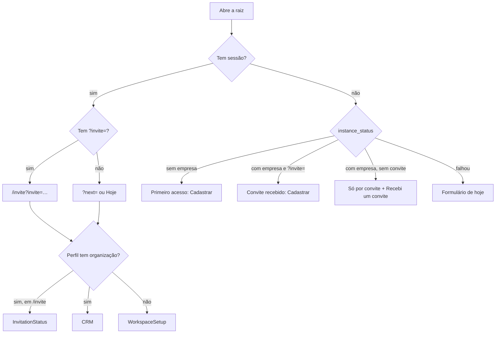

# 1.1 — Empresa única com entrada só por convite

Desenho técnico final do item 1.1 do [roteiro](../ROADMAP-FINALIZACAO.md) (esforço G), feito por `@architect` em 12/10/2026 sobre a branch `chore/f0-base-confiavel`, depois da F0, e implementado no mesmo dia (seção 15). Vale junto com as premissas, a decisão D6 e a "Saída da F1" do roteiro. A implementação é do `@dev`, num único commit do item; o veredito de qualidade é do `@qa`.

Base estudada: as 11 migrações de `supabase/migrations` (a última é `20261011120000_configuration_updated_at.sql`), os testes de `supabase/tests` (inclusive `upgrade/`), `scripts/test-database.mjs` e `scripts/lib/embedded-db.mjs`, as telas [Login.tsx](../../src/pages/Login.tsx), [WorkspaceSetup.tsx](../../src/components/workspace/WorkspaceSetup.tsx), [Team.tsx](../../src/pages/Team.tsx) e [InvitationStatus.tsx](../../src/pages/InvitationStatus.tsx), o `AppLayout`, o `AuthContext`, a fixture do E2E, o gerador dos e-mails do Auth (`scripts/lib/auth-emails.mjs`) e a documentação oficial do Supabase (Auth Hooks, Before User Created Hook, códigos de erro do Auth e erros de gatilho em `auth.users`).

## Resumo das decisões

| # | Decisão | Onde |
| --- | --- | --- |
| A1 | O portão de cadastro é um gatilho `BEFORE INSERT` em `auth.users`, versionado na migração. O hook "Before User Created" foi descartado (seção 8). | `private.enforce_invite_only_signup()` |
| A2 | Com empresa criada, só entra conta nova cujo e-mail tenha convite pendente e válido. Sem empresa, qualquer cadastro passa, porque o primeiro cria a empresa (D6). | `private.signup_allowed(text)` |
| A3 | `create_workspace` exige e-mail confirmado, serializa os pedidos com `pg_advisory_xact_lock` e recusa sempre que já existe uma organização. O provisionamento sai para `private.provision_organization`. | migração do item |
| A4 | Nenhuma restrição física de "uma linha" em `organizations`: a regra fica na RPC, e `authenticated` continua sem `INSERT` na tabela. | seção 8 |
| A5 | `instance_status()` devolve só `has_organization boolean`, para `anon` e `authenticated`, no padrão RPC pública `SECURITY INVOKER` sobre função privada `SECURITY DEFINER`. | seção 4.4 |
| A6 | Convites só nascem pela RPC `create_invitation(p_email, p_role)`: o `INSERT` direto é revogado. Convite de dono existe, mas só um dono o cria; o convite expirado dá lugar ao novo; o válido e o de quem já é da equipe são recusados com mensagem própria. | seção 4.4 |
| A7 | Só donos e administradores leem convites (política de `SELECT`); o convite de dono, só donos leem e revogam (revisão de 12/10/2026). | seção 4.3 |
| A8 | `accept_invitation` aceita convite de dono e passa a dizer por que recusou, numa ordem que não revela o estado do convite a quem usa outro e-mail. | seção 4.4 |
| A9 | Break-glass versionado e testado: `private.restore_owner(p_email, p_org_id)`, executável só pelo dono do banco (editor SQL do painel), com guia distribuível `docs/RECUPERAR-ACESSO-DONO.md`. | seção 4.4 e 11 |
| A10 | A tela de entrada lê `instance_status()` e tem três estados: primeiro acesso, convite recebido e entrada só por convite. "Recebi um convite" fica sempre visível. Os erros do Auth viram pt-BR por código. | seção 5 |
| A11 | O cadastro sem senha ("Link por e-mail") só cria conta com convite ou com a instância vazia (`shouldCreateUser`). | seção 5.1 |
| A12 | A RLS por organização continua igual nas demais tabelas, e os testes entre organizações continuam, com as organizações de teste criadas pelo provisionamento interno. | seção 10.2 |
| A13 | Antes do aceite e da criação da empresa, a conta grava a senha digitada e encerra as outras sessões (revisão de 12/10/2026): o Auth não troca a senha de uma conta não confirmada criada antes por outra pessoa. | seção 5.3 |

## 1. Objetivo

Hoje qualquer pessoa com a URL cria conta e uma empresa nova, e quem chega primeiro vira dono (diagnóstico do roteiro). O item fecha a instância numa empresa só, sem tirar a RLS por organização:

1. enquanto a instância não tem empresa, o primeiro cadastro cria a empresa e fica com o papel de Dono (D6);
2. depois disso, nenhuma empresa nova é criada, e uma conta nova só nasce para um e-mail convidado;
3. o convite funciona de ponta a ponta: link `/?invite=<id>` na raiz, cadastro, confirmação de e-mail e aceite;
4. quem chega sem convite entende o que fazer, em pt-BR, tanto antes quanto depois de entrar;
5. o dono que perdeu o papel recupera o acesso por um procedimento documentado e testado.

## 2. Estado atual

O que o código faz hoje e por que cada ponto muda:

| Ponto | Hoje | Problema |
| --- | --- | --- |
| Criação da empresa | `private.create_workspace` (em [commercial_foundation](../../supabase/migrations/20260906051319_commercial_foundation.sql)) só recusa quem já tem organização | Qualquer conta sem organização cria outra empresa |
| Cadastro | Nenhuma barreira: o Auth cria a conta e `private.handle_new_user` cria o perfil | Qualquer e-mail cria conta |
| Link por e-mail | `signInWithOtp` sem `shouldCreateUser`, que por padrão cria a conta | Segundo caminho de cadastro aberto |
| Criação de convite | `INSERT` direto em `invitations` (GRANT por coluna em [immutable_metadata](../../supabase/migrations/20260906051341_immutable_metadata.sql) e política `tenant_insert` para gestores) | O índice parcial `invitations_pending (org_id, lower(email)) where accepted_at is null` inclui os expirados: um convite vencido bloqueia o novo para o mesmo e-mail |
| Papel do convite | `CHECK (role in ('admin','member','viewer'))` | Não há convite de dono, e a regra "só dono convida dono" não tem onde morar |
| Leitura de convites | `tenant_read` deixa qualquer membro ler e-mails e IDs dos convites pela API | A Equipe só os lê para gestores (item 0.9), mas a RLS não protege |
| Aceite | `private.accept_invitation` (em [workspace_membership_audit](../../supabase/migrations/20260906051334_workspace_membership_audit.sql)) devolve uma mensagem só para não encontrado, usado, expirado e outro e-mail | A pessoa não sabe o que fazer |
| Tela sem organização | `WorkspaceSetup` mostra "Criar espaço de trabalho" a qualquer conta sem organização | É o caminho da segunda empresa |
| Erros do Auth | `authErrorMessage` (em `src/lib/offline.ts`) só traduz a falta de conexão; o resto aparece em inglês | "Invalid login credentials", "Database error saving new user" |
| Testes | `commercial-security.sql` cria as organizações A e B por `create_workspace`, e o `upgrade/` da 0.6 grava uma "Organização Legada" antes das verificações | Com a regra nova, a segunda chamada (e já a primeira, por causa da legada) seria recusada |

## 3. Critérios de aceite

Cada critério aponta a verificação que o comprova (seção 10).

| # | Critério | Verificação |
| --- | --- | --- |
| AC-1 | Numa instância sem organização, o primeiro `create_workspace` de uma conta com e-mail confirmado cria a empresa, o funil "Comercial" com as 4 etapas e as 4 regras da fila, e dá o papel `owner` à conta. | test:db (instância vazia) |
| AC-2 | Com uma organização existente, `create_workspace` é recusado com "Este CRM já tem uma empresa…", inclusive para conta sem organização (segunda empresa). | test:db |
| AC-3 | Dois `create_workspace` simultâneos numa instância vazia criam exatamente uma organização; o segundo espera o primeiro e é recusado. | corrida no runner do test:db |
| AC-4 | Com empresa criada, inserir em `auth.users` um e-mail sem convite pendente e válido é recusado; com convite válido (sem diferenciar maiúsculas nem espaços nas pontas), é aceito e o perfil é criado. Convite expirado ou já usado não abre o cadastro. E-mail nulo é recusado. | test:db |
| AC-5 | Sem empresa, qualquer cadastro é aceito. | test:db (instância vazia) |
| AC-6 | `anon` executa `public.instance_status()` e recebe só `has_organization`; não executa nenhuma outra função de `private` nem RPC de escrita, e continua sem privilégio em tabelas. | test:db |
| AC-7 | `create_invitation`: dono convida dono, administrador, colaborador e somente leitura; administrador convida todos menos dono; colaborador e somente leitura são recusados; e-mail inválido, papel inválido e quem já é da equipe são recusados; convite válido pendente para o mesmo e-mail é recusado; convite expirado é substituído por um novo (ID novo, o antigo deixa de existir); o e-mail é gravado em minúsculas e sem espaços. | test:db, unitário da Equipe, E2E |
| AC-8 | `authenticated` não insere em `invitations` diretamente (nem por coluna). | test:db |
| AC-9 | Só donos e administradores leem convites; colaborador, somente leitura e outra organização leem zero linhas. O convite de dono, só donos leem e revogam: o administrador não o lê nem o revoga, nem numa exclusão em massa. | test:db, E2E |
| AC-10 | `accept_invitation` aceita convite de dono e recusa com mensagens distintas: e-mail não confirmado, conta já em organização, convite não encontrado, outro e-mail, já usado e expirado. | test:db, unitário, E2E |
| AC-11 | `private.restore_owner` devolve o papel de dono a uma conta da empresa, coloca como dona uma conta sem organização e, sem conta, cria um convite de dono; `authenticated`, `anon` e `service_role` não a executam. | test:db |
| AC-12 | Instância existente com uma organização e um dono continua igual depois da migração: mesmo dono, mesmos dados, convites antigos válidos continuam aceitos e os expirados podem ser renovados. | test:db com `upgrade/` |
| AC-13 | Tela de entrada: sem empresa, mostra o primeiro acesso; com empresa e sem convite, a aba "Cadastrar" explica que a entrada é só por convite e não mostra o formulário; com `?invite=`, mostra o aviso do convite e o formulário; "Recebi um convite" aparece em todos os estados. | unitário, E2E desktop e mobile |
| AC-14 | Conta sem organização numa instância com empresa vê "Falta o convite da sua equipe", com o e-mail da conta, "Recebi um convite" e "Sair da conta", e não vê "Criar empresa". | unitário, E2E desktop e mobile |
| AC-15 | Os erros comuns do Auth aparecem em pt-BR (tabela da seção 5.6), inclusive o link expirado que volta na URL. A falha de envio do e-mail, que o Auth hospedado manda com o código da recusa do portão (`unexpected_failure`), mostra a mensagem do envio de e-mail em qualquer tela, e nunca a do convite. | unitário, E2E |
| AC-16 | O e-mail "Invite user" do Auth deixa de citar "Criar espaço de trabalho" e cita "Recebi um convite", conferido contra o componente; `emails:check` passa. | `auth-emails.test.mjs`, `emails:check` |
| AC-17 | O guia `docs/RECUPERAR-ACESSO-DONO.md` existe, não cita o ref do dono e usa só `private.restore_owner`. | `docs:links`, revisão |
| AC-18 | Antes de `accept_invitation` e de `create_workspace`, a conta sem organização grava a senha digitada (`updateUser`) e encerra as outras sessões (`signOut({ scope: 'others' })`); a senha que já era a da conta (`same_password`) é aceita; uma recusa do Auth mostra o motivo em pt-BR e não chama a RPC. | unitário, E2E |

## 4. Modelo de dados e RPCs

### 4.1 Migração

Um arquivo novo, aditivo: `supabase/migrations/20261012100000_single_company_admission.sql`, posterior a `20261011120000_configuration_updated_at.sql`. Nenhuma tabela nova. Ordem do conteúdo, cada bloco com o comentário em português no estilo das migrações da F0:

1. `private.provision_organization` (novo);
2. `private.create_workspace` (substituído; a assinatura e a RPC pública não mudam);
3. `private.instance_status` e `public.instance_status` (novos) e `grant usage on schema private to anon`;
4. `private.signup_allowed`, `private.enforce_invite_only_signup` e o gatilho em `auth.users` (novos);
5. `private.is_owner` (novo, revisão de 12/10/2026) e `invitations`: novo `CHECK` de papel, `revoke insert`, troca das políticas de leitura, de inserção e de exclusão;
6. `private.create_invitation` e `public.create_invitation` (novos);
7. `private.accept_invitation` (substituído);
8. `private.restore_owner` (novo);
9. `revoke`/`grant` de execução de todas as funções novas, no fim, como nas migrações anteriores.

Depois da migração: `npm run gen:types` (entram `instance_status` e `create_invitation` em `Functions`).

### 4.2 Tabelas, constraints e índices

Só `public.invitations` muda:

| Mudança | Antes | Depois | Segura com dados? |
| --- | --- | --- | --- |
| `CHECK` do papel | `invitations_role_check`: `admin`, `member`, `viewer` | `owner`, `admin`, `member`, `viewer` | Sim: amplia o conjunto. O nome é o gerado pelo PostgreSQL para a restrição de coluna; a migração faz `drop constraint invitations_role_check` e o test:db confere a definição nova. |
| Índice `invitations_pending` | `(org_id, lower(email)) where accepted_at is null` | igual | — |

Por que o índice fica igual: um índice parcial não pode usar `now()`, então "pendente e não expirado" não cabe nele. A RPC apaga o pendente expirado do mesmo e-mail antes de inserir o novo (seção 4.4), e o índice continua garantindo no máximo um pendente por e-mail e organização, como barreira final contra corrida.

Sem índice novo para o portão de cadastro: ele procura por e-mail em todas as organizações, mas `invitations` tem dezenas de linhas numa instância de 1 a 50 pessoas; um índice só pesaria nas gravações. Se um dia houver milhares de convites, `create index on public.invitations (lower(email)) where accepted_at is null` resolve sem mudar a função.

Sem *backfill*: os convites antigos podem ter e-mail com maiúsculas ou espaços (a API aceitava), e todas as comparações novas usam `lower(trim(email))`. A RPC grava sempre `lower(trim())`.

### 4.3 RLS e grants

| Objeto | `anon` | `authenticated` | Observação |
| --- | --- | --- | --- |
| `invitations` | nada | `SELECT` só gestores (nova política `invitations_manager_read`: `org_id = current_org() and can_manage()`, e `role <> 'owner' or is_owner()`); `DELETE` só gestores, com a mesma condição (nova política `invitations_manager_delete`); **sem `INSERT`** (`revoke insert`, que também revoga o GRANT por coluna); sem `UPDATE` (como hoje) | As políticas `tenant_read`, `tenant_insert` e `tenant_delete` de `invitations` saem. Continua uma única política permissiva de leitura, como confere `configuration-permissions.sql`. O convite de dono fica fora do alcance do administrador (revisão de 12/10/2026): com o e-mail dele, o administrador poderia criar antes a conta do convidado (seção 5.3). |
| `private.is_owner()` | nada | `EXECUTE` | Novo (revisão de 12/10/2026), no molde de `can_manage`: a conta é dona na organização atual. Usado pelas políticas de convites. |
| schema `private` | `USAGE` (novo) | `USAGE` (como hoje) | Necessário porque `public.instance_status` é `SECURITY INVOKER` e chama `private.instance_status`. O test:db confere que `anon` executa só essa função em `private`. |
| `public.instance_status()` / `private.instance_status()` | `EXECUTE` | `EXECUTE` | `revoke ... from public` antes. |
| `public.create_invitation(text,text)` / `private.create_invitation(text,text)` | nada | `EXECUTE` | |
| `public.create_workspace(text)`, `public.accept_invitation(uuid)` | nada | `EXECUTE` | Sem mudança (o `create or replace` mantém os grants). |
| `private.provision_organization`, `private.signup_allowed`, `private.enforce_invite_only_signup`, `private.restore_owner` | nada | nada | `revoke execute ... from public, anon, authenticated, service_role`. Só o dono das funções (`postgres`) e as funções `SECURITY DEFINER` que ele possui as chamam. |

A RLS das outras 18 tabelas não muda: tudo continua filtrado por `org_id = private.current_org()`. Numa instância de uma empresa isso parece redundante, mas é a defesa em profundidade que o roteiro manda manter (seção "Fora do escopo", "Mantido de propósito"), e protege quem personalizar a base para várias empresas.

### 4.4 Funções e RPCs

Todas com `set search_path = ''` e nomes qualificados, como o restante da base. Mensagens em pt-BR, porque a interface as mostra.

**`private.provision_organization(p_user_id uuid, p_name text) returns uuid`** — `plpgsql`, `SECURITY INVOKER`, sem acesso pela API.
O corpo atual de `create_workspace` depois das guardas: valida o nome (2 a 160 caracteres depois do `trim`, "Use um nome de empresa com 2 a 160 caracteres."), trava o perfil (`for update`; sem perfil, "Perfil não encontrado."), recusa perfil que já tem organização, insere a organização, liga o perfil, cria o papel `owner`, o funil padrão "Comercial" com as quatro etapas e as quatro regras da fila. **Não aplica a regra da empresa única**: é o primitivo de provisionamento. Usado por `create_workspace` e pelos testes (organizações A e B), e reaproveitável pelo seed de demonstração (1.15) e por quem personalizar para várias empresas. Por ser `INVOKER` e revogada de todos os papéis da API, só roda dentro de `create_workspace` (`SECURITY DEFINER`, dono `postgres`) ou pelo dono do banco.

**`private.create_workspace(p_name text) returns uuid`** — substituída; `public.create_workspace` não muda.

```sql
-- Esboço; a implementação final segue o estilo das migrações da F0.
if auth.uid() is null then raise exception 'Entre na sua conta para continuar.'; end if;
select email_confirmed_at into v_confirmed from auth.users where id = auth.uid();
if v_confirmed is null then raise exception 'Confirme seu e-mail antes de criar a empresa.'; end if;
-- Empresa única (D6): o lock vale até o commit e serializa dois primeiros cadastros simultâneos.
perform pg_advisory_xact_lock(hashtextextended('crm.instance.first_company', 0));
perform 1 from public.profiles where id = auth.uid() for update;
if private.current_org() is not null then raise exception 'Sua conta já pertence a uma organização.'; end if;
if exists (select 1 from public.organizations) then
  raise exception 'Este CRM já tem uma empresa. Para entrar, peça um convite a quem administra.';
end if;
return private.provision_organization(auth.uid(), p_name);
```

- O lock é tomado antes de qualquer leitura de regra. Em `READ COMMITTED` (o do PostgREST), o `exists` seguinte roda com um snapshot novo e enxerga a organização que o primeiro pedido acabou de gravar.
- A chave `hashtextextended('crm.instance.first_company', 0)` é fixa e documentada no comentário; outras rotinas que precisem da mesma exclusão usam a mesma chave.
- **Além da especificação:** exigir e-mail confirmado. Evita que um endereço digitado errado (ou de outra pessoa) vire dono. Com a confirmação desligada no Auth, o próprio Supabase preenche `email_confirmed_at` no cadastro, então nada muda para quem a desliga. O aceite de convite já exigia o mesmo.

**`private.is_owner() returns boolean`** — `language sql stable`, `SECURITY DEFINER`, como `can_manage`: `exists` de um papel `owner` da conta na organização atual. Executável por `authenticated` (as políticas rodam com o papel de quem consulta), não por `anon`.

**`private.instance_status()` / `public.instance_status()` `returns table (has_organization boolean)`** — `language sql stable`; a privada é `SECURITY DEFINER` e devolve `exists (select 1 from public.organizations)`; a pública é `SECURITY INVOKER` e devolve `select * from private.instance_status()`. Nada além do booleano: nem nome da empresa, nem contagem de pessoas, nem versão. O tipo gerado fica `{ has_organization: boolean }[]`, lido com `.rpc('instance_status').single()`.

**`private.signup_allowed(p_email text) returns boolean`** — `language sql stable`, `SECURITY INVOKER`, sem acesso pela API.

```sql
select not exists (select 1 from public.organizations)
    or exists (select 1 from public.invitations i
               where lower(trim(i.email)) = lower(trim(p_email))
                 and i.accepted_at is null and i.expires_at > now());
```

E-mail nulo (conta anônima ou por telefone) dá `false` quando há empresa.

**`private.enforce_invite_only_signup() returns trigger`** — `plpgsql`, `SECURITY DEFINER` (o Auth insere como `supabase_auth_admin`, que não lê `public`; o mesmo motivo de `handle_new_user`).

```sql
if not private.signup_allowed(new.email) then
  raise exception 'Cadastro recusado: este CRM aceita novas contas só por convite.'
    using hint = 'Crie o convite em Equipe e peça para a pessoa se cadastrar pelo link do convite.';
end if;
return new;
```

Gatilho: `create trigger enforce_invite_only_signup before insert on auth.users for each row execute function private.enforce_invite_only_signup();`. É `BEFORE`, então a conta nem chega a ser gravada, e `on_auth_user_created` (o `AFTER` que cria o perfil) não roda. O Auth devolve ao cliente HTTP 500 com o código `unexpected_failure` e a mensagem "Database error saving new user" (documentação do Supabase sobre erros de gatilho em `auth.users`); a mensagem e a dica acima aparecem nos logs do Postgres e do Auth, para quem administra. A interface traduz pelo contexto (seção 5.6).

**`private.create_invitation(p_email text, p_role text) returns uuid`** — `plpgsql`, `SECURITY DEFINER`; `public.create_invitation(p_email text, p_role text) returns uuid` é `language sql`, `SECURITY INVOKER`. Sem valor padrão para `p_role`, para o contrato do tipo ficar explícito.

| Passo | Regra | Mensagem |
| --- | --- | --- |
| 1 | Precisa de sessão, organização e papel de gestor (`can_manage`) | "Somente donos e administradores podem convidar pessoas." |
| 2 | Trava a organização (`select … for update`), como `set_member_role`: serializa convites e mudanças de papel | — |
| 3 | Papel em `owner`, `admin`, `member`, `viewer` | "Papel inválido." |
| 4 | `owner` só se quem convida é dono | "Somente um dono pode convidar outro dono." |
| 5 | `lower(trim(p_email))`, até 254 caracteres e no formato `algo@dominio.tld`, sem espaços | "Informe um e-mail válido." |
| 6 | Recusa e-mail de quem já tem papel na organização (comparado com `auth.users.email`, sempre atual) | "Esta pessoa já faz parte da equipe." |
| 7 | Pendente válido do mesmo e-mail na organização (`for update`) | "Já existe um convite válido para este e-mail. Copie o link na lista de convites ou revogue-o antes de criar outro." |
| 8 | Pendente expirado do mesmo e-mail: `delete` (a auditoria registra) | — |
| 9 | `insert` com `org_id`, e-mail normalizado e papel; `invited_by` vem de `protect_record_metadata`; validade padrão de 7 dias | — |
| 10 | `unique_violation` (corrida residual com o índice) vira a mensagem do passo 7 | idem |

O convite expirado é apagado e recriado, e não renovado no lugar: renovar reativaria o link antigo, que pode ter circulado por canais que a empresa não controla.

**`private.accept_invitation(p_invitation_id uuid) returns uuid`** — substituída; a pública não muda. Mesmas travas de hoje, com mensagens separadas e nesta ordem, para que quem usa outra conta só descubra que o convite não é dela:

1. sem sessão: "Entre na sua conta para aceitar.";
2. e-mail não confirmado: "Confirme seu e-mail antes de aceitar o convite.";
3. perfil com organização: "Sua conta já pertence a uma organização." (mantida; a rota `/invite` mostra `InvitationStatus` nesse caso);
4. não encontrado (revogado ou trocado por um novo): "Convite não encontrado. Ele pode ter sido revogado ou trocado por um novo; peça o link atualizado a quem administra.";
5. outro e-mail: "Este convite é para outro e-mail. Entre com a conta do e-mail convidado.";
6. já usado: "Este convite já foi usado.";
7. expirado: "Este convite expirou. Peça um novo a quem administra.";
8. senão, liga o perfil, cria o papel do convite (inclusive `owner`) e marca `accepted_at`.

**Além da especificação:** as mensagens distintas. Não revelam nada a quem não tem o link (um UUID aleatório) e evitam o "convite inválido, expirado ou destinado a outro e-mail" de hoje, que não diz o que fazer.

**`private.restore_owner(p_email text, p_org_id uuid default null) returns text`** — `plpgsql`, `SECURITY INVOKER`, revogada de `public`, `anon`, `authenticated` e `service_role`. Roda no editor SQL do painel, onde o papel é `postgres` (dono das tabelas, sem RLS). Devolve uma frase em pt-BR dizendo o que fez:

| Situação | Ação | Resposta |
| --- | --- | --- |
| Conta existe com e-mail não confirmado (revisão de 12/10/2026) | nada | erro "A conta … ainda não confirmou o e-mail, e o papel de Dono só vai para conta confirmada. Exclua-a em Authentication → Users e rode o comando de novo." |
| Conta existe e pertence a uma organização | `user_roles.role = 'owner'` (insere se faltar) | "A conta … agora tem o papel de Dono." |
| Conta existe sem organização, e a instância tem uma organização (ou `p_org_id` foi informado) | liga o perfil e cria o papel `owner` | "A conta … entrou na empresa com o papel de Dono." |
| Conta existe sem organização, e a instância não tem empresa | nada | erro "Este CRM ainda não tem empresa. Entre com esta conta e use “Criar empresa”." |
| Conta sem organização, várias organizações e sem `p_org_id` | nada | erro "Este CRM tem N organizações. Informe qual em p_org_id." |
| Não há conta com o e-mail | apaga o pendente do mesmo e-mail e cria convite `owner` | "Não há conta com este e-mail. Convite de dono criado: abra <endereço do CRM>/?invite=<id>, cadastre-se com este e-mail e confirme-o." |
| `p_org_id` inexistente, ou conta em outra organização | nada | erro explicando |

A conta não confirmada é recusada pela mesma razão que o aceite e a criação da empresa exigem e-mail confirmado: enquanto a instância não tem empresa, qualquer pessoa cria conta com o e-mail de outra, com uma senha própria, e o Auth não troca essa senha num novo cadastro; promovida, a conta daria o acesso de Dono a essa senha assim que o dono real a confirmasse. Excluída a conta, a função cria o convite de dono, e o cadastro pelo convite exige a confirmação.

A auditoria registra a alteração de `user_roles` ou do convite sem autor (`auth.uid()` é nulo no editor SQL), o que deixa rastro de que veio do painel. A tela Segurança não mostra o autor; o guia traz a consulta de `audit_logs` com `user_id is null`. Ser uma função, e não um bloco SQL colado do guia, faz o procedimento ser testado no test:db e acompanhar o schema: o item 1.2 (desativação) atualiza a função, e o guia continua igual.

### 4.5 O que não muda no banco

`handle_new_user`, `current_org`, `can_write`, `can_manage`, `set_member_role`, as FKs compostas e as políticas das demais tabelas. O `CHECK` de papéis de `user_roles` já aceita `owner`.

## 5. Fluxos de tela

### 5.1 Tela de entrada (`/`)

Um hook novo, `useInstanceStatus()` (`src/hooks/useInstanceStatus.ts`), chama `instance_status` com TanStack Query: chave `['instance-status']`, fora do espaço `['crm', orgId, …]` (não há organização na entrada), `staleTime` de 30 s com `refetchOnWindowFocus: true` (o padrão do app é desligado), uma nova tentativa, desligado sem backend configurado. Devolve `hasOrganization: boolean | null`; `null` quando a leitura falhou ou a função não existe (banco ainda sem a migração). As duas falhas são distintas (revisão de 12/10/2026): `unavailable` é a função ausente (`PGRST202` ou `42883`), e `readFailed` é a leitura que falhou por rede ou erro do servidor, sem nenhum valor lido. Enquanto carrega, o link por e-mail usa `shouldCreateUser = Boolean(invite) || hasOrganization !== true`.

| Estado | Condição | Aba inicial | Conteúdo de "Cadastrar" | `shouldCreateUser` do link por e-mail |
| --- | --- | --- | --- | --- |
| Verificando | consulta em andamento | Entrar | "Verificando este CRM…" (`role="status"`) | — |
| Primeiro acesso | `hasOrganization === false` | Cadastrar | Aviso: "Este CRM ainda não tem empresa. A primeira conta cria a empresa e fica com o papel de Dono. Se não é você quem vai administrar o CRM, não se cadastre: peça um convite." e o formulário | `true` |
| Convite recebido | `?invite=` válido | Cadastrar | Aviso: "Você recebeu um convite. Crie sua conta com o e-mail convidado ou entre, se já tiver conta." e o formulário | `true` |
| Só por convite | `hasOrganization === true` e sem `?invite=` | Entrar | "Este CRM aceita novas contas só por convite. Peça o link a quem administra a equipe." e o bloco "Recebi um convite" aberto; sem formulário | `false` |
| Sem leitura | `hasOrganization === null` | Entrar | o formulário, como hoje (o banco continua barrando) | `true` |

- As abas passam a ser controladas (`value`), para trocar a aba quando o convite chega pela URL.
- **"Recebi um convite"** fica abaixo das abas em todos os estados: um botão com `aria-expanded` que abre um campo "Link do convite" e "Abrir convite". O componente `ReceivedInvite` (`src/components/workspace/ReceivedInvite.tsx`) é o mesmo da tela "Falta o convite". `parseInviteLink` (`src/lib/invite-link.ts`) aceita o link inteiro (qualquer origem, lendo `invite` da consulta) ou só o UUID, ignora espaços e maiúsculas e recusa o resto ("Este link de convite está incompleto. Copie o link inteiro que você recebeu."). Com um ID válido, navega para `authPath('/', { invite, next })`, preservando `?next=`.
- Um `?invite=` com valor que não é UUID mostra o mesmo aviso de link incompleto, em vez de chamar o banco.
- Os erros passam a aparecer dentro do formulário ativo (`role="alert"`, ligado ao botão por `aria-describedby`), e não só em toast, que some em segundos no celular. Os avisos de sucesso ("Link enviado") continuam em toast. **Além da especificação**, pela clareza que a D6 pede.
- Cadastro com sucesso e `data.user.identities` vazio (o Supabase devolve assim quando o e-mail já tem conta confirmada, sem erro): "Este e-mail já tem conta. Entre na aba “Entrar” ou use “Esqueceu a senha?”."
- Link expirado: o Auth volta à raiz com `error_code` e `error_description` no fragmento (fluxo implícito, o padrão do cliente) ou na consulta. A tela lê esses parâmetros ao abrir, mostra a mensagem da seção 5.6 e limpa a URL com `navigate(…, { replace: true })` do React Router, mantendo `invite` e `next`. (Corrigido na implementação: um `history.replaceState` direto deixaria o React Router com a URL antiga, e um erro vindo na consulta continuaria em `useSearchParams`.)
- Na falha `unexpected_failure` do cadastro, a tela relê `instance_status` antes de escolher a mensagem: se a empresa acabou de ser criada por outra pessoa, mostra a de convite.

### 5.2 Decisão de entrada



### 5.3 `WorkspaceSetup` (conta com sessão e sem organização)

| Modo | Condição | Título | Ação principal |
| --- | --- | --- | --- |
| Aceite | `?invite=` | "Entre na sua equipe" | Campo **Senha da conta** e "Aceitar convite da equipe". Antes da RPC, o passo da senha (abaixo). Em falha, mostra a mensagem do Auth ou do banco (seção 4.4) e, para "não encontrado", o link "Continuar sem este convite" (para `/dashboard`). |
| Link incompleto | `?invite=` que não é UUID | "Entre na sua equipe" | O aviso "Este link de convite está incompleto…" ao abrir, sem o botão de aceite, "Recebi um convite" aberto, "Continuar sem este convite" e "Sair da conta", como na tela de entrada (revisão de 12/10/2026). |
| Criar empresa | sem convite e `hasOrganization === false` (ou função ausente, `unavailable`, como hoje) | "Seu negócio, seu CRM" | Campo "Nome da empresa", com a dica "É o nome que a equipe vê no CRM. Você pode mudá-lo depois em Configurações, na aba Organização.", campo **Senha da conta** e botão **"Criar empresa"**, com o passo da senha antes da RPC. Texto: "Você é a primeira pessoa a entrar neste CRM. Crie a empresa para começar: sua conta fica com o papel de Dono, e a equipe entra depois, por convite, em Equipe." Com a função ausente, sem a primeira frase, porque a tela não sabe se a instância está vazia. |
| Falha de leitura | sem convite e `readFailed` | "Não foi possível verificar este CRM" | "Confira a conexão e tente novamente…", **Tentar novamente** (relê a instância), "Recebi um convite" e "Sair da conta"; nunca "Criar empresa" (revisão de 12/10/2026). |
| Falta o convite | sem convite e `hasOrganization === true` | "Falta o convite da sua equipe" | Texto: "Este CRM já tem uma empresa, e a entrada é só por convite. Peça a quem administra o CRM um convite para <e-mail da conta>. Quando receber o link, abra-o neste navegador ou cole-o abaixo." Depois, `ReceivedInvite` e "Sair da conta". |

- O botão "Criar espaço de trabalho" passa a "Criar empresa" e o campo "Nome da organização" a "Nome da empresa", na linguagem da D6 ("o primeiro cadastro cria a empresa"). **Além da especificação**; o e-mail do Auth deixa de citar o botão (seção 5.7).
- Corrida: se `create_workspace` voltar com "Este CRM já tem uma empresa", a tela invalida `['instance-status']` e passa ao modo "Falta o convite", com a frase "Outra pessoa criou a empresa deste CRM agora há pouco." só quando a última leitura mostrava a instância vazia (com a função ausente, sem a frase).
- Depois de criar ou aceitar: `refreshProfile`, invalidação de `['instance-status']` e navegação para `?next=` ou Hoje, como hoje.
- **Passo da senha** (revisão de 12/10/2026). O portão deixa qualquer pessoa criar a conta de um e-mail com convite pendente (e, na instância vazia, de qualquer e-mail), com a senha que quiser. Quando o dono do e-mail se cadastra depois, o Auth só reenvia a confirmação e mantém a senha da primeira conta (`internal/api/signup.go`: "do not update the user because we can't be sure of their claimed identity"). A confirmação prova que quem abriu o link controla o e-mail, mas não que só ele conhece a senha: sem mais nada, quem criou a conta entraria nela com o papel recebido no aceite (para um administrador, o de Dono, num convite de dono) ou na criação da empresa. Por isso, antes de `accept_invitation` e de `create_workspace`, `claimAccountPassword` (`src/lib/account-password.ts`) chama `supabase.auth.updateUser({ password })`, que no Auth também encerra as outras sessões da conta, e `signOut({ scope: 'others' })`. A senha que já era a da conta volta com `same_password` e é aceita: quem a digitou já a conhece. Qualquer outra recusa (senha fraca, sessão encerrada, nova autenticação exigida, rede) aparece em pt-BR no alerta do formulário, e a RPC não é chamada. O campo pede "a senha que você vai usar para entrar: pode ser a mesma do cadastro", e a conta criada pelo painel ("Invite user"), que não tem senha, ganha uma no aceite.

### 5.4 Convite de ponta a ponta

1. Dono ou administrador, em Equipe, cria o convite (`create_invitation`) e copia `<SUA_URL>/?invite=<id>`. O CRM não envia e-mail (o envio é do item 3.2a).
2. A pessoa abre o link: estado "Convite recebido", aba Cadastrar.
3. Cadastro com o e-mail convidado: o gatilho deixa passar; com a confirmação ligada, o Auth envia o e-mail de confirmação, que volta para `/?invite=<id>&next=…` (já é assim desde o 0.9).
4. Com sessão, a entrada leva a `/invite?invite=<id>`; o `AppLayout` mostra `WorkspaceSetup` no modo Aceite.
5. A pessoa informa a senha da conta; "Aceitar convite da equipe" grava a senha, encerra as outras sessões e chama `accept_invitation`, e o CRM abre.

Quem já tem conta (por exemplo, criada pelo painel do Supabase) entra pela aba Entrar no passo 2 e segue do passo 4. O cadastro pelo "Link por e-mail" com convite também funciona (`shouldCreateUser` ligado).

### 5.5 Equipe e `InvitationStatus`

- **Equipe** (`Team.tsx`): criar convite chama `crmDb.rpc('create_invitation', { p_email, p_role })`; a mensagem do banco (código `P0001`) aparece num `role="alert"` logo abaixo do formulário, ligado ao campo e ao botão por `aria-describedby`, e o preenchimento fica (revisão de 12/10/2026: no alerta do topo, ficava fora da tela no celular). As recusas de "Gerar novo link" e "Revogar" aparecem sobre a lista de convites, e a de "Alterar papel", no diálogo. O seletor de papel ganha "Dono" só para donos, com o aviso "Dono tem todos os poderes, inclusive alterar o papel de outros donos. Convide como dono só sócios ou responsáveis pela empresa." A lista mostra "Expirado" e, para gestores, **"Gerar novo link"** no lugar de "Copiar", que chama `create_invitation` com o mesmo e-mail e papel (o administrador não vê a ação num convite de dono). **Além da especificação:** a ação de renovar, que é o uso natural da correção do convite expirado.
- **`InvitationStatus`** (conta com organização abrindo um convite): título "Você já está na equipe" e texto "Este convite não foi usado, porque sua conta já faz parte deste CRM. Se o convite é para outra pessoa, saia e entre com a conta do e-mail convidado." Os botões continuam.

### 5.6 Mensagens do Auth em pt-BR

Novo módulo `src/lib/auth-errors.ts` com `authErrorMessage(error, context)`, que substitui o de `src/lib/offline.ts` (que mantém só as constantes de conexão). Reconhece pelo `code` do `AuthApiError` (supabase-js 2.99) e, sem código, pelo texto em inglês. `context` diz a tela (`login`, `signup`, `magic_link`, `recovery`, `reset_password`, `redirect`) e se a instância é só por convite.

| Código ou texto | Mensagem |
| --- | --- |
| sem conexão (`OfflineRequestError`) | "Sem conexão com a internet. Conecte-se e tente de novo." (como hoje) |
| `invalid_credentials` | "E-mail ou senha incorretos. Confira e tente de novo, ou use “Esqueceu a senha?”." |
| `email_not_confirmed` | "Confirme seu e-mail antes de entrar: abra o link que enviamos. Não recebeu? Peça outro em “Link por e-mail”." |
| `weak_password` (com `reasons`) | `length`: "A senha precisa ter pelo menos N caracteres." (N lido da mensagem do Auth; sem número, "é curta demais"); `characters`: "Use na senha os tipos de caractere exigidos: letras maiúsculas, minúsculas, números e símbolos."; `pwned`: "Esta senha já apareceu em vazamentos conhecidos. Escolha outra." |
| `user_already_exists`, `email_exists` | "Já existe uma conta com este e-mail. Entre com a senha ou use “Esqueceu a senha?”." |
| `over_email_send_rate_limit` | "Muitos e-mails enviados para este endereço. Aguarde alguns minutos antes de pedir outro." |
| `over_request_rate_limit` | "Muitas tentativas seguidas. Aguarde alguns minutos e tente de novo." |
| `otp_expired`, `flow_state_expired`, `flow_state_not_found`, `bad_code_verifier` | "O link expirou ou já foi usado. Peça um novo em “Link por e-mail”." (em recuperação: "Peça um novo em “Esqueceu a senha?”.") |
| `otp_disabled` com `shouldCreateUser: false` | "Não há conta com este e-mail. Se você recebeu um convite, abra o link do convite para criar a conta." |
| `unexpected_failure` com "Database error saving new user" (ou sem texto), ao criar conta (cadastro, ou "Link por e-mail" com `shouldCreateUser`), só por convite | "Este e-mail não tem convite válido neste CRM. Use o e-mail que recebeu o convite ou peça um novo convite a quem administra." |
| o mesmo, instância sem empresa | "Não foi possível criar a conta agora. Tente de novo em instantes; se continuar, avise quem administra o CRM." |
| `email_address_not_authorized`, ou "Error sending … email" com qualquer código, inclusive `unexpected_failure` | "O CRM ainda não consegue enviar e-mails para este endereço. Avise quem administra: falta configurar o envio de e-mails do Supabase." |
| `reauthentication_needed` (troca de senha com "Secure password change" e sessão antiga) | "Por segurança, saia da conta, entre de novo e repita o pedido." |
| `email_address_invalid`, `validation_failed` | "Confira o e-mail informado. Alguns domínios de teste não são aceitos." |
| `signup_disabled`, `email_provider_disabled` | "O cadastro está desligado nas configurações deste CRM. Avise quem administra." |
| `same_password` | "A nova senha precisa ser diferente da atual." |
| `session_not_found`, `session_expired`, `refresh_token_not_found`, `refresh_token_already_used` | "Sua sessão terminou. Entre novamente." |
| `user_banned` | "Este acesso está bloqueado. Fale com quem administra o CRM." |
| `AuthRetryableFetchError` ou falha de rede | "Não foi possível falar com o servidor. Verifique a conexão e tente de novo." |
| qualquer outro | "Não foi possível concluir agora. Tente de novo em instantes." (o texto original vai para o `console.warn`, não para a tela) |

`ResetPassword` passa a usar o mesmo módulo para o erro de `updateUser` (senha fraca, igual à atual, sessão encerrada).

O código `unexpected_failure` sozinho não basta (revisão de 12/10/2026): o Auth hospedado o usa para todo `NewInternalServerError`, inclusive a falha de envio do e-mail (`internal/api/mail.go`: "Error sending confirmation email", "Error sending magic link email"), que aparece com o SMTP próprio mal configurado ou fora do ar. O texto decide: a falha de envio vira a mensagem do envio de e-mail em qualquer tela; só "Database error saving new user" (ou a falha sem texto) ao criar conta é o portão; o "Link por e-mail" com `shouldCreateUser: false` nunca é o portão; outra falha interna vira a mensagem genérica.

### 5.7 E-mail do Auth "Invite user"

O convite pelo painel do Supabase continua existindo, mas, com a empresa criada, o portão só deixa o painel criar a conta de quem já tem convite do CRM (e mostra "Database error saving new user" no painel para os demais). Mudanças em `scripts/lib/auth-emails.mjs`:

- sai `CREATE_WORKSPACE`; entra `RECEIVED_INVITE = 'Recebi um convite'`;
- o aviso antes do botão passa a: "**Importante:** depois de ativar, abra o link de convite do CRM que quem administra enviou: é ele que coloca você na equipe. Se o CRM pedir um convite, use “Recebi um convite” e cole o link.";
- o teste confere o aviso antes do CTA e que `src/components/workspace/ReceivedInvite.tsx` contém `'Recebi um convite'` e é importado por `Login.tsx` e `WorkspaceSetup.tsx`;
- os textos `when` de `confirmation`, `invite` e `magic_link` passam a dizer que, com a empresa criada, conta nova só nasce com convite;
- `npm run emails:build` regrava `supabase/templates/invite.html`; o `supabase/templates/README.md` atualiza a linha do `invite.html` e o parágrafo "Convite pelo painel".

### 5.8 Arquivos do frontend

| Arquivo | Mudança |
| --- | --- |
| `src/pages/Login.tsx` | estados da 5.1, abas controladas, `shouldCreateUser`, erros no formulário, erro do link na URL, `ReceivedInvite` |
| `src/components/workspace/WorkspaceSetup.tsx` | modos da 5.3, com o campo **Senha da conta** no aceite e na criação da empresa |
| `src/components/workspace/ReceivedInvite.tsx` | novo |
| `src/hooks/useInstanceStatus.ts` | novo |
| `src/lib/auth-errors.ts` | novo; `src/lib/offline.ts` perde `authErrorMessage` |
| `src/lib/invite-link.ts` | novo (`parseInviteLink`, `isInvitationId`) |
| `src/lib/account-password.ts` | novo na revisão de 12/10/2026 (`claimAccountPassword`, o passo da senha da 5.3) |
| `src/pages/Team.tsx` | RPC, papel Dono, mensagem do banco, "Gerar novo link" |
| `src/pages/InvitationStatus.tsx` | texto |
| `src/pages/ResetPassword.tsx` | mensagens do Auth |
| `src/components/help/faq-content.ts` | perguntas da seção 11 |
| `src/integrations/supabase/database.types.ts` | `npm run gen:types` |

Componentes do DS já existentes: `Button`, `Input`, `Label`, `Tabs`, a coluna `eia-auth-form` e o `AuthBrandPanel`. Sem dependência nova.

## 6. Casos de borda e corrida

| Caso | Comportamento |
| --- | --- |
| Dois primeiros cadastros ao mesmo tempo | Os dois criam conta (não há empresa). O primeiro `create_workspace` vira dono; o segundo espera o lock, é recusado e vê "Falta o convite". |
| Cadastro sem convite em andamento enquanto o dono cria a empresa | A conta pode ser criada (o portão viu a instância vazia). Fica sem organização, não cria empresa e vê "Falta o convite". Sem dano; quem administra pode apagá-la no painel. Não vale um lock no portão. |
| Estranho cria a empresa antes do dono (risco da D6) | O dono real não consegue se cadastrar. Break-glass: `restore_owner('dono@…')` cria convite de dono; o dono se cadastra pelo link, aceita e, em Equipe, rebaixa o estranho. Cortar também a leitura do estranho depende do 1.2 (seção 13). |
| Convite revogado depois do cadastro e antes do aceite | Aceite recusado ("não encontrado"); a conta fica sem organização até um novo convite. |
| Convite expira entre o cadastro e a confirmação do e-mail | Aceite recusado ("expirou"); o gestor usa "Gerar novo link"; a pessoa entra pela aba Entrar com o link novo e aceita. |
| Cadastro com outro e-mail que não o convidado | Recusado pelo portão (sem convite para esse e-mail), com a mensagem da 5.6. |
| Outra pessoa cria antes a conta do e-mail convidado, com uma senha própria (revisão de 12/10/2026) | O convidado se cadastra, e o Auth só reenvia a confirmação, sem trocar a senha. Ele confirma, e o aceite pede a senha da conta: `updateUser` troca a senha e encerra as outras sessões antes de `accept_invitation`. A senha de quem criou a conta deixa de valer. |
| SMTP próprio mal configurado ou fora do ar | Cadastro e "Link por e-mail" voltam com `unexpected_failure` e "Error sending … email": a tela pede para avisar quem administra (envio de e-mail), e não fala em convite. |
| E-mail convidado em maiúsculas ou com espaço | Aceito no portão e no aceite (`lower(trim())` dos dois lados). |
| Conta já existente sem organização (órfã de antes do 1.1, ou de uma corrida) | Entra, vê "Falta o convite"; com o link, aceita. |
| Conta criada pelo painel ("Invite user") | Só para e-mail com convite pendente no CRM. Ao ativar, cai em "Falta o convite" e usa o link do CRM. |
| Instância antiga com mais de uma organização | A migração passa; nenhuma nova é criada; cada organização continua isolada pela RLS; o portão aceita convites de qualquer uma; `restore_owner` pede `p_org_id` quando precisa. O guia (1.4) deve mandar conferir. |
| Membro abre um convite | `InvitationStatus` ("Você já está na equipe"). |
| Administrador tenta convite de dono pela API | Recusado na RPC; o `INSERT` direto não existe mais. |
| Dois gestores convidam o mesmo e-mail ao mesmo tempo | A trava da organização serializa; o segundo recebe "Já existe um convite válido". |
| Convite de dono criado por um dono que depois foi rebaixado | Continua válido até expirar ou ser revogado. Registrado para o 1.2 decidir (seção 12). |
| Conta anônima (se alguém ligar o login anônimo) | Sem e-mail: recusada pelo portão com empresa; sem e-mail confirmado, não cria empresa. O 1.3 versiona o login anônimo desligado. |
| Frontend novo sobre banco antigo | `instance_status` falha (`PGRST202`): a entrada usa o formulário de hoje; criar convite falha com mensagem; nada quebra de forma silenciosa. |
| Banco novo sobre frontend antigo | A Equipe antiga faz `INSERT` direto e recebe "permissão negada" ("Não foi possível criar o convite"); a tela antiga oferece "Criar espaço de trabalho", que o banco recusa. Por isso a migração e o frontend sobem juntos (seção 7). |
| Página aberta há muito tempo | O status é relido a cada 30 s ao focar e sempre antes de escolher a mensagem de recusa do cadastro. |

## 7. Caminho de atualização para instâncias existentes

1. A migração não reescreve dados: só troca funções, um `CHECK` mais amplo, grants e políticas, e cria um gatilho. Roda em milissegundos numa instância pequena.
2. A instância do dono (1 organização, 1 usuário) continua igual: mesmo dono, mesmos dados; quem não tem convite não cria conta nova; `create_workspace` passa a recusar.
3. Convites antigos: os válidos continuam aceitos (o portão e o aceite comparam `lower(trim())`); os expirados podem ser renovados por "Gerar novo link"; os aceitos não mudam.
4. Ordem de publicação: aplicar a migração e publicar o frontend do mesmo commit em seguida, no mesmo dia. Entre os dois passos, criar convite fica indisponível (seção 6); nenhum dado se perde.
5. Ambiente do dono: a migração entra na lista de não aplicadas de `docs/dono/AMBIENTE.md`. Antes de aplicá-la lá, conferir se as Edge Functions encontradas em 12/10/2026 (Instagram e entrada de leads) criam usuários no Auth: se criarem, o portão as recusa. Conferir também as funções de `private` que vieram com elas: o `USAGE` novo de `anon` em `private` deixaria executável por `anon`, através de uma RPC pública `SECURITY INVOKER` (`public.instagram_service`, `public.intake_service`), qualquer uma que não tenha `revoke ... from public` (acrescentado na implementação; vale para qualquer instância com funções próprias em `private`). Enquanto as duas versões fora do repositório estiverem no histórico remoto, o `db push` continua bloqueado.
6. Volta atrás, se preciso: uma migração nova pode remover o gatilho (`drop trigger enforce_invite_only_signup on auth.users`) e recriar as funções anteriores. Nenhuma mudança deste item é destrutiva.
7. O receptor da Fecha IA (PR #1) passa a precisar de timestamp posterior a `20261012100000` no rebase (registrar em `docs/INTEGRACOES-PENDENTES.md`).

## 8. Alternativas consideradas

| Alternativa | Por que foi descartada |
| --- | --- |
| **Hook "Before User Created"** (função Postgres) | Existe no plano Free e devolve a mensagem própria ao cliente (4xx). Mas é ligado no painel (Authentication → Hooks) ou por `supabase config push` com `[auth.hook.before_user_created]`: um passo manual que o aluno pode esquecer, e que o `db push` não aplica. Sem ele ligado, a instância fica aberta sem nenhum aviso. Ligado com a função ausente ou renomeada, todo cadastro falha. O test:db não consegue exercitar o hook (o bootstrap não tem o Auth), só a função. E o gatilho cobre também as contas criadas pelo painel e pela API de administração. A mensagem clara fica a cargo da interface, que lê `instance_status` e traduz a recusa. Pode voltar como reforço opcional depois do 1.3, se a mensagem genérica do Auth confundir em produção. |
| Hook HTTP numa Edge Function | Exige publicar função e segredo; a instância mínima é só banco e frontend estático. |
| Desligar cadastros no Auth e convidar pelo painel ou pela API de administração | O convite pelo CRM precisaria da chave `service_role` numa Edge Function; o primeiro dono precisaria ser criado no painel. |
| `UNIQUE` sobre constante em `organizations` (ou gatilho que recusa a segunda linha) | Faria a migração falhar em instâncias antigas com várias organizações, impediria as organizações A e B dos testes de RLS entre empresas (a defesa em profundidade que o roteiro manda manter) e seria mais uma trava a remover por quem revender como SaaS (premissa 2). Sem `INSERT` para `authenticated`, a RPC é o único caminho da API. |
| Lock só por `for update` no perfil, sem advisory lock | Trava a linha de cada um, não a instância: dois cadastros diferentes passariam juntos. |
| Renovar o convite expirado no lugar (`expires_at` novo) | Reativaria um link antigo que pode ter circulado. |
| Coluna de situação no convite (revogado, substituído) | Mais estado sem ganho: a auditoria já guarda criação e exclusão. |
| Validar convites por gatilho no `INSERT` direto | Duas portas para a mesma regra; a RPC dá mensagens claras e segue o padrão de `accept_invitation` e `set_member_role`. |
| Esconder colunas do convite por GRANT por coluna, em vez de política | Os demais papéis não precisam de nenhuma linha; a política é mais simples. |
| `public.instance_status` `SECURITY DEFINER` direto em `public` | Quebra o padrão da base e aparece no advisor do Supabase como função privilegiada executável por `anon`. |
| "Meu convite" (`my_invitation()`, achar o convite pelo e-mail da conta, sem o link) | Com a confirmação de e-mail desligada (tentação de quem não configurou SMTP), qualquer um que soubesse um e-mail convidado criaria a conta e entraria na equipe sem o link. O aceite exige o link (UUID aleatório), o e-mail confirmado e, desde a revisão de 12/10/2026, a senha da conta gravada na mesma sessão: o e-mail confirmado sozinho não garante que só o convidado conhece a senha, porque o Auth mantém a de uma conta criada antes por outra pessoa (seção 5.3). |
| Exigir no banco o passo da senha (por exemplo, recusar o aceite com outras sessões em `auth.sessions`) | A troca de senha já apaga as outras sessões no Auth; o que sobra é o token de acesso já emitido, que o PostgREST aceita até expirar, e nenhuma verificação no aceite o alcança. Quem chama o aceite é o próprio convidado, pelo frontend do CRM. |
| Prévia do convite para `anon` (e-mail mascarado, papel, validade) | Expõe dados a quem tiver o link, que pode circular; contraria o "mínimo para `anon`". |
| Fechar a instância antes de publicar (empresa criada por SQL com convite de dono, sem janela da D6) | Elimina o risco da D6, mas muda a decisão do dono e acrescenta um passo. Fica como sugestão para o dono decidir no guia (1.4). |
| Bloco SQL de recuperação colado no guia, em vez de função | Não seria testado e ficaria defasado quando o 1.2 mudar o schema. |
| Pedir que `create_workspace` aceite só o e-mail do primeiro dono pré-cadastrado | Mesmo motivo da linha "fechar a instância antes de publicar". |

## 9. Riscos

| Risco | Efeito | Mitigação |
| --- | --- | --- |
| Formato real do erro do Auth diferente do documentado | A interface mostra a mensagem genérica em vez da de convite | Reconhecer por código e por texto; validar num projeto Supabase real (pendência humana, seção 13). |
| Janela da D6 (estranho cria a empresa) | Perda do papel de dono | Guia manda o primeiro cadastro logo após publicar; `noindex` e `robots.txt` (0.3); break-glass testado. |
| Instância sem SMTP próprio | O e-mail de confirmação só chega aos membros da equipe do projeto Supabase; o convidado não confirma e não aceita | Mensagem da 5.6; o 1.3 e o 1.4 tratam do SMTP. Desligar a confirmação mantém o convite protegido pelo link, mas o guia não deve recomendar. |
| Portão recusa contas de Edge Functions desconhecidas no projeto do dono | Integrações que criam usuários param | Conferir antes de aplicar (seção 7). |
| `anon` com `USAGE` em `private` | Uma função futura em `private` sem `revoke` ficaria executável por `anon` via outra RPC pública `INVOKER` | Teste que lista as funções de `private` executáveis por `anon` (só `instance_status`). |
| Advisor do Supabase acusar `private.instance_status` (`SECURITY DEFINER` executável por `anon`) | Aviso no painel | É fora do schema exposto; se aparecer, o guia explica. |
| Enumeração de contas pela entrada | Dá para descobrir se um e-mail tem conta | O próprio Supabase já revela isso em alguns fluxos; o CRM é de uma empresa, sem cadastro público. Registrado. |
| Portão como oráculo de convites (revisão de 12/10/2026) | Um cadastro recusado volta com HTTP 500 e um aceito com sucesso: dá para descobrir que um e-mail tem convite pendente e, no mesmo pedido, criar a conta dele com uma senha própria | O aceite e a criação da empresa pedem a senha da conta, que troca a senha e encerra as outras sessões antes da RPC (seção 5.3); o convite de dono não aparece para administradores. Resta o token de acesso de uma sessão aberta com a senha antiga entre a confirmação do convidado e o aceite: vale até expirar (1 hora no padrão do Supabase). Registrado. |
| Break-glass com intruso dono | O intruso vê o convite de dono criado por `restore_owner` e pode revogá-lo ou criar antes a conta do e-mail | O guia manda conferir que nenhuma conta apareceu para o e-mail, oferece a conta criada pelo painel (Add user, Auto Confirm) e manda definir senha nova em qualquer caso depois de recuperar. |
| Gatilho em `auth.users` e mudanças futuras do Supabase | Uma restrição nova ao schema `auth` poderia barrar gatilhos | O padrão `on_auth_user_created` é documentado e já usado pela base; o 1.13 (manifesto) passa a listar o gatilho. |

## 10. Plano de testes

### 10.1 Unitários (Vitest)

- `src/lib/auth-errors.test.ts`: cada linha da tabela 5.6, por código e por texto; `weak_password` com cada `reason` e com o número da mensagem; `unexpected_failure` com e sem convite; a falha de envio do e-mail com `unexpected_failure` no cadastro (com e sem convite), no "Link por e-mail" (com e sem criar conta) e na recuperação; o link sem criar conta nunca vira a recusa do portão; falta de conexão; desconhecido sem inglês na tela.
- `src/lib/account-password.test.ts` (revisão): a senha gravada antes de encerrar as outras sessões; `same_password` aceito; senha fraca, falha ao encerrar as sessões e falta de conexão com o motivo em pt-BR.
- `src/lib/invite-link.test.ts`: UUID puro, maiúsculas, espaços, link com outros parâmetros, link de outra origem, `invite` repetido, texto sem UUID, vazio.
- `src/hooks/useInstanceStatus.test.ts`: `true`, `false`, erro e função ausente viram `null`, com `readFailed` e `unavailable` distintos; uma releitura com falha mantém o valor; desligado sem backend.
- `src/pages/Login.test.tsx` (ampliado, com `QueryClientProvider`): os cinco estados da 5.1; aba inicial; formulário escondido no "só por convite"; `shouldCreateUser` por estado; "Recebi um convite" em todos os estados e navegação com `?next=` preservado; `identities` vazio; erro no formulário com `role="alert"`; erro do link expirado lido do fragmento e URL limpa; releitura do status antes da mensagem de recusa.
- `src/components/workspace/WorkspaceSetup.test.tsx` (ampliado): os modos da 5.3, inclusive a falha de leitura e o link incompleto ao abrir; "Criar empresa" só com instância vazia; corrida (recusa leva ao modo "Falta o convite"); mensagens do aceite; e-mail da conta no texto; "Continuar sem este convite"; o passo da senha antes do aceite e da criação da empresa (ordem das chamadas, `same_password`, senha recusada e falha ao encerrar as sessões sem chamar a RPC).
- `src/pages/Team.test.tsx` (novo): dono vê "Dono" no seletor e administrador não; chamada da RPC com e-mail e papel; mensagem do banco no alerta abaixo do formulário, ligada ao botão, preenchimento mantido; recusa de "Gerar novo link" sobre a lista; "Gerar novo link" no expirado; nenhuma chamada de `insert` em `invitations`.
- `src/pages/InvitationStatus.test.tsx`: texto novo.
- `src/integrations/supabase/database-types.test.ts`: `instance_status` (`Returns: { has_organization: boolean }[]`) e `create_invitation` (`Args: { p_email: string; p_role: string }`, `Returns: string`).
- `scripts/lib/auth-emails.test.mjs`: aviso novo antes do CTA, `'Recebi um convite'` em `ReceivedInvite.tsx` importado pelas duas telas, nenhuma menção a "Criar espaço de trabalho".

### 10.2 test:db

Reorganização dos arquivos existentes:

- `commercial-security.sql` ganha `test_support.denied_with(statement, fragment, message)`, que confere também o texto do erro: aqui as recusas têm motivos diferentes e o teste precisa saber qual disparou.
- As contas de teste são criadas com o portão desligado na transação (`alter table auth.users disable trigger enforce_invite_only_signup` e `enable` logo depois; o `rollback` final desfaz tudo). O portão é testado ligado em `instance-admission.sql`, que confere no começo que ele está ligado.
- As organizações A e B nascem por `test_support.provision(user, name)`, que chama `private.provision_organization` como superusuário, com `request.jwt.claim.sub` do dono (para a auditoria). Antes disso, o dono B chama `public.create_workspace`, que tem de ser recusado com "já tem uma empresa": é o teste da segunda empresa.
- O convite `30000000-…-001` passa a ser criado por `public.create_invitation` (ID guardado com `set_config`); a conta `new@example.test` é inserida com o portão ligado (convite válido), e `wrong@example.test` com ele desligado.
- `configuration-permissions.sql` tira `invitations` da matriz de inserção direta (agora revogada) e ganha um bloco próprio de convites.

Arquivo novo `supabase/tests/instance-admission.sql`, incluído por `\ir` por último:

1. schema: gatilho `BEFORE INSERT` habilitado em `auth.users`; funções `SECURITY DEFINER` ou `INVOKER` como na seção 4.4, todas com `search_path=''`; `CHECK` de papel com `owner`; `invitations` com uma única política de leitura e sem `INSERT` para `authenticated` (`has_table_privilege` e `has_any_column_privilege`);
2. `anon`: `select * from public.instance_status()` devolve uma linha com `true` e só a coluna `has_organization` (`pg_get_function_result`); a lista de funções de `private` executáveis por `anon` é exatamente `instance_status`; sem `EXECUTE` em `create_workspace`, `create_invitation` e `accept_invitation`;
3. portão com empresa: e-mail sem convite, com convite expirado, com convite já usado e e-mail nulo recusados; convite válido em maiúsculas e com espaços aceito, com perfil criado;
4. `create_invitation`: matriz de papéis da AC-7 (dono, administrador, colaborador, somente leitura, outra organização); e-mail e papel inválidos; membro existente; pendente válido; expirado substituído (ID antigo some, novo existe, auditoria com `delete`); e-mail gravado normalizado;
5. leitura de convites por papel; revogação por administrador e recusa para colaborador; o convite de dono: o administrador não o lê nem o revoga (nem numa exclusão em massa, sem filtro de coluna, em que só a política de exclusão age; desfeita por `savepoint`), e o dono o lê e o revoga;
6. `accept_invitation`: convite de dono vira `owner`; as seis mensagens da seção 4.4, na ordem;
7. `restore_owner`: `authenticated` sem `EXECUTE`; as linhas da tabela da seção 4.4, inclusive `p_org_id` exigido com várias organizações (o banco de teste tem a legada, A e B), a conta não confirmada recusada (com e sem organização, e na instância vazia) e a auditoria sem autor;
8. dados de atualização (abaixo): o dono legado continua dono e com `can_manage`; o convite legado válido abre o cadastro e é aceito; o expirado é renovado pelo dono legado; a conta órfã não cria empresa;
9. instância vazia, dentro da transação: `truncate auth.users, public.organizations cascade` (desfeito pelo `rollback`); cadastro sem convite aceito; `instance_status` falso; `create_workspace` com e-mail não confirmado recusado; com e-mail confirmado cria empresa, funil, 4 etapas, 4 regras e o papel `owner`; uma segunda conta (criada antes) é recusada com "já tem uma empresa"; um cadastro novo sem convite passa a ser recusado; `instance_status` verdadeiro.

Dados no formato anterior: `supabase/tests/upgrade/20261012100000_single_company_admission.sql`, com `session_replication_role=replica` como os demais, na organização legada da 0.6: um convite pendente válido com e-mail em maiúsculas e espaço (`' Pendente@Example.test'`, vencendo em 3 dias), um expirado (`expirado@example.test`), um aceito e uma conta órfã (`orfa@example.test`, sem organização).

### 10.3 Corrida no runner

Depois do arquivo principal (que termina em `rollback`), `scripts/test-database.mjs` roda uma verificação com duas sessões, contada nas verificações `PASS`:

1. sessão de administração: `truncate auth.users, public.organizations cascade` (gravado de vez: o cluster é descartável e está no fim) e duas contas com e-mail confirmado;
2. sessão A: `begin`, papel `authenticated`, `sub` da conta A, `select public.create_workspace('Empresa A')`, sem `commit`;
3. sessão B, em paralelo: o mesmo com a conta B; o runner confere em `pg_stat_activity` que B espera um lock consultivo (`wait_event_type = 'Lock'`, `wait_event = 'advisory'`);
4. A faz `commit`; B termina com erro contendo "já tem uma empresa"; a sessão de administração confere uma única organização.

Sem o advisory lock, o passo 3 reprova (B não espera) e o passo 4 também (duas organizações). O `embedded-db.mjs` ganha, se preciso, um `openSession()` para duas conexões ao mesmo tempo, já que `withSession` guarda uma só em `state.client`.

### 10.4 E2E (Playwright)

Arquivo novo `tests/browser/entry.spec.ts`. O projeto `mobile-chrome` do `playwright.config.ts` passa a `testMatch: ['smoke.spec.ts', 'entry.spec.ts']`, então todos os cenários rodam em desktop e no Pixel 7.

Fixture (`tests/browser/fixture.ts`):
- opções `instance: { hasOrganization }` (padrão `true`, para não mudar os testes atuais), perfil sem organização e respostas configuráveis para `/auth/v1/signup`, `/auth/v1/otp` e `/auth/v1/token` (status e corpo no formato do Auth, inclusive `unexpected_failure` com "Database error saving new user");
- emulação de `instance_status`, `create_workspace`, `accept_invitation` e `create_invitation` com as mesmas regras do banco (papéis, expirado substituído, válido recusado, mensagens);
- `GET invitations` vazio para colaborador e somente leitura, como a RLS nova.

Cenários:

1. instância vazia: aviso de primeiro acesso, aba Cadastrar, cadastro com sessão, "Criar empresa", Hoje;
2. com empresa e sem convite: aba Cadastrar sem formulário, mensagem de convite; "Recebi um convite" com link incompleto (erro) e com link válido (URL com `?invite=`, aviso e formulário);
3. com convite: cadastro sem sessão ("Confira seu e-mail") e corpo do pedido com o retorno para `/?invite=…`; volta com sessão, aceite, Hoje;
4. cadastro recusado pelo portão: mensagem de convite em pt-BR;
5. erros do Auth: senha errada, e-mail não confirmado, limite de envio e link expirado no fragmento (mensagem e URL limpa);
6. conta sem organização com empresa: "Falta o convite da sua equipe", e-mail da conta, sem "Criar empresa", "Recebi um convite" levando ao aceite;
7. aceite recusado: "expirou" e "outro e-mail";
8. corrida: status vazio e `create_workspace` recusado levam ao modo "Falta o convite";
9. Equipe: dono convida "Dono"; administrador não vê a opção nem os convites de dono; convite válido duplicado mostra a mensagem; "Gerar novo link" num expirado;
10. falha no envio do e-mail de confirmação (`unexpected_failure`, "Error sending confirmation email"): a mensagem do envio de e-mail, sem a do convite; aceite e criação da empresa com a senha da conta (`PUT /auth/v1/user` e `POST /auth/v1/logout?scope=others`);
11. layout das telas de entrada a 320 px e 1440 px, claro e escuro, sem rolagem horizontal (mesma medida do `smoke.spec.ts`).

`routes.spec.ts` ajusta a expectativa do `InvitationStatus` ("Você já está na equipe").

### 10.5 Mutações a conferir

Cada uma deve reprovar algum teste: sem o advisory lock; portão que aceita sem convite; portão que aceita convite expirado; `create_invitation` que deixa administrador convidar dono; convite expirado não substituído; leitura de convites aberta a todos; `INSERT` direto não revogado; `instance_status` devolvendo o nome da empresa; `restore_owner` executável por `authenticated`; `create_workspace` sem a checagem de empresa existente; `shouldCreateUser` sempre ligado; formulário de cadastro visível no "só por convite"; mensagem de recusa sem reler o status; e-mail do Auth ainda citando "Criar espaço de trabalho".

### 10.6 Suíte completa

`format:check`, `docs:links`, `lint:ci` (no máximo 9 avisos), `typecheck`, `npm test`, `test:db`, `gen:types:check`, `emails:check`, `build` e `test:e2e`.

## 11. Documentação a atualizar na implementação

- **Novo** `docs/RECUPERAR-ACESSO-DONO.md` (distribuível, sem ref do dono): quando usar; aviso de segurança (o editor SQL do painel tem acesso total e ignora a RLS; só quem administra o projeto Supabase deve usá-lo; proteja a conta do Supabase com verificação em duas etapas; confira o e-mail antes de rodar, porque um erro de digitação dá o papel de dono a outra pessoa; nunca cole SQL de terceiros); o passo a passo com `select private.restore_owner('dono@empresa.com.br');`; o que cada resposta significa; a consulta de conferência (e-mail e papel de cada membro); o que fazer depois (rebaixar em Equipe quem não deveria ser dono); o limite atual (cortar a leitura de outra conta depende do item 1.2).
- `README.md`: em "Banco independente", a regra da empresa única e o portão; nova seção "Entrada na instância" (primeiro dono, convite de ponta a ponta, "Recebi um convite", mensagens do Auth, onde ficam `useInstanceStatus`, `auth-errors` e `invite-link`) e link para o break-glass.
- `docs/PUBLICACAO-CRM.md`: "Primeiro dono" (fazer o primeiro cadastro logo depois de publicar), manter o cadastro ligado e a confirmação de e-mail ligada no Auth, publicar migração e frontend juntos, e o link para o break-glass.
- `docs/INTEGRACOES-PENDENTES.md`: a última migração da base passa a ser `20261012100000_single_company_admission.sql`.
- `docs/dono/AMBIENTE.md`: a migração do 1.1 na lista de não aplicadas e o cuidado com as Edge Functions desconhecidas (seção 7).
- `supabase/templates/README.md`: linha do `invite.html` e parágrafo "Convite pelo painel".
- Roteiro: item 1.1 com "Feito em" e pendências; notas nos itens 1.2, 1.3, 1.4, 1.13, 1.15 e 2A.2 (seção 12).
- Ajuda (`faq-content.ts`): "Como uma pessoa nova entra na equipe?", "Recebi um convite e o cadastro foi recusado. E agora?" e "Quem administra o CRM perdeu o acesso de dono".

## 12. Impacto em itens futuros

| Item | O que herda deste desenho |
| --- | --- |
| 1.2 Desativar membro | `restore_owner` também reativa; `create_invitation` diz "pessoa desativada; reative em Equipe" em vez de "já faz parte"; decidir se convites pendentes de quem foi desativado (ou rebaixado de dono) caem; cortar o acesso de um intruso (break-glass) passa a ser "Desativar". |
| 1.3 Configuração do Auth | `config.toml` com cadastro ligado (`enable_signup = true`: o portão está no banco), confirmação de e-mail ligada, login anônimo desligado e o retorno à raiz com `?invite=` e `?next=`; limite de e-mails dimensionado para convites. |
| 1.4 Guia e `verify-instance` | Primeiro cadastro logo depois de publicar; decisão do dono sobre "fechar a instância antes de publicar"; `instance-check.sql` confere uma organização, o gatilho habilitado, `instance_status` para `anon` e as funções revogadas; ensaio com "primeiro login do dono" e "convite aceito". |
| 1.6 Marca | A entrada continua sem o nome da empresa vindo do banco (`instance_status` não o expõe); a marca vem das variáveis do 1.6. |
| 1.8 Regras para IA | Invariante: convite só por `create_invitation`; nada de `INSERT` em `organizations` fora de `provision_organization`; `private` sem `EXECUTE` para `anon` além de `instance_status`. |
| 1.13 Manifesto | Listar as funções novas e o gatilho em `auth.users`. |
| 1.15 Seed de demonstração | Criar a empresa por `provision_organization` (com uma conta) ou com um convite de dono, respeitando a trava de instância vazia. |
| 2A.2 Papel `manager` | Acrescentar o papel no `CHECK` de `invitations` e em `create_invitation`; de preferência extrair a regra "quem concede qual papel" para uma função usada também por `set_member_role`. |
| 2A.7 Notificações | "Convite aceito" sai de `accept_invitation`, único ponto de aceite. |
| 3.2a Convite por e-mail | O envio usa o ID devolvido por `create_invitation`; o link continua `/?invite=<id>`. |
| 3.4 Fecha IA | Rebase depois da migração deste item. |

## 13. Fora do escopo e pendências de pessoas

Fora do escopo:
- envio do convite por e-mail pelo CRM (3.2a); o link continua sendo copiado;
- cortar a leitura de uma conta indesejada (1.2);
- configuração do Auth versionada (1.3) e guia de implantação (1.4);
- várias empresas por instância (premissa 2; a RLS por organização continua).

Pendências que dependem de pessoas:
- `@devops` ou o dono: validar num projeto Supabase real (Free) o formato do erro do Auth quando o gatilho recusa (cadastro por senha, por "Link por e-mail" e pelo "Invite user" do painel) e o fluxo completo do convite com confirmação de e-mail, inclusive o aceite com a senha da conta (troca de senha encerrando as outras sessões, `same_password` para a senha igual) e a falha de envio do e-mail. A verificação local é por fixture e pelo test:db;
- dono: aplicar a migração no projeto de desenvolvimento depois de conferir as Edge Functions desconhecidas e de resolver as duas versões fora do repositório (seção 7);
- dono: decidir se o guia oferece "fechar a instância antes de publicar" (seção 8);
- ensaio do guia por pessoa não desenvolvedora (1.4): primeiro login do dono, convite aceito e break-glass.

## 14. Sequência de implementação sugerida

1. Migração, `upgrade/` e test:db (inclusive a reorganização dos arquivos existentes e a corrida no runner); `gen:types`.
2. `auth-errors`, `invite-link`, `useInstanceStatus` e testes unitários.
3. `Login`, `ReceivedInvite`, `WorkspaceSetup`, `InvitationStatus`, `Team`, `ResetPassword` e testes.
4. Gerador dos e-mails, `emails:build` e teste.
5. Fixture e `entry.spec.ts`, desktop e mobile.
6. Documentação da seção 11, mutações da 10.5 e suíte completa, num único commit do item: `feat: empresa única com entrada só por convite [Roteiro 1.1]`.

## 15. Ajustes da implementação (12/10/2026)

Implementado pelo `@dev` no item 1.1 do roteiro, seguindo este desenho. Ajustes e detalhes que o desenho não fixava:

- **Banco.**
  - `create_invitation` não trava o convite pendente com `for update` (passo 7): a trava da organização (passo 2) já serializa convites e mudanças de papel.
  - `restore_owner` também recusa e-mail vazio e mais de uma conta com o mesmo e-mail ("Há N contas com o e-mail …"), e, numa instância sem empresa e sem conta com o e-mail, manda se cadastrar e usar "Criar empresa".
  - No test:db, uma verificação do que uma RPC acabou de gravar vai no comando seguinte: no mesmo comando, o snapshot de quem chama não enxerga a gravação.
  - A corrida usa `openSession` (`scripts/lib/embedded-db.mjs`), e a falha dela sai como "Falha na corrida entre dois primeiros cadastros".
  - Revisão de 12/10/2026: `restore_owner` recusa conta com e-mail não confirmado (seção 4.4), e `supabase/tests/local-bootstrap.sql` simula os privilégios padrão do schema `public` do Supabase hospedado (`alter default privileges ... grant all on tables, functions, sequences to anon, authenticated, service_role`). Sem isso, um `revoke ... from public` sem `anon` passava no test:db, porque o cluster local não dá o `EXECUTE` explícito que o projeto hospedado dá.
- **Frontend.**
  - `useInstanceStatus` não repete a leitura quando a função não existe (`PGRST202` ou `42883`, banco sem a migração); nas demais falhas, tenta uma vez mais. Uma releitura com falha mantém o último valor lido.
  - Os erros do Auth aparecem só dentro do formulário (antes, só em toast); os avisos de sucesso continuam em toast.
  - Com sessão, um `?invite=` que não é UUID segue para `/invite`, onde o aceite mostra o aviso de link incompleto sem chamar o banco (e "Continuar sem este convite").
  - `WorkspaceSetup` mostra "Verificando este CRM…" enquanto lê a instância, para não oferecer "Criar empresa" por um instante numa instância que já tem empresa.
  - Revisão de 12/10/2026: `useInstanceStatus` separa a função ausente (`unavailable`) da falha de leitura (`readFailed`), e `WorkspaceSetup` ganhou os modos "Falha de leitura" e "Link incompleto" (seção 5.3); a frase da corrida só aparece depois de uma leitura que mostrava a instância vazia; os erros da Equipe ficam junto da ação (seção 5.5); a entrada escreve "e-mail" em rótulos e avisos; o campo "Nome da empresa" e a Ajuda ligam a "empresa" da entrada à "organização" de Configurações, que não é um registro de Empresas.
  - Novo `src/lib/rpc-errors.ts` (`rpcRefusalMessage`): mostra a recusa das RPCs (código `P0001`, em pt-BR) e troca as demais falhas por um texto de reserva, sem inglês. Usado pela Equipe e pela conta sem organização.
  - Sem conexão, a redefinição de senha mantém a mensagem de gravação (decisão do 0.9); os demais erros dela passam por `authErrorMessage`.
- **Revisão de 12/10/2026 (segunda rodada).**
  - Falha de envio do e-mail: o Auth hospedado manda `unexpected_failure` também para "Error sending confirmation email" e "Error sending magic link email", e a tela mostrava a recusa do convite. `authErrorMessage` passou a decidir pelo texto (seção 5.6) e ganhou `reauthentication_needed`; `authErrorCode` expõe o código para o passo da senha.
  - Sequestro do convite: outra pessoa podia criar antes a conta do e-mail convidado, com uma senha própria que o Auth mantém, e entrar nela depois do aceite; com o convite de dono, um administrador viraria dono. O aceite e a criação da empresa ganharam o passo da senha (seção 5.3, `src/lib/account-password.ts`), e o convite de dono passou a ser lido e revogado só por donos (`private.is_owner()`, `invitations_manager_read` e `invitations_manager_delete`, no lugar de `tenant_delete`). O guia de recuperação ganhou "Depois do convite de dono" e manda definir senha nova em qualquer caso; `PUBLICACAO-CRM.md` deixou de dizer que a confirmação do e-mail basta, e o passo 2 do aceite diz como chegar a cada mensagem da entrada só por convite.
  - O e-mail "Invite user" diz que o aceite pede a senha da conta, com a qual a pessoa entra nas próximas vezes.
- **Testes.** As mutações da seção 10.5 foram conferidas e todas reprovam algum teste; também "Criar empresa" com a instância já com empresa, administrador vendo a opção Dono, link de convite cortado aceito e erro desconhecido do Auth mostrado em inglês. Na segunda rodada: política de leitura sem o filtro do convite de dono, política de exclusão sem ele (só reprovada pela exclusão em massa), aceite e criação da empresa sem o passo da senha e `unexpected_failure` decidido só pelo código. Resultado no roteiro, item 1.1.
