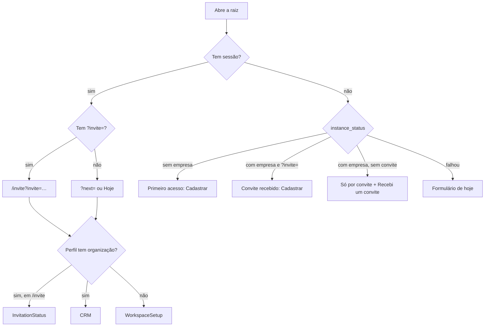
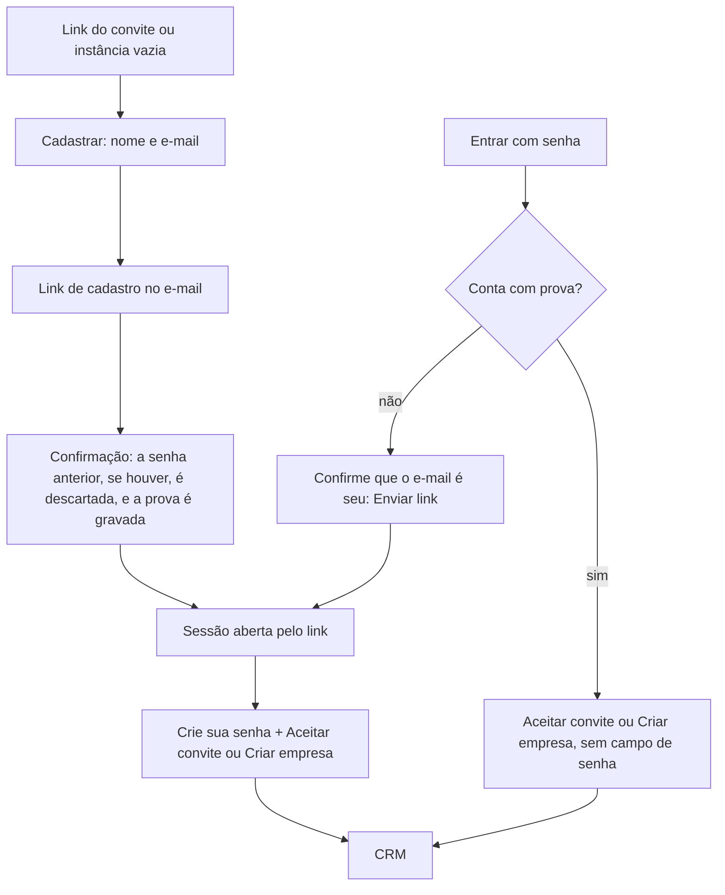

# 1.1 — Empresa única com entrada só por convite

Desenho técnico final do item 1.1 do [roteiro](../ROADMAP-FINALIZACAO.md) (esforço G), feito por `@architect` em 12/10/2026 sobre a branch `chore/f0-base-confiavel`, depois da F0, e implementado no mesmo dia (seção 15). O reforço de 12/10/2026 (seção 16) troca o passo da senha, que agia só na tela, por regras no banco: a senha anterior à confirmação do e-mail é descartada, e a conta só ganha papel com a prova do e-mail. Vale junto com as premissas, a decisão D6 e a "Saída da F1" do roteiro. A implementação é do `@dev`, num único commit do item; o veredito de qualidade é do `@qa`.

Base estudada: as 11 migrações de `supabase/migrations` (a última é `20261011120000_configuration_updated_at.sql`), os testes de `supabase/tests` (inclusive `upgrade/`), `scripts/test-database.mjs` e `scripts/lib/embedded-db.mjs`, as telas [Login.tsx](../../src/pages/Login.tsx), [WorkspaceSetup.tsx](../../src/components/workspace/WorkspaceSetup.tsx), [Team.tsx](../../src/pages/Team.tsx) e [InvitationStatus.tsx](../../src/pages/InvitationStatus.tsx), o `AppLayout`, o `AuthContext`, a fixture do E2E, o gerador dos e-mails do Auth (`scripts/lib/auth-emails.mjs`) e a documentação oficial do Supabase (Auth Hooks, Before User Created Hook, códigos de erro do Auth e erros de gatilho em `auth.users`).

## Resumo das decisões

| # | Decisão | Onde |
| --- | --- | --- |
| A1 | O portão de cadastro é um gatilho `BEFORE INSERT` em `auth.users`, versionado na migração. O hook "Before User Created" foi descartado (seção 8). | `private.enforce_invite_only_signup()` |
| A2 | Com empresa criada, só entra conta nova cujo e-mail tenha convite pendente e válido. Sem empresa, qualquer cadastro passa, porque o primeiro cria a empresa (D6). | `private.signup_allowed(text)` |
| A3 | `create_workspace` exige e-mail confirmado, serializa os pedidos com `pg_advisory_xact_lock` e recusa sempre que já existe uma organização. O provisionamento sai para `private.provision_organization`. | migração do item |
| A4 | Nenhuma restrição física de "uma linha" em `organizations`: a regra fica na RPC, e `authenticated` continua sem `INSERT` na tabela. | seção 8 |
| A5 | `instance_status()` devolve só `has_organization boolean`, para `anon` e `authenticated`, no padrão RPC pública `SECURITY INVOKER` sobre função privada `SECURITY DEFINER`. | seção 4.4 |
| A6 | Convites só nascem pela RPC `create_invitation(p_email, p_role)`: o `INSERT` direto é revogado. Convite de dono existe, mas só um dono o cria; o convite expirado dá lugar ao novo; o válido e o de quem já é da equipe são recusados com mensagem própria. | seção 4.4 |
| A7 | Só donos e administradores leem convites (política de `SELECT`); o convite de dono, só donos leem e revogam (revisão de 12/10/2026). | seção 4.3 |
| A8 | `accept_invitation` aceita convite de dono e passa a dizer por que recusou, numa ordem que não revela o estado do convite a quem usa outro e-mail. | seção 4.4 |
| A9 | Break-glass versionado e testado: `private.restore_owner(p_email, p_org_id)`, executável só pelo dono do banco (editor SQL do painel), com guia distribuível `docs/RECUPERAR-ACESSO-DONO.md`. | seção 4.4 e 11 |
| A10 | A tela de entrada lê `instance_status()` e tem três estados: primeiro acesso, convite recebido e entrada só por convite. "Recebi um convite" fica sempre visível. Os erros do Auth viram pt-BR por código. | seção 5 |
| A11 | O cadastro sem senha ("Link por e-mail") só cria conta com convite ou com a instância vazia (`shouldCreateUser`). | seção 5.1 |
| A12 | A RLS por organização continua igual nas demais tabelas, e os testes entre organizações continuam, com as organizações de teste criadas pelo provisionamento interno. | seção 10.2 |
| A13 | Substituída pelo reforço (A14 a A16). Na revisão de 12/10/2026, a conta gravava a senha digitada e encerrava as outras sessões antes do aceite e da criação da empresa; o passo só agia na tela, não alcançava o aceite pela API e deixava o token do intruso valendo até 1 hora. | seção 16.1 |
| A14 | A senha não sobrevive à confirmação do e-mail: a senha anterior é descartada, e a prova é registrada com o e-mail só quando a sessão aberta pelo link nasce na transação da confirmação (revisão, rodada 2); a confirmação na mesma transação da criação (painel com Auto Confirm, confirmação desligada) não descarta nem prova. Vale também na instância vazia. | seção 16.3, R1 e R2 |
| A15 | `accept_invitation` e `create_workspace` exigem, por último, a prova do e-mail atual da conta ou uma sessão aberta por link enviado ao e-mail (`amr`). | seção 16.3, R3 |
| A16 | Conta nova nasce pelo link: "Cadastrar" pede nome e e-mail e envia o link; **Crie sua senha** aparece só na sessão aberta por link; a conta sem prova numa sessão por senha pede o link de acesso. O oráculo do portão fica, como risco registrado. | seção 16.3, R4 a R6 |
| A17 | Conta sem organização não troca de e-mail (revisão, rodada 1), e a confirmação de e-mail do Auth nunca é desligada: desligada, o cadastro entrega a quem pedir a sessão de qualquer conta não confirmada (revisão, rodada 2). | seção 16.3, R10 e R11 |

## 1. Objetivo

Hoje qualquer pessoa com a URL cria conta e uma empresa nova, e quem chega primeiro vira dono (diagnóstico do roteiro). O item fecha a instância numa empresa só, sem tirar a RLS por organização:

1. enquanto a instância não tem empresa, o primeiro cadastro cria a empresa e fica com o papel de Dono (D6);
2. depois disso, nenhuma empresa nova é criada, e uma conta nova só nasce para um e-mail convidado;
3. o convite funciona de ponta a ponta: link `/?invite=<id>` na raiz, cadastro, confirmação de e-mail e aceite;
4. quem chega sem convite entende o que fazer, em pt-BR, tanto antes quanto depois de entrar;
5. o dono que perdeu o papel recupera o acesso por um procedimento documentado e testado.

## 2. Estado atual

O que o código faz hoje e por que cada ponto muda:

| Ponto | Hoje | Problema |
| --- | --- | --- |
| Criação da empresa | `private.create_workspace` (em [commercial_foundation](../../supabase/migrations/20260906051319_commercial_foundation.sql)) só recusa quem já tem organização | Qualquer conta sem organização cria outra empresa |
| Cadastro | Nenhuma barreira: o Auth cria a conta e `private.handle_new_user` cria o perfil | Qualquer e-mail cria conta |
| Link por e-mail | `signInWithOtp` sem `shouldCreateUser`, que por padrão cria a conta | Segundo caminho de cadastro aberto |
| Criação de convite | `INSERT` direto em `invitations` (GRANT por coluna em [immutable_metadata](../../supabase/migrations/20260906051341_immutable_metadata.sql) e política `tenant_insert` para gestores) | O índice parcial `invitations_pending (org_id, lower(email)) where accepted_at is null` inclui os expirados: um convite vencido bloqueia o novo para o mesmo e-mail |
| Papel do convite | `CHECK (role in ('admin','member','viewer'))` | Não há convite de dono, e a regra "só dono convida dono" não tem onde morar |
| Leitura de convites | `tenant_read` deixa qualquer membro ler e-mails e IDs dos convites pela API | A Equipe só os lê para gestores (item 0.9), mas a RLS não protege |
| Aceite | `private.accept_invitation` (em [workspace_membership_audit](../../supabase/migrations/20260906051334_workspace_membership_audit.sql)) devolve uma mensagem só para não encontrado, usado, expirado e outro e-mail | A pessoa não sabe o que fazer |
| Tela sem organização | `WorkspaceSetup` mostra "Criar espaço de trabalho" a qualquer conta sem organização | É o caminho da segunda empresa |
| Erros do Auth | `authErrorMessage` (em `src/lib/offline.ts`) só traduz a falta de conexão; o resto aparece em inglês | "Invalid login credentials", "Database error saving new user" |
| Testes | `commercial-security.sql` cria as organizações A e B por `create_workspace`, e o `upgrade/` da 0.6 grava uma "Organização Legada" antes das verificações | Com a regra nova, a segunda chamada (e já a primeira, por causa da legada) seria recusada |

## 3. Critérios de aceite

Cada critério aponta a verificação que o comprova (seção 10).

| # | Critério | Verificação |
| --- | --- | --- |
| AC-1 | Numa instância sem organização, o primeiro `create_workspace` de uma conta com e-mail confirmado cria a empresa, o funil "Comercial" com as 4 etapas e as 4 regras da fila, e dá o papel `owner` à conta. | test:db (instância vazia) |
| AC-2 | Com uma organização existente, `create_workspace` é recusado com "Este CRM já tem uma empresa…", inclusive para conta sem organização (segunda empresa). | test:db |
| AC-3 | Dois `create_workspace` simultâneos numa instância vazia criam exatamente uma organização; o segundo espera o primeiro e é recusado. | corrida no runner do test:db |
| AC-4 | Com empresa criada, inserir em `auth.users` um e-mail sem convite pendente e válido é recusado; com convite válido (sem diferenciar maiúsculas nem espaços nas pontas), é aceito e o perfil é criado. Convite expirado ou já usado não abre o cadastro. E-mail nulo é recusado. | test:db |
| AC-5 | Sem empresa, qualquer cadastro é aceito. | test:db (instância vazia) |
| AC-6 | `anon` executa `public.instance_status()` e recebe só `has_organization`; não executa nenhuma outra função de `private` nem RPC de escrita, e continua sem privilégio em tabelas. | test:db |
| AC-7 | `create_invitation`: dono convida dono, administrador, colaborador e somente leitura; administrador convida todos menos dono; colaborador e somente leitura são recusados; e-mail inválido, papel inválido e quem já é da equipe são recusados; convite válido pendente para o mesmo e-mail é recusado; convite expirado é substituído por um novo (ID novo, o antigo deixa de existir); o e-mail é gravado em minúsculas e sem espaços. | test:db, unitário da Equipe, E2E |
| AC-8 | `authenticated` não insere em `invitations` diretamente (nem por coluna). | test:db |
| AC-9 | Só donos e administradores leem convites; colaborador, somente leitura e outra organização leem zero linhas. O convite de dono, só donos leem e revogam: o administrador não o lê nem o revoga, nem numa exclusão em massa. | test:db, E2E |
| AC-10 | `accept_invitation` aceita convite de dono e recusa com mensagens distintas: e-mail não confirmado, conta já em organização, convite não encontrado, outro e-mail, já usado e expirado. | test:db, unitário, E2E |
| AC-11 | `private.restore_owner` devolve o papel de dono a uma conta da empresa, coloca como dona uma conta sem organização e, sem conta, cria um convite de dono; `authenticated`, `anon` e `service_role` não a executam. | test:db |
| AC-12 | Instância existente com uma organização e um dono continua igual depois da migração: mesmo dono, mesmos dados, convites antigos válidos continuam aceitos e os expirados podem ser renovados. | test:db com `upgrade/` |
| AC-13 | Tela de entrada: sem empresa, mostra o primeiro acesso; com empresa e sem convite, a aba "Cadastrar" explica que a entrada é só por convite e não mostra o formulário; com `?invite=`, mostra o aviso do convite e o formulário; "Recebi um convite" aparece em todos os estados. | unitário, E2E desktop e mobile |
| AC-14 | Conta sem organização numa instância com empresa vê "Falta o convite da sua equipe", com o e-mail da conta, "Recebi um convite" e "Sair da conta", e não vê "Criar empresa". | unitário, E2E desktop e mobile |
| AC-15 | Os erros comuns do Auth aparecem em pt-BR (tabela da seção 5.6), inclusive o link expirado que volta na URL. A falha de envio do e-mail, que o Auth hospedado manda com o código da recusa do portão (`unexpected_failure`), mostra a mensagem do envio de e-mail em qualquer tela, e nunca a do convite. | unitário, E2E |
| AC-16 | O e-mail "Invite user" do Auth deixa de citar "Criar espaço de trabalho" e cita "Recebi um convite", conferido contra o componente; `emails:check` passa. | `auth-emails.test.mjs`, `emails:check` |
| AC-17 | O guia `docs/RECUPERAR-ACESSO-DONO.md` existe, não cita o ref do dono e usa só `private.restore_owner`. | `docs:links`, revisão |
| AC-18 | Substituído pelo reforço: AC-R1 a AC-R17 (seção 16.4). A gravação da senha antes da RPC continua, só na sessão aberta por link (AC-R9). | seção 16.4 |

## 4. Modelo de dados e RPCs

### 4.1 Migração

Um arquivo novo, aditivo: `supabase/migrations/20261012100000_single_company_admission.sql`, posterior a `20261011120000_configuration_updated_at.sql`. Nenhuma tabela nova. Ordem do conteúdo, cada bloco com o comentário em português no estilo das migrações da F0:

1. `private.provision_organization` (novo);
2. `private.create_workspace` (substituído; a assinatura e a RPC pública não mudam);
3. `private.instance_status` e `public.instance_status` (novos) e `grant usage on schema private to anon`;
4. `private.signup_allowed`, `private.enforce_invite_only_signup` e o gatilho em `auth.users` (novos);
5. `private.is_owner` (novo, revisão de 12/10/2026) e `invitations`: novo `CHECK` de papel, `revoke insert`, troca das políticas de leitura, de inserção e de exclusão;
6. `private.create_invitation` e `public.create_invitation` (novos);
7. `private.accept_invitation` (substituído);
8. `private.restore_owner` (novo);
9. `revoke`/`grant` de execução de todas as funções novas, no fim, como nas migrações anteriores.

Depois da migração: `npm run gen:types` (entram `instance_status` e `create_invitation` em `Functions`).

### 4.2 Tabelas, constraints e índices

Só `public.invitations` muda:

| Mudança | Antes | Depois | Segura com dados? |
| --- | --- | --- | --- |
| `CHECK` do papel | `invitations_role_check`: `admin`, `member`, `viewer` | `owner`, `admin`, `member`, `viewer` | Sim: amplia o conjunto. O nome é o gerado pelo PostgreSQL para a restrição de coluna; a migração faz `drop constraint invitations_role_check` e o test:db confere a definição nova. |
| Índice `invitations_pending` | `(org_id, lower(email)) where accepted_at is null` | igual | — |

Por que o índice fica igual: um índice parcial não pode usar `now()`, então "pendente e não expirado" não cabe nele. A RPC apaga o pendente expirado do mesmo e-mail antes de inserir o novo (seção 4.4), e o índice continua garantindo no máximo um pendente por e-mail e organização, como barreira final contra corrida.

Sem índice novo para o portão de cadastro: ele procura por e-mail em todas as organizações, mas `invitations` tem dezenas de linhas numa instância de 1 a 50 pessoas; um índice só pesaria nas gravações. Se um dia houver milhares de convites, `create index on public.invitations (lower(email)) where accepted_at is null` resolve sem mudar a função.

Sem *backfill*: os convites antigos podem ter e-mail com maiúsculas ou espaços (a API aceitava), e todas as comparações novas usam `lower(trim(email))`. A RPC grava sempre `lower(trim())`.

### 4.3 RLS e grants

| Objeto | `anon` | `authenticated` | Observação |
| --- | --- | --- | --- |
| `invitations` | nada | `SELECT` só gestores (nova política `invitations_manager_read`: `org_id = current_org() and can_manage()`, e `role <> 'owner' or is_owner()`); `DELETE` só gestores, com a mesma condição (nova política `invitations_manager_delete`); **sem `INSERT`** (`revoke insert`, que também revoga o GRANT por coluna); sem `UPDATE` (como hoje) | As políticas `tenant_read`, `tenant_insert` e `tenant_delete` de `invitations` saem. Continua uma única política permissiva de leitura, como confere `configuration-permissions.sql`. O convite de dono fica fora do alcance do administrador (revisão de 12/10/2026): com o e-mail dele, o administrador poderia criar antes a conta do convidado (seção 5.3). |
| `private.is_owner()` | nada | `EXECUTE` | Novo (revisão de 12/10/2026), no molde de `can_manage`: a conta é dona na organização atual. Usado pelas políticas de convites. |
| schema `private` | `USAGE` (novo) | `USAGE` (como hoje) | Necessário porque `public.instance_status` é `SECURITY INVOKER` e chama `private.instance_status`. O test:db confere que `anon` executa só essa função em `private`. |
| `public.instance_status()` / `private.instance_status()` | `EXECUTE` | `EXECUTE` | `revoke ... from public` antes. |
| `public.create_invitation(text,text)` / `private.create_invitation(text,text)` | nada | `EXECUTE` | |
| `public.create_workspace(text)`, `public.accept_invitation(uuid)` | nada | `EXECUTE` | Sem mudança (o `create or replace` mantém os grants). |
| `private.provision_organization`, `private.signup_allowed`, `private.enforce_invite_only_signup`, `private.restore_owner` | nada | nada | `revoke execute ... from public, anon, authenticated, service_role`. Só o dono das funções (`postgres`) e as funções `SECURITY DEFINER` que ele possui as chamam. |

A RLS das outras 18 tabelas não muda: tudo continua filtrado por `org_id = private.current_org()`. Numa instância de uma empresa isso parece redundante, mas é a defesa em profundidade que o roteiro manda manter (seção "Fora do escopo", "Mantido de propósito"), e protege quem personalizar a base para várias empresas.

### 4.4 Funções e RPCs

Todas com `set search_path = ''` e nomes qualificados, como o restante da base. Mensagens em pt-BR, porque a interface as mostra.

**`private.provision_organization(p_user_id uuid, p_name text) returns uuid`** — `plpgsql`, `SECURITY INVOKER`, sem acesso pela API.
O corpo atual de `create_workspace` depois das guardas: valida o nome (2 a 160 caracteres depois do `trim`, "Use um nome de empresa com 2 a 160 caracteres."), trava o perfil (`for update`; sem perfil, "Perfil não encontrado."), recusa perfil que já tem organização, insere a organização, liga o perfil, cria o papel `owner`, o funil padrão "Comercial" com as quatro etapas e as quatro regras da fila. **Não aplica a regra da empresa única**: é o primitivo de provisionamento. Usado por `create_workspace` e pelos testes (organizações A e B), e reaproveitável pelo seed de demonstração (1.15) e por quem personalizar para várias empresas. Por ser `INVOKER` e revogada de todos os papéis da API, só roda dentro de `create_workspace` (`SECURITY DEFINER`, dono `postgres`) ou pelo dono do banco.

**`private.create_workspace(p_name text) returns uuid`** — substituída; `public.create_workspace` não muda.

```sql
-- Esboço; a implementação final segue o estilo das migrações da F0.
if auth.uid() is null then raise exception 'Entre na sua conta para continuar.'; end if;
select email_confirmed_at into v_confirmed from auth.users where id = auth.uid();
if v_confirmed is null then raise exception 'Confirme seu e-mail antes de criar a empresa.'; end if;
-- Empresa única (D6): o lock vale até o commit e serializa dois primeiros cadastros simultâneos.
perform pg_advisory_xact_lock(hashtextextended('crm.instance.first_company', 0));
perform 1 from public.profiles where id = auth.uid() for update;
if private.current_org() is not null then raise exception 'Sua conta já pertence a uma organização.'; end if;
if exists (select 1 from public.organizations) then
  raise exception 'Este CRM já tem uma empresa. Para entrar, peça um convite a quem administra.';
end if;
return private.provision_organization(auth.uid(), p_name);
```

- O lock é tomado antes de qualquer leitura de regra. Em `READ COMMITTED` (o do PostgREST), o `exists` seguinte roda com um snapshot novo e enxerga a organização que o primeiro pedido acabou de gravar.
- A chave `hashtextextended('crm.instance.first_company', 0)` é fixa e documentada no comentário; outras rotinas que precisem da mesma exclusão usam a mesma chave.
- **Além da especificação:** exigir e-mail confirmado. Evita que um endereço digitado errado (ou de outra pessoa) vire dono. Com a confirmação desligada no Auth, o próprio Supabase preenche `email_confirmed_at` no cadastro, então nada muda para quem a desliga. O aceite de convite já exigia o mesmo.

**`private.is_owner() returns boolean`** — `language sql stable`, `SECURITY DEFINER`, como `can_manage`: `exists` de um papel `owner` da conta na organização atual. Executável por `authenticated` (as políticas rodam com o papel de quem consulta), não por `anon`.

**`private.instance_status()` / `public.instance_status()` `returns table (has_organization boolean)`** — `language sql stable`; a privada é `SECURITY DEFINER` e devolve `exists (select 1 from public.organizations)`; a pública é `SECURITY INVOKER` e devolve `select * from private.instance_status()`. Nada além do booleano: nem nome da empresa, nem contagem de pessoas, nem versão. O tipo gerado fica `{ has_organization: boolean }[]`, lido com `.rpc('instance_status').single()`.

**`private.signup_allowed(p_email text) returns boolean`** — `language sql stable`, `SECURITY INVOKER`, sem acesso pela API.

```sql
select not exists (select 1 from public.organizations)
    or exists (select 1 from public.invitations i
               where lower(trim(i.email)) = lower(trim(p_email))
                 and i.accepted_at is null and i.expires_at > now());
```

E-mail nulo (conta anônima ou por telefone) dá `false` quando há empresa.

**`private.enforce_invite_only_signup() returns trigger`** — `plpgsql`, `SECURITY DEFINER` (o Auth insere como `supabase_auth_admin`, que não lê `public`; o mesmo motivo de `handle_new_user`).

```sql
if not private.signup_allowed(new.email) then
  raise exception 'Cadastro recusado: este CRM aceita novas contas só por convite.'
    using hint = 'Crie o convite em Equipe e peça para a pessoa se cadastrar pelo link do convite.';
end if;
return new;
```

Gatilho: `create trigger enforce_invite_only_signup before insert on auth.users for each row execute function private.enforce_invite_only_signup();`. É `BEFORE`, então a conta nem chega a ser gravada, e `on_auth_user_created` (o `AFTER` que cria o perfil) não roda. O Auth devolve ao cliente HTTP 500 com o código `unexpected_failure` e a mensagem "Database error saving new user" (documentação do Supabase sobre erros de gatilho em `auth.users`); a mensagem e a dica acima aparecem nos logs do Postgres e do Auth, para quem administra. A interface traduz pelo contexto (seção 5.6).

**`private.create_invitation(p_email text, p_role text) returns uuid`** — `plpgsql`, `SECURITY DEFINER`; `public.create_invitation(p_email text, p_role text) returns uuid` é `language sql`, `SECURITY INVOKER`. Sem valor padrão para `p_role`, para o contrato do tipo ficar explícito.

| Passo | Regra | Mensagem |
| --- | --- | --- |
| 1 | Precisa de sessão, organização e papel de gestor (`can_manage`) | "Somente donos e administradores podem convidar pessoas." |
| 2 | Trava a organização (`select … for update`), como `set_member_role`: serializa convites e mudanças de papel | — |
| 3 | Papel em `owner`, `admin`, `member`, `viewer` | "Papel inválido." |
| 4 | `owner` só se quem convida é dono | "Somente um dono pode convidar outro dono." |
| 5 | `lower(trim(p_email))`, até 254 caracteres e no formato `algo@dominio.tld`, sem espaços | "Informe um e-mail válido." |
| 6 | Recusa e-mail de quem já tem papel na organização (comparado com `auth.users.email`, sempre atual) | "Esta pessoa já faz parte da equipe." |
| 7 | Pendente válido do mesmo e-mail na organização (`for update`) | "Já existe um convite válido para este e-mail. Copie o link na lista de convites ou revogue-o antes de criar outro." |
| 8 | Pendente expirado do mesmo e-mail: `delete` (a auditoria registra) | — |
| 9 | `insert` com `org_id`, e-mail normalizado e papel; `invited_by` vem de `protect_record_metadata`; validade padrão de 7 dias | — |
| 10 | `unique_violation` (corrida residual com o índice) vira a mensagem do passo 7 | idem |

O convite expirado é apagado e recriado, e não renovado no lugar: renovar reativaria o link antigo, que pode ter circulado por canais que a empresa não controla.

**`private.accept_invitation(p_invitation_id uuid) returns uuid`** — substituída; a pública não muda. Mesmas travas de hoje, com mensagens separadas e nesta ordem, para que quem usa outra conta só descubra que o convite não é dela:

1. sem sessão: "Entre na sua conta para aceitar.";
2. e-mail não confirmado: "Confirme seu e-mail antes de aceitar o convite.";
3. perfil com organização: "Sua conta já pertence a uma organização." (mantida; a rota `/invite` mostra `InvitationStatus` nesse caso);
4. não encontrado (revogado ou trocado por um novo): "Convite não encontrado. Ele pode ter sido revogado ou trocado por um novo; peça o link atualizado a quem administra.";
5. outro e-mail: "Este convite é para outro e-mail. Entre com a conta do e-mail convidado.";
6. já usado: "Este convite já foi usado.";
7. expirado: "Este convite expirou. Peça um novo a quem administra.";
8. senão, liga o perfil, cria o papel do convite (inclusive `owner`) e marca `accepted_at`.

**Além da especificação:** as mensagens distintas. Não revelam nada a quem não tem o link (um UUID aleatório) e evitam o "convite inválido, expirado ou destinado a outro e-mail" de hoje, que não diz o que fazer.

**`private.restore_owner(p_email text, p_org_id uuid default null) returns text`** — `plpgsql`, `SECURITY INVOKER`, revogada de `public`, `anon`, `authenticated` e `service_role`. Roda no editor SQL do painel, onde o papel é `postgres` (dono das tabelas, sem RLS). Devolve uma frase em pt-BR dizendo o que fez:

| Situação | Ação | Resposta |
| --- | --- | --- |
| Conta existe com e-mail não confirmado (revisão de 12/10/2026) | nada | erro "A conta … ainda não confirmou o e-mail, e o papel de Dono só vai para conta confirmada. Exclua-a em Authentication → Users e rode o comando de novo." |
| Conta existe e pertence a uma organização | `user_roles.role = 'owner'` (insere se faltar) | "A conta … agora tem o papel de Dono." |
| Conta existe sem organização, e a instância tem uma organização (ou `p_org_id` foi informado) | liga o perfil e cria o papel `owner` | "A conta … entrou na empresa com o papel de Dono." |
| Conta existe sem organização, e a instância não tem empresa | nada | erro "Este CRM ainda não tem empresa. Entre com esta conta e use “Criar empresa”." |
| Conta sem organização, várias organizações e sem `p_org_id` | nada | erro "Este CRM tem N organizações. Informe qual em p_org_id." |
| Não há conta com o e-mail | apaga o pendente do mesmo e-mail e cria convite `owner` | "Não há conta com este e-mail. Convite de dono criado: abra <endereço do CRM>/?invite=<id>, cadastre-se com este e-mail e confirme-o." |
| `p_org_id` inexistente, ou conta em outra organização | nada | erro explicando |

A conta não confirmada é recusada pela mesma razão que o aceite e a criação da empresa exigem e-mail confirmado: enquanto a instância não tem empresa, qualquer pessoa cria conta com o e-mail de outra, com uma senha própria, e o Auth não troca essa senha num novo cadastro; promovida, a conta daria o acesso de Dono a essa senha assim que o dono real a confirmasse. Excluída a conta, a função cria o convite de dono, e o cadastro pelo convite exige a confirmação.

A auditoria registra a alteração de `user_roles` ou do convite sem autor (`auth.uid()` é nulo no editor SQL), o que deixa rastro de que veio do painel. A tela Segurança não mostra o autor; o guia traz a consulta de `audit_logs` com `user_id is null`. Ser uma função, e não um bloco SQL colado do guia, faz o procedimento ser testado no test:db e acompanhar o schema: o item 1.2 (desativação) atualiza a função, e o guia continua igual.

### 4.5 O que não muda no banco

`handle_new_user`, `current_org`, `can_write`, `can_manage`, `set_member_role`, as FKs compostas e as políticas das demais tabelas. O `CHECK` de papéis de `user_roles` já aceita `owner`.

## 5. Fluxos de tela

### 5.1 Tela de entrada (`/`)

Um hook novo, `useInstanceStatus()` (`src/hooks/useInstanceStatus.ts`), chama `instance_status` com TanStack Query: chave `['instance-status']`, fora do espaço `['crm', orgId, …]` (não há organização na entrada), `staleTime` de 30 s com `refetchOnWindowFocus: true` (o padrão do app é desligado), uma nova tentativa, desligado sem backend configurado. Devolve `hasOrganization: boolean | null`; `null` quando a leitura falhou ou a função não existe (banco ainda sem a migração). As duas falhas são distintas (revisão de 12/10/2026): `unavailable` é a função ausente (`PGRST202` ou `42883`), e `readFailed` é a leitura que falhou por rede ou erro do servidor, sem nenhum valor lido. Enquanto carrega, o link por e-mail usa `shouldCreateUser = Boolean(invite) || hasOrganization !== true`.

| Estado | Condição | Aba inicial | Conteúdo de "Cadastrar" | `shouldCreateUser` do link por e-mail |
| --- | --- | --- | --- | --- |
| Verificando | consulta em andamento | Entrar | "Verificando este CRM…" (`role="status"`) | — |
| Primeiro acesso | `hasOrganization === false` | Cadastrar | Aviso: "Este CRM ainda não tem empresa. A primeira conta cria a empresa e fica com o papel de Dono. Se não é você quem vai administrar o CRM, não se cadastre: peça um convite." e o formulário (desde o reforço, só nome e e-mail, que envia o link de cadastro; seção 16.6) | `true` |
| Convite recebido | `?invite=` válido | Cadastrar | Aviso do convite e o formulário de nome e e-mail (texto do reforço na seção 16.6) | `true` |
| Só por convite | `hasOrganization === true` e sem `?invite=` | Entrar | "Este CRM aceita novas contas só por convite. Peça o link a quem administra a equipe." e o bloco "Recebi um convite" aberto; sem formulário | `false` |
| Sem leitura | `hasOrganization === null` | Entrar | o formulário de nome e e-mail, sem aviso (o banco continua barrando) | `true` |

- As abas passam a ser controladas (`value`), para trocar a aba quando o convite chega pela URL. Desde o reforço, a aba automática é decidida uma vez por convite e fica fixa depois da primeira leitura e do primeiro foco num campo (achado 1, seção 16.12).
- **"Recebi um convite"** fica abaixo das abas em todos os estados: um botão com `aria-expanded` que abre um campo "Link do convite" e "Abrir convite". O componente `ReceivedInvite` (`src/components/workspace/ReceivedInvite.tsx`) é o mesmo da tela "Falta o convite". `parseInviteLink` (`src/lib/invite-link.ts`) aceita o link inteiro (qualquer origem, lendo `invite` da consulta) ou só o UUID, ignora espaços e maiúsculas e recusa o resto ("Este link de convite está incompleto. Copie o link inteiro que você recebeu."). Com um ID válido, navega para `authPath('/', { invite, next })`, preservando `?next=`.
- Um `?invite=` com valor que não é UUID mostra o mesmo aviso de link incompleto, em vez de chamar o banco.
- Os erros passam a aparecer dentro do formulário ativo (`role="alert"`, ligado ao botão por `aria-describedby`), e não só em toast, que some em segundos no celular. Os avisos de sucesso ("Link enviado") continuam em toast. **Além da especificação**, pela clareza que a D6 pede.
- O aviso do cadastro com `identities` vazio (e-mail com conta confirmada) saiu com o reforço. O cadastro pelo link responde "Confira seu e-mail" também para quem já tem conta (o Auth manda o link de acesso), sem dizer se a conta existe.
- Link expirado: o Auth volta à raiz com `error_code` e `error_description` no fragmento (fluxo implícito, o padrão do cliente) ou na consulta. A tela lê esses parâmetros ao abrir, mostra a mensagem da seção 5.6 e limpa a URL com `navigate(…, { replace: true })` do React Router, mantendo `invite` e `next`. (Corrigido na implementação: um `history.replaceState` direto deixaria o React Router com a URL antiga, e um erro vindo na consulta continuaria em `useSearchParams`.)
- Na falha `unexpected_failure` do cadastro, a tela relê `instance_status` antes de escolher a mensagem: se a empresa acabou de ser criada por outra pessoa, mostra a de convite.

### 5.2 Decisão de entrada



### 5.3 `WorkspaceSetup` (conta com sessão e sem organização)

| Modo | Condição | Título | Ação principal |
| --- | --- | --- | --- |
| Aceite | `?invite=` | "Entre na sua equipe" | "Aceitar convite da equipe", com o campo **Crie sua senha** só na sessão aberta por link, e o painel **Confirme que o e-mail é seu** quando falta a prova (seção 16.6). Em falha, mostra a mensagem do Auth ou do banco (seção 4.4) e, para "não encontrado", o link "Continuar sem este convite" (para `/dashboard`). |
| Link incompleto | `?invite=` que não é UUID | "Entre na sua equipe" | O aviso "Este link de convite está incompleto…" ao abrir, sem o botão de aceite, "Recebi um convite" aberto, "Continuar sem este convite" e "Sair da conta", como na tela de entrada (revisão de 12/10/2026). |
| Criar empresa | sem convite e `hasOrganization === false` (ou função ausente, `unavailable`, como hoje) | "Seu negócio, seu CRM" | Campo "Nome da empresa", com a dica "É o nome que a equipe vê no CRM. Você pode mudá-lo depois em Configurações, na aba Organização." (desde o 1.6, a dica diz que o nome e o logo da entrada vêm da configuração da implantação e não mudam com ele; [desenho do 1.6](1.6.md#168-revisão-de-13102026-rodada-2)), o campo **Crie sua senha** só na sessão aberta por link e o botão **"Criar empresa"**, com o painel da prova quando ela falta (seção 16.6). Texto: "Você é a primeira pessoa a entrar neste CRM. Crie a empresa para começar: sua conta fica com o papel de Dono, e a equipe entra depois, por convite, em Equipe." Com a função ausente, sem a primeira frase, porque a tela não sabe se a instância está vazia. |
| Falha de leitura | sem convite e `readFailed` | "Não foi possível verificar este CRM" | "Confira a conexão e tente novamente…", **Tentar novamente** (relê a instância), "Recebi um convite" e "Sair da conta"; nunca "Criar empresa" (revisão de 12/10/2026). |
| Falta o convite | sem convite e `hasOrganization === true` | "Falta o convite da sua equipe" | Texto: "Este CRM já tem uma empresa, e a entrada é só por convite. Peça a quem administra o CRM um convite para <e-mail da conta>. Quando receber o link, abra-o neste navegador ou cole-o abaixo." Depois, `ReceivedInvite` e "Sair da conta". |

- O botão "Criar espaço de trabalho" passa a "Criar empresa" e o campo "Nome da organização" a "Nome da empresa", na linguagem da D6 ("o primeiro cadastro cria a empresa"). **Além da especificação**; o e-mail do Auth deixa de citar o botão (seção 5.7).
- Corrida: se `create_workspace` voltar com "Este CRM já tem uma empresa", a tela invalida `['instance-status']` e passa ao modo "Falta o convite", com a frase "Outra pessoa criou a empresa deste CRM agora há pouco." só quando a última leitura mostrava a instância vazia (com a função ausente, sem a frase).
- Depois de criar ou aceitar: `refreshProfile`, invalidação de `['instance-status']` e navegação para `?next=` ou Hoje, como hoje.
- **Passo da senha** (revisão de 12/10/2026; substituído pelo reforço da seção 16, que o mantém só na sessão aberta por link e põe as regras no banco). O portão deixa qualquer pessoa criar a conta de um e-mail com convite pendente (e, na instância vazia, de qualquer e-mail), com a senha que quiser. Quando o dono do e-mail se cadastra depois, o Auth só reenvia a confirmação e mantém a senha da primeira conta (`internal/api/signup.go`: "do not update the user because we can't be sure of their claimed identity"). A confirmação prova que quem abriu o link controla o e-mail, mas não que só ele conhece a senha: sem mais nada, quem criou a conta entraria nela com o papel recebido no aceite (para um administrador, o de Dono, num convite de dono) ou na criação da empresa. Por isso, antes de `accept_invitation` e de `create_workspace`, `claimAccountPassword` (`src/lib/account-password.ts`) chama `supabase.auth.updateUser({ password })`, que no Auth também encerra as outras sessões da conta, e `signOut({ scope: 'others' })`. A senha que já era a da conta volta com `same_password` e é aceita: quem a digitou já a conhece. Qualquer outra recusa (senha fraca, sessão encerrada, nova autenticação exigida, rede) aparece em pt-BR no alerta do formulário, e a RPC não é chamada. O campo pede "a senha que você vai usar para entrar: pode ser a mesma do cadastro", e a conta criada pelo painel ("Invite user"), que não tem senha, ganha uma no aceite.

### 5.4 Convite de ponta a ponta

1. Dono ou administrador, em Equipe, cria o convite (`create_invitation`) e copia `<SUA_URL>/?invite=<id>`. O CRM não envia e-mail (o envio é do item 3.2a).
2. A pessoa abre o link: estado "Convite recebido", aba Cadastrar.
3. Cadastro com o nome e o e-mail convidado (desde o reforço, sem senha): o gatilho deixa passar, e o Auth envia o e-mail de confirmação, que volta para `/?invite=<id>&next=…` (já é assim desde o 0.9). Na confirmação pelo link, o banco descarta qualquer senha anterior e, com a sessão do link aberta na mesma transação, grava a prova do e-mail (seção 16).
4. Com a sessão aberta pelo link, a entrada leva a `/invite?invite=<id>`; o `AppLayout` mostra `WorkspaceSetup` no modo Aceite.
5. A pessoa cria a senha em **Crie sua senha**; "Aceitar convite da equipe" grava a senha, encerra as outras sessões e chama `accept_invitation`, que confere a prova, e o CRM abre.

Quem já tem conta (por exemplo, criada pelo painel do Supabase) entra pela aba Entrar no passo 2 e segue do passo 4; se a conta não tem a prova do e-mail, o aceite pede o link de acesso (seção 16.6). O cadastro pelo "Link por e-mail" com convite também funciona (`shouldCreateUser` ligado).

### 5.5 Equipe e `InvitationStatus`

- **Equipe** (`Team.tsx`): criar convite chama `crmDb.rpc('create_invitation', { p_email, p_role })`; a mensagem do banco (código `P0001`) aparece num `role="alert"` logo abaixo do formulário, ligado ao campo e ao botão por `aria-describedby`, e o preenchimento fica (revisão de 12/10/2026: no alerta do topo, ficava fora da tela no celular). As recusas de "Gerar novo link" e "Revogar" aparecem sobre a lista de convites, e a de "Alterar papel", no diálogo. O seletor de papel ganha "Dono" só para donos, com o aviso "Dono tem todos os poderes, inclusive alterar o papel de outros donos. Convide como dono só sócios ou responsáveis pela empresa." A lista mostra "Expirado" e, para gestores, **"Gerar novo link"** no lugar de "Copiar", que chama `create_invitation` com o mesmo e-mail e papel (o administrador não vê a ação num convite de dono). **Além da especificação:** a ação de renovar, que é o uso natural da correção do convite expirado.
- **`InvitationStatus`** (conta com organização abrindo um convite): título "Você já está na equipe" e texto "Este convite não foi usado, porque sua conta já faz parte deste CRM. Se o convite é para outra pessoa, saia e entre com a conta do e-mail convidado." Os botões continuam.

### 5.6 Mensagens do Auth em pt-BR

Novo módulo `src/lib/auth-errors.ts` com `authErrorMessage(error, context)`, que substitui o de `src/lib/offline.ts` (que mantém só as constantes de conexão). Reconhece pelo `code` do `AuthApiError` (supabase-js 2.99) e, sem código, pelo texto em inglês. `context` diz a tela (`login`, `signup`, `magic_link`, `recovery`, `reset_password`, `redirect`) e se a instância é só por convite.

| Código ou texto | Mensagem |
| --- | --- |
| sem conexão (`OfflineRequestError`) | "Sem conexão com a internet. Conecte-se e tente de novo." (como hoje) |
| `invalid_credentials` | "E-mail ou senha incorretos. Confira e tente de novo, ou use “Esqueceu a senha?”." (o reforço acrescenta "Se ainda não criou uma senha, entre por “Link por e-mail”."; seção 16.7) |
| `current_password_required`, `current_password_mismatch` (reforço) | "Este CRM exige a senha atual para trocá-la, e esta tela não a pede. Saia da conta, use “Esqueceu a senha?” na tela de entrada e abra o link que chegar: por ele, você cria a senha sem informar a atual." |
| `email_not_confirmed` | "Confirme seu e-mail antes de entrar: abra o link que enviamos. Não recebeu? Peça outro em “Link por e-mail”." |
| `weak_password` (com `reasons`) | `length`: "A senha precisa ter pelo menos N caracteres." (N lido da mensagem do Auth; sem número, "é curta demais"); `characters`: "Use na senha os tipos de caractere exigidos: letras maiúsculas, minúsculas, números e símbolos."; `pwned`: "Esta senha já apareceu em vazamentos conhecidos. Escolha outra." |
| `user_already_exists`, `email_exists` | "Já existe uma conta com este e-mail. Entre com a senha ou use “Esqueceu a senha?”." |
| `over_email_send_rate_limit` | "Muitos e-mails enviados para este endereço. Aguarde alguns minutos antes de pedir outro." |
| `over_request_rate_limit` | "Muitas tentativas seguidas. Aguarde alguns minutos e tente de novo." |
| `otp_expired`, `flow_state_expired`, `flow_state_not_found`, `bad_code_verifier` | "O link expirou ou já foi usado. Peça um novo em “Link por e-mail”." (em recuperação: "Peça um novo em “Esqueceu a senha?”.") |
| `otp_disabled` com `shouldCreateUser: false` | "Não há conta com este e-mail. Se você recebeu um convite, abra o link do convite para criar a conta." |
| `unexpected_failure` com "Database error saving new user" (ou sem texto), ao criar conta (cadastro, ou "Link por e-mail" com `shouldCreateUser`), só por convite | "Este e-mail não tem convite válido neste CRM. Use o e-mail que recebeu o convite ou peça um novo convite a quem administra." |
| o mesmo, instância sem empresa | "Não foi possível criar a conta agora. Tente de novo em instantes; se continuar, avise quem administra o CRM." |
| `email_address_not_authorized`, ou "Error sending … email" com qualquer código, inclusive `unexpected_failure` | "O CRM ainda não consegue enviar e-mails para este endereço. Avise quem administra: falta configurar o envio de e-mails do Supabase." |
| `reauthentication_needed` (troca de senha com "Secure password change" e sessão antiga) | "Por segurança, saia da conta, entre de novo e repita o pedido." |
| `email_address_invalid`, `validation_failed` | "Confira o e-mail informado. Alguns domínios de teste não são aceitos." |
| `signup_disabled`, `email_provider_disabled` | "O cadastro está desligado nas configurações deste CRM. Avise quem administra." |
| `same_password` | "A nova senha precisa ser diferente da atual." |
| `session_not_found`, `session_expired`, `refresh_token_not_found`, `refresh_token_already_used` | "Sua sessão terminou. Entre novamente." |
| `user_banned` | "Este acesso está bloqueado. Fale com quem administra o CRM." |
| `AuthRetryableFetchError` ou falha de rede | "Não foi possível falar com o servidor. Verifique a conexão e tente de novo." |
| qualquer outro | "Não foi possível concluir agora. Tente de novo em instantes." (o texto original vai para o `console.warn`, não para a tela) |

`ResetPassword` passa a usar o mesmo módulo para o erro de `updateUser` (senha fraca, igual à atual, sessão encerrada). Como nas demais telas de entrada, o erro fica dentro do formulário: a implementação o deixou num toast, e o reforço alinha o código a este desenho (achado 2, seção 16.12).

O código `unexpected_failure` sozinho não basta (revisão de 12/10/2026): o Auth hospedado o usa para todo `NewInternalServerError`, inclusive a falha de envio do e-mail (`internal/api/mail.go`: "Error sending confirmation email", "Error sending magic link email"), que aparece com o SMTP próprio mal configurado ou fora do ar. O texto decide: a falha de envio vira a mensagem do envio de e-mail em qualquer tela; só "Database error saving new user" (ou a falha sem texto) ao criar conta é o portão; o "Link por e-mail" com `shouldCreateUser: false` nunca é o portão; outra falha interna vira a mensagem genérica.

### 5.7 E-mail do Auth "Invite user"

O convite pelo painel do Supabase continua existindo, mas, com a empresa criada, o portão só deixa o painel criar a conta de quem já tem convite do CRM (e mostra "Database error saving new user" no painel para os demais). Mudanças em `scripts/lib/auth-emails.mjs`:

- sai `CREATE_WORKSPACE`; entra `RECEIVED_INVITE = 'Recebi um convite'`;
- o aviso antes do botão passa a: "**Importante:** depois de ativar, abra o link de convite do CRM que quem administra enviou: é ele que coloca você na equipe. Se o CRM pedir um convite, use “Recebi um convite” e cole o link.";
- o teste confere o aviso antes do CTA e que `src/components/workspace/ReceivedInvite.tsx` contém `'Recebi um convite'` e é importado por `Login.tsx` e `WorkspaceSetup.tsx`;
- os textos `when` de `confirmation`, `invite` e `magic_link` passam a dizer que, com a empresa criada, conta nova só nasce com convite;
- `npm run emails:build` regrava `supabase/templates/invite.html`; o `supabase/templates/README.md` atualiza a linha do `invite.html` e o parágrafo "Convite pelo painel".

### 5.8 Arquivos do frontend

| Arquivo | Mudança |
| --- | --- |
| `src/pages/Login.tsx` | estados da 5.1, abas controladas, `shouldCreateUser`, erros no formulário, erro do link na URL, `ReceivedInvite` |
| `src/components/workspace/WorkspaceSetup.tsx` | modos da 5.3; desde o reforço, **Crie sua senha** só na sessão aberta por link e o painel da prova |
| `src/components/workspace/ReceivedInvite.tsx` | novo |
| `src/hooks/useInstanceStatus.ts` | novo |
| `src/lib/auth-errors.ts` | novo; `src/lib/offline.ts` perde `authErrorMessage` |
| `src/lib/invite-link.ts` | novo (`parseInviteLink`, `isInvitationId`) |
| `src/lib/account-password.ts` | novo na revisão de 12/10/2026 (`claimAccountPassword`); no reforço, `setAccountPassword` e `isEmailLinkSession` (seção 16.6) |
| `src/pages/Team.tsx` | RPC, papel Dono, mensagem do banco, "Gerar novo link" |
| `src/pages/InvitationStatus.tsx` | texto |
| `src/pages/ResetPassword.tsx` | mensagens do Auth |
| `src/components/help/faq-content.ts` | perguntas da seção 11 |
| `src/integrations/supabase/database.types.ts` | `npm run gen:types` |

Componentes do DS já existentes: `Button`, `Input`, `Label`, `Tabs`, a coluna `eia-auth-form` e o `AuthBrandPanel`. Sem dependência nova.

## 6. Casos de borda e corrida

| Caso | Comportamento |
| --- | --- |
| Dois primeiros cadastros ao mesmo tempo | Os dois criam conta (não há empresa). O primeiro `create_workspace` vira dono; o segundo espera o lock, é recusado e vê "Falta o convite". |
| Cadastro sem convite em andamento enquanto o dono cria a empresa | A conta pode ser criada (o portão viu a instância vazia). Fica sem organização, não cria empresa e vê "Falta o convite". Sem dano; quem administra pode apagá-la no painel. Não vale um lock no portão. |
| Estranho cria a empresa antes do dono (risco da D6) | O dono real não consegue se cadastrar. Break-glass: `restore_owner('dono@…')` cria convite de dono; o dono se cadastra pelo link, aceita e, em Equipe, rebaixa o estranho. Cortar também a leitura do estranho depende do 1.2 (seção 13). |
| Convite revogado depois do cadastro e antes do aceite | Aceite recusado ("não encontrado"); a conta fica sem organização até um novo convite. |
| Convite expira entre o cadastro e a confirmação do e-mail | Aceite recusado ("expirou"); o gestor usa "Gerar novo link"; a pessoa entra pela aba Entrar com o link novo e aceita. |
| Cadastro com outro e-mail que não o convidado | Recusado pelo portão (sem convite para esse e-mail), com a mensagem da 5.6. |
| Outra pessoa cria antes a conta do e-mail convidado, com uma senha própria | O convidado se cadastra, e o Auth só reenvia a confirmação, sem trocar a senha. Desde o reforço, a confirmação descarta essa senha no banco, antes de qualquer sessão, e a sessão do link, nascida na mesma transação, grava a prova do e-mail; quem criou a conta nunca entra nela (seção 16.8). |
| SMTP próprio mal configurado ou fora do ar | Cadastro e "Link por e-mail" voltam com `unexpected_failure` e "Error sending … email": a tela pede para avisar quem administra (envio de e-mail), e não fala em convite. |
| E-mail convidado em maiúsculas ou com espaço | Aceito no portão e no aceite (`lower(trim())` dos dois lados). |
| Conta já existente sem organização (órfã de antes do 1.1, ou de uma corrida) | Entra, vê "Falta o convite"; com o link, aceita. Sem a prova do e-mail (conta confirmada antes do reforço), o aceite pede o link de acesso. |
| Conta criada pelo painel ("Invite user") | Só para e-mail com convite pendente no CRM. Ao ativar, cai em "Falta o convite" e usa o link do CRM. |
| Instância antiga com mais de uma organização | A migração passa; nenhuma nova é criada; cada organização continua isolada pela RLS; o portão aceita convites de qualquer uma; `restore_owner` pede `p_org_id` quando precisa. O guia (1.4) deve mandar conferir. |
| Membro abre um convite | `InvitationStatus` ("Você já está na equipe"). |
| Administrador tenta convite de dono pela API | Recusado na RPC; o `INSERT` direto não existe mais. |
| Dois gestores convidam o mesmo e-mail ao mesmo tempo | A trava da organização serializa; o segundo recebe "Já existe um convite válido". |
| Convite de dono criado por um dono que depois foi rebaixado | Continua válido até expirar ou ser revogado. Registrado para o 1.2 decidir (seção 12). |
| Conta anônima (se alguém ligar o login anônimo) | Sem e-mail: recusada pelo portão com empresa; sem e-mail confirmado, não cria empresa. O 1.3 versiona o login anônimo desligado. |
| Frontend novo sobre banco antigo | `instance_status` falha (`PGRST202`): a entrada usa o formulário de hoje; criar convite falha com mensagem; nada quebra de forma silenciosa. |
| Banco novo sobre frontend antigo | A Equipe antiga faz `INSERT` direto e recebe "permissão negada" ("Não foi possível criar o convite"); a tela antiga oferece "Criar espaço de trabalho", que o banco recusa. Por isso a migração e o frontend sobem juntos (seção 7). |
| Página aberta há muito tempo | O status é relido a cada 30 s ao focar e sempre antes de escolher a mensagem de recusa do cadastro. |

## 7. Caminho de atualização para instâncias existentes

1. A migração não reescreve dados: só troca funções, um `CHECK` mais amplo, grants e políticas, e cria um gatilho. Roda em milissegundos numa instância pequena.
2. A instância do dono (1 organização, 1 usuário) continua igual: mesmo dono, mesmos dados; quem não tem convite não cria conta nova; `create_workspace` passa a recusar.
3. Convites antigos: os válidos continuam aceitos (o portão e o aceite comparam `lower(trim())`); os expirados podem ser renovados por "Gerar novo link"; os aceitos não mudam.
4. Ordem de publicação: aplicar a migração e publicar o frontend do mesmo commit em seguida, no mesmo dia. Entre os dois passos, criar convite fica indisponível (seção 6); nenhum dado se perde.
5. Ambiente do dono: a migração entra na lista de não aplicadas do registro do ambiente do dono. Antes de aplicá-la lá, conferir se as Edge Functions encontradas em 12/10/2026 (Instagram e entrada de leads) criam usuários no Auth: se criarem, o portão as recusa. Conferir também as funções de `private` que vieram com elas: o `USAGE` novo de `anon` em `private` deixaria executável por `anon`, através de uma RPC pública `SECURITY INVOKER` (`public.instagram_service`, `public.intake_service`), qualquer uma que não tenha `revoke ... from public` (acrescentado na implementação; vale para qualquer instância com funções próprias em `private`). Enquanto as duas versões fora do repositório estiverem no histórico remoto, o `db push` continua bloqueado.
6. Volta atrás, se preciso: uma migração nova pode remover o gatilho (`drop trigger enforce_invite_only_signup on auth.users`) e recriar as funções anteriores. Nenhuma mudança deste item é destrutiva.
7. O receptor da Fecha IA (PR #1) passa a precisar de timestamp posterior a `20261012100000` no rebase (registrar em `docs/INTEGRACOES-PENDENTES.md`); depois do reforço, a `20261012110000`.
8. Reforço: a migração `20261012110000_admission_email_proof.sql` sobe junto com esta e com o frontend do mesmo commit (seção 16.9).

## 8. Alternativas consideradas

| Alternativa | Por que foi descartada |
| --- | --- |
| **Hook "Before User Created"** (função Postgres) | Existe no plano Free e devolve a mensagem própria ao cliente (4xx). Mas é ligado no painel (Authentication → Hooks) ou por `supabase config push` com `[auth.hook.before_user_created]`: um passo manual que o aluno pode esquecer, e que o `db push` não aplica. Sem ele ligado, a instância fica aberta sem nenhum aviso. Ligado com a função ausente ou renomeada, todo cadastro falha. O test:db não consegue exercitar o hook (o bootstrap não tem o Auth), só a função. E o gatilho cobre também as contas criadas pelo painel e pela API de administração. A mensagem clara fica a cargo da interface, que lê `instance_status` e traduz a recusa. Pode voltar como reforço opcional depois do 1.3, se a mensagem genérica do Auth confundir em produção. |
| Hook HTTP numa Edge Function | Exige publicar função e segredo; a instância mínima é só banco e frontend estático. |
| Desligar cadastros no Auth e convidar pelo painel ou pela API de administração | O convite pelo CRM precisaria da chave `service_role` numa Edge Function; o primeiro dono precisaria ser criado no painel. |
| `UNIQUE` sobre constante em `organizations` (ou gatilho que recusa a segunda linha) | Faria a migração falhar em instâncias antigas com várias organizações, impediria as organizações A e B dos testes de RLS entre empresas (a defesa em profundidade que o roteiro manda manter) e seria mais uma trava a remover por quem revender como SaaS (premissa 2). Sem `INSERT` para `authenticated`, a RPC é o único caminho da API. |
| Lock só por `for update` no perfil, sem advisory lock | Trava a linha de cada um, não a instância: dois cadastros diferentes passariam juntos. |
| Renovar o convite expirado no lugar (`expires_at` novo) | Reativaria um link antigo que pode ter circulado. |
| Coluna de situação no convite (revogado, substituído) | Mais estado sem ganho: a auditoria já guarda criação e exclusão. |
| Validar convites por gatilho no `INSERT` direto | Duas portas para a mesma regra; a RPC dá mensagens claras e segue o padrão de `accept_invitation` e `set_member_role`. |
| Esconder colunas do convite por GRANT por coluna, em vez de política | Os demais papéis não precisam de nenhuma linha; a política é mais simples. |
| `public.instance_status` `SECURITY DEFINER` direto em `public` | Quebra o padrão da base e aparece no advisor do Supabase como função privilegiada executável por `anon`. |
| "Meu convite" (`my_invitation()`, achar o convite pelo e-mail da conta, sem o link) | Com a confirmação de e-mail desligada (tentação de quem não configurou SMTP), qualquer um que soubesse um e-mail convidado criaria a conta e entraria na equipe sem o link. O aceite exige o link (UUID aleatório), o e-mail confirmado e, desde o reforço, a prova do e-mail (seção 16): o e-mail confirmado sozinho não garantia que só o convidado conhecia a senha, porque o Auth mantém a de uma conta criada antes por outra pessoa. |
| Exigir no banco o passo da senha (por exemplo, recusar o aceite com outras sessões em `auth.sessions`) | A troca de senha já apaga as outras sessões no Auth; o que sobra é o token de acesso já emitido, que o PostgREST aceita até expirar, e nenhuma verificação no aceite o alcança. O reforço resolve na origem: a senha anterior à confirmação é descartada, então quem pré-cadastrou nunca chega a ter sessão (seção 16.10). |
| Prévia do convite para `anon` (e-mail mascarado, papel, validade) | Expõe dados a quem tiver o link, que pode circular; contraria o "mínimo para `anon`". |
| Fechar a instância antes de publicar (empresa criada por SQL com convite de dono, sem janela da D6) | Elimina o risco da D6, mas muda a decisão do dono e acrescenta um passo. Fica como sugestão para o dono decidir no guia (1.4). |
| Bloco SQL de recuperação colado no guia, em vez de função | Não seria testado e ficaria defasado quando o 1.2 mudar o schema. |
| Pedir que `create_workspace` aceite só o e-mail do primeiro dono pré-cadastrado | Mesmo motivo da linha "fechar a instância antes de publicar". |

## 9. Riscos

| Risco | Efeito | Mitigação |
| --- | --- | --- |
| Formato real do erro do Auth diferente do documentado | A interface mostra a mensagem genérica em vez da de convite | Reconhecer por código e por texto; validar num projeto Supabase real (pendência humana, seção 13). |
| Janela da D6 (estranho cria a empresa) | Perda do papel de dono | Guia manda o primeiro cadastro logo após publicar; `noindex` e `robots.txt` (0.3); break-glass testado. |
| Instância sem SMTP próprio | O e-mail de confirmação só chega aos membros da equipe do projeto Supabase; o convidado não confirma e não aceita | Mensagem da 5.6; o 1.3 e o 1.4 tratam do SMTP. Desligar a confirmação mantém o convite protegido pelo link, mas o guia não deve recomendar. |
| Portão recusa contas de Edge Functions desconhecidas no projeto do dono | Integrações que criam usuários param | Conferir antes de aplicar (seção 7). |
| `anon` com `USAGE` em `private` | Uma função futura em `private` sem `revoke` ficaria executável por `anon` via outra RPC pública `INVOKER` | Teste que lista as funções de `private` executáveis por `anon` (só `instance_status`). |
| Advisor do Supabase acusar `private.instance_status` (`SECURITY DEFINER` executável por `anon`) | Aviso no painel | É fora do schema exposto; se aparecer, o guia explica. |
| Enumeração de contas pela entrada | Dá para descobrir se um e-mail tem conta | O próprio Supabase já revela isso em alguns fluxos; o CRM é de uma empresa, sem cadastro público. Registrado. |
| Portão como oráculo de convites | Um cadastro recusado volta com HTTP 500 e um aceito com sucesso: dá para descobrir que um e-mail tem convite pendente e criar a conta dele | Desde o reforço, a conta criada assim perde a senha de quem a criou na confirmação, e a admissão exige a prova do e-mail (seção 16); o oráculo fica como risco registrado (seção 16.11). |
| Break-glass com intruso dono | O intruso vê o convite de dono criado por `restore_owner` e pode revogá-lo | Desde o reforço, pré-cadastrar a conta do e-mail não a entrega mais ao intruso. O guia mantém a conta criada pelo painel (Add user, Auto Confirm) como alternativa e manda definir senha nova depois de recuperar. |
| Gatilho em `auth.users` e mudanças futuras do Supabase | Uma restrição nova ao schema `auth` poderia barrar gatilhos | O padrão `on_auth_user_created` é documentado e já usado pela base; o 1.13 (manifesto) passa a listar o gatilho. |

## 10. Plano de testes

O plano abaixo é o da implementação do item. O reforço acrescenta e ajusta testes na seção 16.14 (o passo da senha passa a valer só na sessão aberta por link, o cadastro passa a ser pelo link, e as contas de teste que aceitam convite ou criam empresa precisam da prova do e-mail).

### 10.1 Unitários (Vitest)

- `src/lib/auth-errors.test.ts`: cada linha da tabela 5.6, por código e por texto; `weak_password` com cada `reason` e com o número da mensagem; `unexpected_failure` com e sem convite; a falha de envio do e-mail com `unexpected_failure` no cadastro (com e sem convite), no "Link por e-mail" (com e sem criar conta) e na recuperação; o link sem criar conta nunca vira a recusa do portão; falta de conexão; desconhecido sem inglês na tela.
- `src/lib/account-password.test.ts` (revisão): a senha gravada antes de encerrar as outras sessões; `same_password` aceito; senha fraca, falha ao encerrar as sessões e falta de conexão com o motivo em pt-BR.
- `src/lib/invite-link.test.ts`: UUID puro, maiúsculas, espaços, link com outros parâmetros, link de outra origem, `invite` repetido, texto sem UUID, vazio.
- `src/hooks/useInstanceStatus.test.ts`: `true`, `false`, erro e função ausente viram `null`, com `readFailed` e `unavailable` distintos; uma releitura com falha mantém o valor; desligado sem backend.
- `src/pages/Login.test.tsx` (ampliado, com `QueryClientProvider`): os cinco estados da 5.1; aba inicial; formulário escondido no "só por convite"; `shouldCreateUser` por estado; "Recebi um convite" em todos os estados e navegação com `?next=` preservado; `identities` vazio; erro no formulário com `role="alert"`; erro do link expirado lido do fragmento e URL limpa; releitura do status antes da mensagem de recusa.
- `src/components/workspace/WorkspaceSetup.test.tsx` (ampliado): os modos da 5.3, inclusive a falha de leitura e o link incompleto ao abrir; "Criar empresa" só com instância vazia; corrida (recusa leva ao modo "Falta o convite"); mensagens do aceite; e-mail da conta no texto; "Continuar sem este convite"; o passo da senha antes do aceite e da criação da empresa (ordem das chamadas, `same_password`, senha recusada e falha ao encerrar as sessões sem chamar a RPC).
- `src/pages/Team.test.tsx` (novo): dono vê "Dono" no seletor e administrador não; chamada da RPC com e-mail e papel; mensagem do banco no alerta abaixo do formulário, ligada ao botão, preenchimento mantido; recusa de "Gerar novo link" sobre a lista; "Gerar novo link" no expirado; nenhuma chamada de `insert` em `invitations`.
- `src/pages/InvitationStatus.test.tsx`: texto novo.
- `src/integrations/supabase/database-types.test.ts`: `instance_status` (`Returns: { has_organization: boolean }[]`) e `create_invitation` (`Args: { p_email: string; p_role: string }`, `Returns: string`).
- `scripts/lib/auth-emails.test.mjs`: aviso novo antes do CTA, `'Recebi um convite'` em `ReceivedInvite.tsx` importado pelas duas telas, nenhuma menção a "Criar espaço de trabalho".

### 10.2 test:db

Reorganização dos arquivos existentes:

- `commercial-security.sql` ganha `test_support.denied_with(statement, fragment, message)`, que confere também o texto do erro: aqui as recusas têm motivos diferentes e o teste precisa saber qual disparou.
- As contas de teste são criadas com o portão desligado na transação (`alter table auth.users disable trigger enforce_invite_only_signup` e `enable` logo depois; o `rollback` final desfaz tudo). O portão é testado ligado em `instance-admission.sql`, que confere no começo que ele está ligado.
- As organizações A e B nascem por `test_support.provision(user, name)`, que chama `private.provision_organization` como superusuário, com `request.jwt.claim.sub` do dono (para a auditoria). Antes disso, o dono B chama `public.create_workspace`, que tem de ser recusado com "já tem uma empresa": é o teste da segunda empresa.
- O convite `30000000-…-001` passa a ser criado por `public.create_invitation` (ID guardado com `set_config`); a conta `new@example.test` é inserida com o portão ligado (convite válido), e `wrong@example.test` com ele desligado.
- `configuration-permissions.sql` tira `invitations` da matriz de inserção direta (agora revogada) e ganha um bloco próprio de convites.

Arquivo novo `supabase/tests/instance-admission.sql`, incluído por `\ir` por último:

1. schema: gatilho `BEFORE INSERT` habilitado em `auth.users`; funções `SECURITY DEFINER` ou `INVOKER` como na seção 4.4, todas com `search_path=''`; `CHECK` de papel com `owner`; `invitations` com uma única política de leitura e sem `INSERT` para `authenticated` (`has_table_privilege` e `has_any_column_privilege`);
2. `anon`: `select * from public.instance_status()` devolve uma linha com `true` e só a coluna `has_organization` (`pg_get_function_result`); a lista de funções de `private` executáveis por `anon` é exatamente `instance_status`; sem `EXECUTE` em `create_workspace`, `create_invitation` e `accept_invitation`;
3. portão com empresa: e-mail sem convite, com convite expirado, com convite já usado e e-mail nulo recusados; convite válido em maiúsculas e com espaços aceito, com perfil criado;
4. `create_invitation`: matriz de papéis da AC-7 (dono, administrador, colaborador, somente leitura, outra organização); e-mail e papel inválidos; membro existente; pendente válido; expirado substituído (ID antigo some, novo existe, auditoria com `delete`); e-mail gravado normalizado;
5. leitura de convites por papel; revogação por administrador e recusa para colaborador; o convite de dono: o administrador não o lê nem o revoga (nem numa exclusão em massa, sem filtro de coluna, em que só a política de exclusão age; desfeita por `savepoint`), e o dono o lê e o revoga;
6. `accept_invitation`: convite de dono vira `owner`; as seis mensagens da seção 4.4, na ordem;
7. `restore_owner`: `authenticated` sem `EXECUTE`; as linhas da tabela da seção 4.4, inclusive `p_org_id` exigido com várias organizações (o banco de teste tem a legada, A e B), a conta não confirmada recusada (com e sem organização, e na instância vazia) e a auditoria sem autor;
8. dados de atualização (abaixo): o dono legado continua dono e com `can_manage`; o convite legado válido abre o cadastro e é aceito; o expirado é renovado pelo dono legado; a conta órfã não cria empresa;
9. instância vazia, dentro da transação: `truncate auth.users, public.organizations cascade` (desfeito pelo `rollback`); cadastro sem convite aceito; `instance_status` falso; `create_workspace` com e-mail não confirmado recusado; com e-mail confirmado cria empresa, funil, 4 etapas, 4 regras e o papel `owner`; uma segunda conta (criada antes) é recusada com "já tem uma empresa"; um cadastro novo sem convite passa a ser recusado; `instance_status` verdadeiro.

Dados no formato anterior: `supabase/tests/upgrade/20261012100000_single_company_admission.sql`, com `session_replication_role=replica` como os demais, na organização legada da 0.6: um convite pendente válido com e-mail em maiúsculas e espaço (`' Pendente@Example.test'`, vencendo em 3 dias), um expirado (`expirado@example.test`), um aceito e uma conta órfã (`orfa@example.test`, sem organização).

### 10.3 Corrida no runner

Depois do arquivo principal (que termina em `rollback`), `scripts/test-database.mjs` roda uma verificação com duas sessões, contada nas verificações `PASS`:

1. sessão de administração: `truncate auth.users, public.organizations cascade` (gravado de vez: o cluster é descartável e está no fim) e duas contas com e-mail confirmado;
2. sessão A: `begin`, papel `authenticated`, `sub` da conta A, `select public.create_workspace('Empresa A')`, sem `commit`;
3. sessão B, em paralelo: o mesmo com a conta B; o runner confere em `pg_stat_activity` que B espera um lock consultivo (`wait_event_type = 'Lock'`, `wait_event = 'advisory'`);
4. A faz `commit`; B termina com erro contendo "já tem uma empresa"; a sessão de administração confere uma única organização.

Sem o advisory lock, o passo 3 reprova (B não espera) e o passo 4 também (duas organizações). O `embedded-db.mjs` ganha, se preciso, um `openSession()` para duas conexões ao mesmo tempo, já que `withSession` guarda uma só em `state.client`.

### 10.4 E2E (Playwright)

Arquivo novo `tests/browser/entry.spec.ts`. O projeto `mobile-chrome` do `playwright.config.ts` passa a `testMatch: ['smoke.spec.ts', 'entry.spec.ts']`, então todos os cenários rodam em desktop e no Pixel 7.

Fixture (`tests/browser/fixture.ts`):
- opções `instance: { hasOrganization }` (padrão `true`, para não mudar os testes atuais), perfil sem organização e respostas configuráveis para `/auth/v1/signup`, `/auth/v1/otp` e `/auth/v1/token` (status e corpo no formato do Auth, inclusive `unexpected_failure` com "Database error saving new user");
- emulação de `instance_status`, `create_workspace`, `accept_invitation` e `create_invitation` com as mesmas regras do banco (papéis, expirado substituído, válido recusado, mensagens);
- `GET invitations` vazio para colaborador e somente leitura, como a RLS nova.

Cenários:

1. instância vazia: aviso de primeiro acesso, aba Cadastrar, cadastro com sessão, "Criar empresa", Hoje;
2. com empresa e sem convite: aba Cadastrar sem formulário, mensagem de convite; "Recebi um convite" com link incompleto (erro) e com link válido (URL com `?invite=`, aviso e formulário);
3. com convite: cadastro sem sessão ("Confira seu e-mail") e corpo do pedido com o retorno para `/?invite=…`; volta com sessão, aceite, Hoje;
4. cadastro recusado pelo portão: mensagem de convite em pt-BR;
5. erros do Auth: senha errada, e-mail não confirmado, limite de envio e link expirado no fragmento (mensagem e URL limpa);
6. conta sem organização com empresa: "Falta o convite da sua equipe", e-mail da conta, sem "Criar empresa", "Recebi um convite" levando ao aceite;
7. aceite recusado: "expirou" e "outro e-mail";
8. corrida: status vazio e `create_workspace` recusado levam ao modo "Falta o convite";
9. Equipe: dono convida "Dono"; administrador não vê a opção nem os convites de dono; convite válido duplicado mostra a mensagem; "Gerar novo link" num expirado;
10. falha no envio do e-mail de confirmação (`unexpected_failure`, "Error sending confirmation email"): a mensagem do envio de e-mail, sem a do convite; aceite e criação da empresa com a senha da conta (`PUT /auth/v1/user` e `POST /auth/v1/logout?scope=others`);
11. layout das telas de entrada a 320 px e 1440 px, claro e escuro, sem rolagem horizontal (mesma medida do `smoke.spec.ts`).

`routes.spec.ts` ajusta a expectativa do `InvitationStatus` ("Você já está na equipe").

### 10.5 Mutações a conferir

Cada uma deve reprovar algum teste: sem o advisory lock; portão que aceita sem convite; portão que aceita convite expirado; `create_invitation` que deixa administrador convidar dono; convite expirado não substituído; leitura de convites aberta a todos; `INSERT` direto não revogado; `instance_status` devolvendo o nome da empresa; `restore_owner` executável por `authenticated`; `create_workspace` sem a checagem de empresa existente; `shouldCreateUser` sempre ligado; formulário de cadastro visível no "só por convite"; mensagem de recusa sem reler o status; e-mail do Auth ainda citando "Criar espaço de trabalho".

### 10.6 Suíte completa

`format:check`, `docs:links`, `lint:ci` (no máximo 9 avisos), `typecheck`, `npm test`, `test:db`, `gen:types:check`, `emails:check`, `build` e `test:e2e`.

## 11. Documentação a atualizar na implementação

Feita no commit do item. A do reforço está na seção 16.13.

- **Novo** `docs/RECUPERAR-ACESSO-DONO.md` (distribuível, sem ref do dono): quando usar; aviso de segurança (o editor SQL do painel tem acesso total e ignora a RLS; só quem administra o projeto Supabase deve usá-lo; proteja a conta do Supabase com verificação em duas etapas; confira o e-mail antes de rodar, porque um erro de digitação dá o papel de dono a outra pessoa; nunca cole SQL de terceiros); o passo a passo com `select private.restore_owner('dono@empresa.com.br');`; o que cada resposta significa; a consulta de conferência (e-mail e papel de cada membro); o que fazer depois (rebaixar em Equipe quem não deveria ser dono); o limite atual (cortar a leitura de outra conta depende do item 1.2).
- `README.md`: em "Banco independente", a regra da empresa única e o portão; nova seção "Entrada na instância" (primeiro dono, convite de ponta a ponta, "Recebi um convite", mensagens do Auth, onde ficam `useInstanceStatus`, `auth-errors` e `invite-link`) e link para o break-glass.
- `docs/PUBLICACAO-CRM.md`: "Primeiro dono" (fazer o primeiro cadastro logo depois de publicar), manter o cadastro ligado e a confirmação de e-mail ligada no Auth, publicar migração e frontend juntos, e o link para o break-glass.
- `docs/INTEGRACOES-PENDENTES.md`: a última migração da base passa a ser `20261012100000_single_company_admission.sql`.
- Registro do ambiente do dono: a migração do 1.1 na lista de não aplicadas e o cuidado com as Edge Functions desconhecidas (seção 7).
- `supabase/templates/README.md`: linha do `invite.html` e parágrafo "Convite pelo painel".
- Roteiro: item 1.1 com "Feito em" e pendências; notas nos itens 1.2, 1.3, 1.4, 1.13, 1.15 e 2A.2 (seção 12).
- Ajuda (`faq-content.ts`): "Como uma pessoa nova entra na equipe?", "Recebi um convite e o cadastro foi recusado. E agora?" e "Quem administra o CRM perdeu o acesso de dono".

## 12. Impacto em itens futuros

O reforço acrescenta o que está na seção 16.15.

| Item | O que herda deste desenho |
| --- | --- |
| 1.2 Desativar membro | `restore_owner` também reativa; `create_invitation` diz "pessoa desativada; reative em Equipe" em vez de "já faz parte"; decidir se convites pendentes de quem foi desativado (ou rebaixado de dono) caem; cortar o acesso de um intruso (break-glass) passa a ser "Desativar". |
| 1.3 Configuração do Auth | `config.toml` com cadastro ligado (`enable_signup = true`: o portão está no banco), confirmação de e-mail ligada, login anônimo desligado e o retorno à raiz com `?invite=` e `?next=`; limite de e-mails dimensionado para convites. |
| 1.4 Guia e `verify-instance` | Primeiro cadastro logo depois de publicar; decisão do dono sobre "fechar a instância antes de publicar"; `instance-check.sql` confere uma organização, o gatilho habilitado, `instance_status` para `anon` e as funções revogadas; ensaio com "primeiro login do dono" e "convite aceito". |
| 1.6 Marca | A entrada continua sem o nome da empresa vindo do banco (`instance_status` não o expõe); a marca vem das variáveis do 1.6. |
| 1.8 Regras para IA | Invariante: convite só por `create_invitation`; nada de `INSERT` em `organizations` fora de `provision_organization`; `private` sem `EXECUTE` para `anon` além de `instance_status`. |
| 1.13 Manifesto | Listar as funções novas e o gatilho em `auth.users`. |
| 1.15 Seed de demonstração | Criar a empresa por `provision_organization` (com uma conta) ou com um convite de dono, respeitando a trava de instância vazia. |
| 2A.2 Papel `manager` | Acrescentar o papel no `CHECK` de `invitations` e em `create_invitation`; de preferência extrair a regra "quem concede qual papel" para uma função usada também por `set_member_role`. |
| 2A.7 Notificações | "Convite aceito" sai de `accept_invitation`, único ponto de aceite. |
| 3.2a Convite por e-mail | O envio usa o ID devolvido por `create_invitation`; o link continua `/?invite=<id>`. |
| 3.4 Fecha IA | Rebase depois da migração deste item. |

## 13. Fora do escopo e pendências de pessoas

Fora do escopo:
- envio do convite por e-mail pelo CRM (3.2a); o link continua sendo copiado;
- cortar a leitura de uma conta indesejada (1.2);
- configuração do Auth versionada (1.3) e guia de implantação (1.4);
- várias empresas por instância (premissa 2; a RLS por organização continua).

Pendências que dependem de pessoas:
- `@devops` ou o dono: validar num projeto Supabase real (Free) o formato do erro do Auth quando o gatilho recusa (cadastro por senha, por "Link por e-mail" e pelo "Invite user" do painel) e o fluxo completo do convite com confirmação de e-mail, inclusive o aceite com a senha da conta (troca de senha encerrando as outras sessões, `same_password` para a senha igual) e a falha de envio do e-mail. A verificação local é por fixture e pelo test:db. O reforço acrescenta as validações da seção 16.16;
- dono: aplicar a migração no projeto de desenvolvimento, junto com a do reforço (`20261012110000_admission_email_proof.sql`), depois de conferir as Edge Functions desconhecidas e de resolver as duas versões fora do repositório (seção 7);
- dono: decidir se o guia oferece "fechar a instância antes de publicar" (seção 8);
- ensaio do guia por pessoa não desenvolvedora (1.4): primeiro login do dono, convite aceito e break-glass.

## 14. Sequência de implementação sugerida

1. Migração, `upgrade/` e test:db (inclusive a reorganização dos arquivos existentes e a corrida no runner); `gen:types`.
2. `auth-errors`, `invite-link`, `useInstanceStatus` e testes unitários.
3. `Login`, `ReceivedInvite`, `WorkspaceSetup`, `InvitationStatus`, `Team`, `ResetPassword` e testes.
4. Gerador dos e-mails, `emails:build` e teste.
5. Fixture e `entry.spec.ts`, desktop e mobile.
6. Documentação da seção 11, mutações da 10.5 e suíte completa, num único commit do item: `feat: empresa única com entrada só por convite [Roteiro 1.1]`.

## 15. Ajustes da implementação (12/10/2026)

Implementado pelo `@dev` no item 1.1 do roteiro, seguindo este desenho. Ajustes e detalhes que o desenho não fixava:

- **Banco.**
  - `create_invitation` não trava o convite pendente com `for update` (passo 7): a trava da organização (passo 2) já serializa convites e mudanças de papel.
  - `restore_owner` também recusa e-mail vazio e mais de uma conta com o mesmo e-mail ("Há N contas com o e-mail …"), e, numa instância sem empresa e sem conta com o e-mail, manda se cadastrar e usar "Criar empresa".
  - No test:db, uma verificação do que uma RPC acabou de gravar vai no comando seguinte: no mesmo comando, o snapshot de quem chama não enxerga a gravação.
  - A corrida usa `openSession` (`scripts/lib/embedded-db.mjs`), e a falha dela sai como "Falha na corrida entre dois primeiros cadastros".
  - Revisão de 12/10/2026: `restore_owner` recusa conta com e-mail não confirmado (seção 4.4), e `supabase/tests/local-bootstrap.sql` simula os privilégios padrão do schema `public` do Supabase hospedado (`alter default privileges ... grant all on tables, functions, sequences to anon, authenticated, service_role`). Sem isso, um `revoke ... from public` sem `anon` passava no test:db, porque o cluster local não dá o `EXECUTE` explícito que o projeto hospedado dá.
- **Frontend.**
  - `useInstanceStatus` não repete a leitura quando a função não existe (`PGRST202` ou `42883`, banco sem a migração); nas demais falhas, tenta uma vez mais. Uma releitura com falha mantém o último valor lido.
  - Os erros do Auth aparecem só dentro do formulário (antes, só em toast); os avisos de sucesso continuam em toast.
  - Com sessão, um `?invite=` que não é UUID segue para `/invite`, onde o aceite mostra o aviso de link incompleto sem chamar o banco (e "Continuar sem este convite").
  - `WorkspaceSetup` mostra "Verificando este CRM…" enquanto lê a instância, para não oferecer "Criar empresa" por um instante numa instância que já tem empresa.
  - Revisão de 12/10/2026: `useInstanceStatus` separa a função ausente (`unavailable`) da falha de leitura (`readFailed`), e `WorkspaceSetup` ganhou os modos "Falha de leitura" e "Link incompleto" (seção 5.3); a frase da corrida só aparece depois de uma leitura que mostrava a instância vazia; os erros da Equipe ficam junto da ação (seção 5.5); a entrada escreve "e-mail" em rótulos e avisos; o campo "Nome da empresa" e a Ajuda ligam a "empresa" da entrada à "organização" de Configurações, que não é um registro de Empresas.
  - Novo `src/lib/rpc-errors.ts` (`rpcRefusalMessage`): mostra a recusa das RPCs (código `P0001`, em pt-BR) e troca as demais falhas por um texto de reserva, sem inglês. Usado pela Equipe e pela conta sem organização.
  - Sem conexão, a redefinição de senha mantém a mensagem de gravação (decisão do 0.9); os demais erros dela passam por `authErrorMessage`.
- **Revisão de 12/10/2026 (segunda rodada).**
  - Falha de envio do e-mail: o Auth hospedado manda `unexpected_failure` também para "Error sending confirmation email" e "Error sending magic link email", e a tela mostrava a recusa do convite. `authErrorMessage` passou a decidir pelo texto (seção 5.6) e ganhou `reauthentication_needed`; `authErrorCode` expõe o código para o passo da senha.
  - Sequestro do convite: outra pessoa podia criar antes a conta do e-mail convidado, com uma senha própria que o Auth mantém, e entrar nela depois do aceite; com o convite de dono, um administrador viraria dono. O aceite e a criação da empresa ganharam o passo da senha (seção 5.3, `src/lib/account-password.ts`), e o convite de dono passou a ser lido e revogado só por donos (`private.is_owner()`, `invitations_manager_read` e `invitations_manager_delete`, no lugar de `tenant_delete`). O guia de recuperação ganhou "Depois do convite de dono" e manda definir senha nova em qualquer caso; `PUBLICACAO-CRM.md` deixou de dizer que a confirmação do e-mail basta, e o passo 2 do aceite diz como chegar a cada mensagem da entrada só por convite.
  - O e-mail "Invite user" diz que o aceite pede a senha da conta, com a qual a pessoa entra nas próximas vezes.
- **Testes.** As mutações da seção 10.5 foram conferidas e todas reprovam algum teste; também "Criar empresa" com a instância já com empresa, administrador vendo a opção Dono, link de convite cortado aceito e erro desconhecido do Auth mostrado em inglês. Na segunda rodada: política de leitura sem o filtro do convite de dono, política de exclusão sem ele (só reprovada pela exclusão em massa), aceite e criação da empresa sem o passo da senha e `unexpected_failure` decidido só pelo código. Resultado no roteiro, item 1.1.
- **Reforço de 12/10/2026.** O passo da senha desta revisão (A13, AC-18, `claimAccountPassword`) agia só no cliente e foi substituído pelo desenho da seção 16, implementado no mesmo dia (ajustes na seção 16.18).

## 16. Reforço em 12/10/2026: a conta só ganha papel depois de provar o e-mail

Desenho do `@architect` em 12/10/2026, sobre o commit `271415c`, depois das revisões de segurança do item. Substitui o passo da senha da revisão anterior (A13, AC-18 e o passo da senha da seção 5.3), que agia só no cliente. A migração `20261012100000_single_company_admission.sql` ainda não foi aplicada em nenhum banco remoto, mas não é editada: o reforço vem numa migração nova, posterior. O item 1.1 continua `[x]` no roteiro e ganha a nota "Reforço em 12/10/2026" quando a implementação entrar, no mesmo estilo das notas da F0.

Base estudada, além da das seções anteriores: o código do Supabase Auth (repositório `supabase/auth`, branch `master` lida em 12/10/2026; caminhos relativos a `internal/`, linhas da cópia lida), a documentação oficial ("JWT Claims Reference", "User sessions", "Custom Access Token Hook" e os erros de gatilho em `auth.users`), `supabase-js` 2.99.1 (`mfa.getAuthenticatorAssuranceLevel`, que decodifica o `amr` do token localmente) e os testes, a fixture do E2E e as telas do commit `271415c`.

### 16.1 Problema

O portão (`private.signup_allowed`) decide **quem pode criar** a conta de um e-mail, mas não **quem escolhe a senha** dela. Qualquer pessoa cria a conta de um e-mail com convite pendente (e, na instância vazia, de qualquer e-mail) com a senha que quiser, e o Auth não troca essa senha quando o dono do e-mail se cadastra depois: só reenvia a confirmação (`api/signup.go` 193-197, "do not update the user because we can't be sure of their claimed identity"). A mitigação atual, `claimAccountPassword` antes do aceite e da criação da empresa, roda só na tela:

| # | Quem ataca | Como | Efeito com o código de `271415c` |
| --- | --- | --- | --- |
| P1 | Quem sabe um e-mail com convite pendente (o portão revela, P5) | Cria a conta desse e-mail pela API, com senha própria, e tenta entrar a cada poucos segundos até o convidado confirmar o e-mail. | O passo da senha troca a senha e apaga as outras sessões antes do aceite, mas o token de acesso já emitido vale até expirar (1 hora no padrão): depois do aceite, o intruso lê e grava com o papel do convidado. |
| P2 | Quem criou o convite (tem o ID) | P1 e, assim que o convidado confirma, chama `accept_invitation` pela API, com a própria senha. | O convidado abre o CRM já na equipe e nunca passa pelo passo da senha: o autor do convite fica com a conta dele **sem prazo** (personificação, auditoria em nome do convidado, acesso que sobrevive à desativação do autor no 1.2). |
| P3 | Qualquer pessoa, na instância vazia (D6) | P1 com o e-mail do futuro dono e, assim que ele confirma, chama `create_workspace` pela API antes dele. | O intruso cria a empresa **na conta do dono**, que vira Dono sob a senha do intruso, sem prazo: o dono abre o CRM já como dono e nunca passa pelo passo da senha. É a variante mais grave. |
| P4 | — | Com a opção do Auth que exige a senha atual para trocá-la (`UpdatePasswordRequireCurrentPassword`, `api/user.go` 171-187), `updateUser({ password })` de uma conta que já tem senha pede a atual. | O passo da senha falha, e o convidado não consegue aceitar. |
| P5 | Qualquer pessoa | O cadastro recusado pelo portão volta com HTTP 500, e o aceito, com 200. | Oráculo: dá para descobrir se um e-mail tem convite pendente. |

### 16.2 Evidência no código do Auth

Como cada caminho grava `auth.users`:

| Caminho | Pedido | `encrypted_password` no INSERT | Confirmação | Fonte |
| --- | --- | --- | --- | --- |
| Cadastro com senha | `POST /signup` (`signUp`) | hash da senha escolhida | depois, por link; com a confirmação desligada, no mesmo pedido e na mesma transação | `api/signup.go` 75-87 (`ToUserModel` → `models.NewUser` com a senha), 191-237, 380-404 (o INSERT; a falha vira "Database error saving new user") |
| Link por e-mail de conta nova | `POST /otp` (`signInWithOtp`; `create_user` é verdadeiro por padrão) → `MagicLink` | hash de uma **senha aleatória** de 33 caracteres | depois, pelo link do e-mail de confirmação | `api/otp.go` (`Otp` chama `MagicLink`; com `create_user` falso e sem conta, 422 `otp_disabled`), `api/magic_link.go` 81-95 e 125 |
| Convite pelo painel (`inviteUserByEmail`) | `POST /invite` (chave `service_role`) | vazio | por link; antes de confirmar, o Auth grava uma senha aleatória | `api/invite.go` ("params above sets no password"), `api/verify.go` 316-348 |
| Criação pelo painel (`admin.createUser`) | `POST /admin/users` (`service_role`) | hash da senha informada ou de uma aleatória de 64 caracteres | com "Auto Confirm User", no mesmo pedido e na mesma transação | `api/admin.go` 459-471 e 511-570 |
| `admin.generateLink` | `POST /admin/generate_link` (`service_role`) | `signup`: a senha informada; `magiclink` de conta nova: aleatória; `invite`: vazio | por link | `api/mail.go` 77-81 e 105-134 |
| Conta já existente e não confirmada | `/signup` ou `/otp` | nenhum INSERT nem UPDATE da senha; a confirmação é reenviada | com a confirmação desligada (revisão, rodada 2), o `/signup` confirma a conta nessa transação, sem INSERT, e entrega numa transação seguinte uma sessão por senha (`amr` `password`) a quem fez o pedido, sem conferir senha nenhuma; o `/otp` passa pelo mesmo `Signup`, descarta essa sessão e envia o link de acesso | `api/signup.go` 191-197, 228-237 e 306-315; `api/magic_link.go` 81-109 |
| Sessão do link (revisão, rodada 2) | `GET` ou `POST /verify` | — | a confirmação (`signupVerify` ou `recoverVerify`) e a sessão do link (`issueRefreshToken` com `models.OTP`) no mesmo pedido e na mesma transação. `IssueRefreshToken` grava `auth.sessions` e, por `AddClaimToSession`, o método em `auth.mfa_amr_claims` (`INSERT … ON CONFLICT DO UPDATE`), numa transação aninhada que reaproveita a aberta. No PKCE, `verifyGet` só emite o código, e a sessão nasce noutro pedido, na troca do código, com o método do link | `api/verify.go` 143-186 e 245-290; `tokens/service.go` (`IssueRefreshToken`); `models/amr.go`; `storage/dial.go` (`Transaction`); `api/token.go` (`PKCE`) |
| Troca de e-mail (revisão, rodada 1) | `PUT /user` com `email` (qualquer sessão) → `sendEmailChange`; o link → `emailChangeVerify` → `ConfirmEmailChange` | nenhum; a senha da conta continua | a conta já está confirmada, e `ConfirmEmailChange` só grava `email` e `email_change` | `api/user.go` (o pedido); `api/mail.go` 524-589 (os e-mails saem antes do UPDATE de `email_change`); `api/verify.go` 546-585 (com a troca segura, o primeiro link só registra a confirmação, sem sessão) e 185 (a sessão do segundo link, com `amr` `otp` no fluxo implícito, vai para quem o abriu) |

Conclusões:

1. **A regra "conta nasce sem senha" no INSERT não é viável.** O INSERT do "Link por e-mail" leva o hash de uma senha aleatória e é indistinguível do de um cadastro com senha (os dois passam por `Signup` → `ToUserModel` → `models.NewUser`, com os mesmos metadados vindos do cliente). Recusar o INSERT com senha recusaria também o link; sobrariam o convite pelo painel e a API de administração, que exigem a chave `service_role` (uma Edge Function com segredo), contra a premissa de instância só com banco e frontend estático.
2. **Toda confirmação termina num UPDATE de `email_confirmed_at` de nulo para preenchido** (`models.User.Confirm`: `UpdateOnly("confirmation_token", "email_confirmed_at")`), feito por `signupVerify` (`api/verify.go` 346) e por `recoverVerify` quando a conta não estava confirmada (378-387), mas também sem link nenhum: pelo `/signup` com a confirmação desligada numa conta que já existe sem confirmação (`api/signup.go` 228-237), pela API de administração (`email_confirm`) e pelo Auto Confirm do painel. Por isso, o UPDATE não prova nada sozinho. A sessão do link é emitida depois dele, no mesmo pedido e na mesma transação, com o usuário relido do banco (`api/verify.go` 178-186 e 280-285): uma senha descartada nesse UPDATE não volta, e a sessão do link é o que distingue a prova. O `/signup` emite a sessão por senha numa transação seguinte (`api/signup.go` 306-315), e a API de administração não emite sessão. Corrigido na revisão (rodada 2): esta conclusão dizia que a confirmação sem link acontecia na mesma transação do INSERT, e o `/signup` sobre uma conta existente desmente isso.
3. **A sessão aberta por um link enviado ao e-mail se distingue no token.** O `amr` do JWT traz `otp` no fluxo implícito, o do CRM (`api/verify.go` 185 e 285), ou `email/signup`, `magiclink`, `invite`, `recovery` e `email_change` no PKCE; o login por senha traz `password`. A renovação não muda o `amr`: só `IssueRefreshToken` grava o método da sessão, e `RefreshTokenGrant` passa `token_refresh` apenas ao hook (`tokens/service.go`).
4. **A opção que exige a senha atual não alcança a sessão aberta por link.** `api/user.go` 171-187 só pede a senha atual quando `!session.IsRecovery()`, e `models/factor.go` (`AuthenticationMethod.IsRecovery`) trata `otp`, `magiclink` e `recovery` como recuperação (conferido na revisão, rodada 1). No fluxo implícito do CRM, toda sessão aberta por link traz `otp`: **Crie sua senha** e `/reset-password` nunca recebem `current_password_required`.
5. **`updateUser({ password })` apaga as outras sessões, mas não os tokens já emitidos.** `UpdatePassword(tx, sessionID)` chama `LogoutAllExceptMe` (`api/user.go` 206-216; `models/user.go`), e o token de acesso de uma sessão apagada continua aceito pelo PostgREST até expirar (documentação "User sessions": a verificação só acontece na renovação). Numa conta sem senha, não há `same_password` nem pedido da senha atual (`api/user.go` 151 e 171-199), e uma senha vazia nunca autentica (`Authenticate` devolve falso com o hash vazio, `models/user.go`).

### 16.3 Decisões

| # | Decisão | Onde |
| --- | --- | --- |
| R1 | **A senha não sobrevive à prova do e-mail.** Quando a conta passa a confirmada num pedido diferente do que a criou, a senha anterior é descartada (`encrypted_password = ''`). A prova é registrada, com o e-mail confirmado, só quando a sessão aberta pelo link nasce na mesma transação da confirmação (revisão, rodada 2). Vale sempre, inclusive na instância vazia: P3 é a variante mais grave, e o primeiro acesso fica mais simples (a senha é criada uma vez, depois do link). | gatilho `discard_unproven_password` (`BEFORE UPDATE`, só na transição; até a revisão de 13/10/2026, `UPDATE OF email_confirmed_at`) em `auth.users`; gatilho `record_email_proof` (`AFTER INSERT`) em `auth.mfa_amr_claims`; tabela `private.email_proofs` |
| R2 | **Confirmação sem link não prova nada**: a conta confirmada na mesma transação que a criou (painel com "Auto Confirm User"; confirmação desligada no Auth) guarda a senha de quem a criou e fica sem prova; o portão marca a conta criada numa configuração local da transação. Uma conta que já existia e é confirmada sem link (o `/signup` com a confirmação desligada, a API de administração) perde a senha e também fica sem prova (revisão, rodada 2): o gatilho da confirmação marca a conta confirmada, e só a sessão de link dessa conta, na mesma transação, grava a prova. | `private.enforce_invite_only_signup` (substituída), `crm.auth_user_created` e `crm.auth_user_confirmed` |
| R3 | **A conta só ganha papel com a prova do e-mail.** `accept_invitation` e `create_workspace` exigem a prova registrada para o e-mail **atual** da conta, ou uma sessão aberta por um link enviado ao e-mail (`amr`). É a última verificação de cada RPC: as recusas anteriores não mudam de ordem. | `private.email_proven()`; as duas RPCs privadas, substituídas |
| R4 | **Conta nova nasce pelo link.** A aba "Cadastrar" pede só nome e e-mail e envia o link de cadastro (`signInWithOtp` com `shouldCreateUser: true` e `data.name`); a senha é criada no CRM, na sessão aberta pelo link, antes do aceite ou da criação da empresa. `signUp` com senha sai da interface. | `Login.tsx` |
| R5 | **Quem entrou com senha não digita a senha de novo.** O campo **Crie sua senha** aparece só numa sessão aberta por link. Uma conta sem prova numa sessão por senha (anterior ao reforço, criada pelo painel com Auto Confirm ou com a confirmação desligada) recebe a recusa de R3, e a tela oferece **Enviar link para o meu e-mail** (`shouldCreateUser: false`). | `WorkspaceSetup.tsx`, `src/lib/account-password.ts` |
| R6 | **O oráculo fica** (P5), como risco registrado (seção 16.11). Depois de R1, saber que um e-mail tem convite só permite criar a conta dele, que o convidado toma na confirmação. Fechar o oráculo exigiria aceitar qualquer cadastro, e o CRM passaria a mandar e-mails de confirmação a endereços quaisquer (gasto da cota, reputação do remetente, contas soltas). | — |
| R7 | **Sem verificação de sessão viva na RLS.** Com R1, quem pré-cadastrou nunca chega a ter sessão; a verificação de `auth.sessions` em `current_org()` mexeria em todas as políticas por um resíduo de contas antigas (seção 16.11). | — |
| R8 | `restore_owner`, `create_invitation`, o portão de cadastro e as políticas não mudam de regra. O convite de dono continua escondido do administrador, agora por menor privilégio (o administrador não o vê nem o revoga), e não mais pelo pré-cadastro, que R1 neutraliza. | — |
| R9 | Os quatro achados de baixa severidade da revisão do 1.1 entram neste reforço (seção 16.12). | — |
| R10 | **Conta sem organização não troca de e-mail** (revisão, rodada 1; seção 16.19). A prova é do endereço: trocar o e-mail levaria a conta, com a senha de quem a criou, para o e-mail de um convidado, e a sessão do último link da troca segura (`amr` `otp`) passaria na admissão. O gatilho recusa o pedido (`email_change` preenchido) e a conclusão (`email`); membros continuam trocando. `email_change` sai da lista do `amr`. | gatilho `refuse_email_change_without_org` (`BEFORE UPDATE`; até a revisão de 13/10/2026, `UPDATE OF email, email_change`) em `auth.users`; `private.email_proven()` |
| R11 | **A confirmação de e-mail do Auth nunca é desligada** (revisão, rodada 2). Desligada, qualquer conta ainda não confirmada fica com quem chamar o `/signup` com o e-mail dela: o Auth a confirma e entrega a sessão a quem pediu. O banco não grava a prova nesse caso (R2), e a admissão continua exigindo o link, mas essa sessão vale até a pessoa criar a senha, e o token, até 1 hora depois. Se for preciso desligar, excluir antes as contas não confirmadas. O 1.4 reprova `mailer_autoconfirm` ligado. | `README.md`, `docs/PUBLICACAO-CRM.md`; itens 1.3 e 1.4 |
| R12 | **O link do e-mail só é usado quando a pessoa aperta "Continuar", e o e-mail traz também o código** (revisão de 13/10/2026; seção 16.21). Os modelos do CRM levam ao próprio CRM, com o token no fragmento (`<retorno>#token_hash=…&type=…`), e não ao `GET /auth/v1/verify` do Auth, que um filtro de segurança do e-mail gasta ao abrir o link. O CRM confere o token com `verifyOtp` (POST), que confirma a conta e abre a sessão `otp` na mesma transação, como antes. A confirmação e o link de acesso trazem o código, que o aviso de link enviado aceita, também para quem abre o e-mail em outro aparelho. O cliente declara o fluxo implícito, de que dependem os modelos padrão do Supabase. | `src/components/workspace/EmailLinkGate.tsx`, `EmailCodeForm.tsx`, `src/lib/email-link.ts`, `scripts/lib/auth-emails.mjs`, `src/integrations/supabase/client.ts` |

### 16.4 Critérios de aceite

| # | Critério | Verificação |
| --- | --- | --- |
| AC-R1 | Uma conta não confirmada com senha (criada por quem o portão deixa passar) perde a senha na primeira confirmação por link: depois do UPDATE, `encrypted_password = ''`. Nenhuma leitura vê a conta confirmada com a senha anterior. | test:db; verificação de duas sessões no runner |
| AC-R2 | A confirmação pelo link (a sessão de link da conta nasce na transação que a confirma) grava `private.email_proofs` com a conta, o e-mail confirmado (minúsculas, sem espaços) e a hora; uma nova confirmação atualiza a linha; excluir a conta exclui a prova. A confirmação sozinha, a sessão por senha na mesma transação, a sessão de link de outra conta e a sessão de link aberta noutro pedido não gravam a prova (revisão, rodada 2). | test:db; verificação em pedidos separados no runner |
| AC-R3 | A confirmação na mesma transação do INSERT (Auto Confirm do painel, confirmação desligada) mantém a senha e não grava prova; uma conta inserida já confirmada também fica sem prova. A confirmação sem link de uma conta que já existia (o `/signup` com a confirmação desligada) descarta a senha e não grava prova, e a sessão por senha que o `/signup` entrega não aceita o convite nem cria a empresa (revisão, rodada 2). | test:db |
| AC-R4 | `accept_invitation` recusa a conta sem prova válida, como última verificação: "Para aceitar o convite, confirme que o e-mail é seu: entre pelo link enviado a ele." Sem sessão, e-mail não confirmado, conta com organização, convite não encontrado, outro e-mail, já usado e expirado continuam antes, nessa ordem. | test:db |
| AC-R5 | `create_workspace` recusa a conta sem prova válida depois de "Este CRM já tem uma empresa": "Para criar a empresa, confirme que o e-mail é seu: entre pelo link enviado a ele." | test:db, corrida no runner |
| AC-R6 | A prova vale com a linha de `private.email_proofs` cujo e-mail é o atual da conta, ou com `amr` contendo `otp`, `magiclink`, `email/signup`, `invite` ou `recovery` num token cujo `sub` é a própria conta. Não vale com `email_change` (revisão, rodada 1), `password`, `totp`, `token_refresh`, `anonymous`, `oauth`, `sso/saml`, `amr` ausente ou malformado, nem com a prova de um e-mail anterior (troca de e-mail). | test:db |
| AC-R7 | `private.email_proofs` tem RLS ligada, nenhuma política e nenhum privilégio para `public`, `anon`, `authenticated` e `service_role`. As funções novas não são executáveis por nenhum papel da API, e `anon` continua executando só `instance_status` em `private`. `gen:types:check` passa sem mudança no tipo `Database`. | test:db, `gen:types:check` |
| AC-R8 | Na aba "Cadastrar" (primeiro acesso, convite recebido ou sem leitura), a tela pede só nome e e-mail e envia o link (`signInWithOtp` com `shouldCreateUser: true`, `data.name` e o retorno à raiz com `?invite=` e `?next=`), nunca uma senha. Para um e-mail que já tem conta, a resposta é a mesma "Confira seu e-mail". A recusa do portão e a falha de envio mostram as mensagens de antes. | unitário, E2E |
| AC-R9 | Numa sessão aberta por link, o aceite e "Criar empresa" mostram o campo obrigatório **Crie sua senha** e gravam a senha (`updateUser`) e encerram as outras sessões antes da RPC; `same_password` é aceito, e qualquer outra recusa aparece em pt-BR sem chamar a RPC. Numa sessão por senha, o campo não aparece e a RPC é chamada direto. | unitário, E2E |
| AC-R10 | A recusa de R3 troca o formulário por **Confirme que o e-mail é seu**, com **Enviar link para o meu e-mail** (`signInWithOtp` com `shouldCreateUser: false` e o retorno ao convite e ao destino) e o aviso de link enviado; os erros do Auth aparecem no próprio painel. | unitário, E2E |
| AC-R11 | De ponta a ponta, em desktop e no celular: convite → "Cadastrar" → link → **Crie sua senha** → aceite → Hoje; primeiro acesso → link → "Criar empresa" com a senha → Hoje; conta antiga entrando com senha → **Enviar link** → aceite. | E2E |
| AC-R12 | Na entrada, a aba escolhida automaticamente não muda depois da primeira leitura da instância nem depois que a pessoa mexe num campo; o que foi digitado continua nos campos (achado 1). | unitário, E2E |
| AC-R13 | Na redefinição de senha, os erros do Auth (e a falta de conexão) aparecem dentro do formulário, com `role="alert"` ligado ao botão; só o sucesso fica no toast (achado 2). | unitário |
| AC-R14 | As respostas de acesso da Central de ajuda descrevem o fluxo novo e corrigem as três imprecisões da seção 16.12; há uma resposta para quem entrou pelo link sem criar a senha. | teste novo da ajuda |
| AC-R15 | O registro do ambiente do dono traz a frase corrigida sobre "Criar convite" e "Gerar novo link" e a migração nova na lista das não aplicadas (achado 4). | revisão, `docs:links` |
| AC-R16 | O e-mail de confirmação diz que, depois de confirmar, o CRM pede a criação da senha; o "Invite user" continua citando "Recebi um convite"; `emails:check` passa. | `auth-emails.test.mjs`, `emails:check` |
| AC-R17 | Numa instância existente, a migração não reescreve dados: membros continuam iguais; uma conta antiga já confirmada e sem organização só ganha papel numa sessão aberta por link; uma conta antiga não confirmada segue R1 quando confirmar. | test:db com `upgrade/` |
| AC-R18 | Uma conta sem organização não pede nem conclui a troca de e-mail ("Troca de e-mail recusada: a conta ainda não entrou numa empresa deste CRM."); o UPDATE que mantém o e-mail e limpa `email_change` passa; uma conta com organização troca. A marca de criação do portão só poupa a conta que ele acabou de deixar entrar. | test:db |
| AC-R19 | O formulário de **Crie sua senha** leva o e-mail da conta num campo `autocomplete="username"` escondido, e o nome da empresa usa `autocomplete="organization"`; o painel da prova e o aviso de envio recebem o foco quando tomam o lugar do botão, com títulos `h2` abaixo do `h1`; o aviso de envio da conta sem organização oferece **Enviar de novo**, e os da entrada, **Usar outro e-mail**. | unitário, E2E |
| AC-R20 | Abrir um link dos modelos do CRM (`#token_hash=…&type=…`, em qualquer rota) não confere nada no Auth: só **Continuar** chama `verifyOtp` com o `token_hash` e o tipo, e a rota pedida aparece sem o token na URL. Link incompleto, expirado ou sem conexão mostra o motivo em pt-BR e **Ir para a tela de entrada**, que mantém o convite e o destino (revisão de 13/10/2026). | unitário, E2E |
| AC-R21 | O aviso de link enviado (cadastro, "Link por e-mail" e conta sem organização) aceita o código do e-mail (`verifyOtp` com `email`, `token` e `type: 'email'`), e a sessão aberta por ele segue como a do link. A confirmação e o link de acesso trazem o código; um código fora de 6 a 10 dígitos é recusado na tela, e o código errado ou gasto tem mensagem própria (revisão de 13/10/2026). | unitário, E2E, `auth-emails.test.mjs` |
| AC-R22 | Os gatilhos do CRM nas tabelas do Auth não citam coluna (sem `UPDATE OF` nem `WHEN`), e o Auth continua podendo mudar o tipo de `email`, `email_change`, `email_confirmed_at` e `authentication_method` e remover `email_change`. A prova não é gravada quando a conta tem senha no momento da sessão do link. Sem o privilégio `TRIGGER` em `auth.mfa_amr_claims`, a migração segue com um aviso e sem o gatilho da prova. O cliente declara `flowType: 'implicit'` (revisão de 13/10/2026). | test:db, unitário |

### 16.5 Modelo de dados e funções

Migração nova e aditiva: `supabase/migrations/20261012110000_admission_email_proof.sql`, posterior a `20261012100000_single_company_admission.sql`, com o comentário inicial apontando para esta seção. Ordem: tabela, gatilho de INSERT substituído, gatilho de confirmação, gatilho da prova (revisão, rodada 2), gatilho da troca de e-mail (revisão, rodada 1), função da prova, as duas RPCs privadas substituídas e os `revoke` no fim. Sem mudança em `public` além da lógica das duas RPCs (assinaturas iguais): `npm run gen:types` não muda o tipo `Database`, e `gen:types:check` confirma.

**Tabela `private.email_proofs`** (uma linha por conta que provou o e-mail depois do reforço):

| Coluna | Tipo | Regra |
| --- | --- | --- |
| `user_id` | `uuid` | `primary key`, `references auth.users(id) on delete cascade` |
| `email` | `text not null` | o e-mail confirmado, em `lower(trim())` |
| `proven_at` | `timestamptz not null default now()` | hora da confirmação |

- RLS ligada, sem política; `revoke all on private.email_proofs from public, anon, authenticated, service_role`. Só funções do dono do banco a leem e gravam. Nenhum índice além da chave: a leitura é sempre pela conta.
- Exceção registrada à regra "RLS por organização e FK composta": a linha é da **conta**, que ainda não tem organização quando prova o e-mail (como `profiles`, que referencia `auth.users` do mesmo jeito), e a tabela fica fora do schema exposto. Fica em `private`, e não como coluna de `profiles`, porque `profiles` é lido pela equipe pela API, é auditado (cada confirmação viraria uma "Alteração de Perfil" sem autor em Segurança) e entraria no tipo gerado. Também não em `raw_app_meta_data`: o Auth regrava esse campo com o valor que tem em memória logo depois de confirmar (`UpdateAppMetaDataProviders`, `api/verify.go` 174 e 276), e quem tem a chave de administração o edita.
- Guardar o e-mail faz a troca de e-mail invalidar a prova sem outro gatilho (seção 16.8).

**`private.enforce_invite_only_signup()`** — substituída, mesma assinatura e mesmo gatilho. Depois de aceitar o INSERT, grava `perform set_config('crm.auth_user_created', new.id::text, true)`: configuração local da transação, que o Auth não pode receber de fora e que acaba no commit. Com ela, a confirmação no mesmo pedido da criação guarda a senha (R2).

**`private.discard_unproven_password() returns trigger`** — `plpgsql`, `SECURITY DEFINER` (o Auth atualiza como `supabase_auth_admin`, que não grava em `private`), `set search_path = ''`, sem execução por papel da API.

```sql
-- Esboço; a implementação segue o estilo das migrações da F0.
begin
 -- Só a transição de não confirmada para confirmada (revisão de 13/10/2026: a condição saiu do WHEN).
 if not (old.email_confirmed_at is null and new.email_confirmed_at is not null) then return new; end if;
 -- Confirmada no mesmo pedido que a criou: não há senha alheia a descartar.
 if current_setting('crm.auth_user_created', true) is not distinct from new.id::text then return new; end if;
 new.encrypted_password := '';
 -- A prova não nasce aqui (revisão, rodada 2): a confirmação também vem sem link. A conta fica marcada na transação.
 perform set_config('crm.auth_user_confirmed', new.id::text, true);
 return new;
end;
```

```sql
create trigger discard_unproven_password
 before update on auth.users for each row
 execute function private.discard_unproven_password();
```

- `BEFORE`: a senha é descartada no mesmo UPDATE que confirma a conta. Antes do commit, o login vê a conta não confirmada (`email_not_confirmed`); depois, sem senha (`invalid_credentials`). Não existe instante com a conta confirmada e a senha antiga.
- Sem `UPDATE OF` nem `WHEN` (revisão de 13/10/2026, seção 16.21): o gatilho roda em todo UPDATE de `auth.users` e sai no início quando não é a transição (último acesso, metadados, troca de senha). Uma coluna citada na definição de um gatilho impede o Auth de mudar o tipo dela (`0A000`) ou de removê-la (`2BP01`) nas migrações dele; até a revisão, o desenho usava `UPDATE OF email_confirmed_at` com `WHEN`.
- Vazio (`''`), e não nulo: é o que o próprio Auth grava numa conta sem senha (`models.NewUser`), e o modelo do Auth trata os dois como "sem senha".
- Até a revisão da rodada 2, este gatilho também gravava a prova. O `/signup` com a confirmação desligada confirma uma conta existente sem link e entrega a sessão por senha a quem pediu, e essa sessão passava na admissão pela prova (seção 16.20).

**`private.record_email_proof() returns trigger`** (revisão, rodada 2) — `plpgsql`, `SECURITY DEFINER` (o Auth grava como `supabase_auth_admin`, que não grava em `private`), `set search_path = ''`, sem execução por papel da API. Grava a prova quando a sessão aberta pelo link nasce na transação que confirmou a conta.

```sql
-- Esboço.
declare v_user uuid;
begin
 -- Só os métodos de link (revisão de 13/10/2026: a condição saiu do WHEN).
 if coalesce(new.authentication_method::text, '') not in ('otp', 'magiclink', 'email/signup', 'invite', 'recovery') then return null; end if;
 select user_id into v_user from auth.sessions where id = new.session_id;
 if v_user is null or current_setting('crm.auth_user_confirmed', true) is distinct from v_user::text then return null; end if;
 insert into private.email_proofs(user_id, email, proven_at)
  select u.id, lower(trim(u.email)), now() from auth.users u
   where u.id = v_user and nullif(trim(u.email), '') is not null
     and coalesce(u.encrypted_password, '') = ''  -- revisão de 13/10/2026: a conta acabou de perder a senha
 on conflict (user_id) do update set email = excluded.email, proven_at = excluded.proven_at;
 return null;
end;
```

```sql
do $$
begin
 create trigger record_email_proof after insert on auth.mfa_amr_claims for each row
  execute function private.record_email_proof();
exception when insufficient_privilege then
 raise warning 'Gatilho record_email_proof não criado: falta o privilégio TRIGGER em auth.mfa_amr_claims. …';
end $$;
```

- `auth.mfa_amr_claims`, e não `auth.sessions`: a linha da sessão não traz o método, que o Auth grava logo depois, na mesma transação (`AddClaimToSession`, seção 16.2).
- A marca `crm.auth_user_confirmed` acaba no commit. Só a sessão de link da conta confirmada, na mesma transação, grava a prova: no `verifyGet` (fluxo implícito, o do CRM) e no `verifyPost`, com o método `otp`. A sessão por senha do `/signup` vem noutra transação, e uma sessão de link aberta num pedido posterior também não grava, porque a conta pode já ter a sessão por senha de outra pessoa, que passaria a valer pela prova da tabela.
- Os métodos são os mesmos de `email_proven`. Na confirmação, o Auth grava `otp`; os do PKCE (`magiclink`, `email/signup`, `invite`, `recovery`) chegam na troca do código, noutro pedido, sem a marca: no PKCE, a confirmação não grava a prova, e a sessão do link aceita pelo `amr` enquanto durar (falha fechada).
- `INSERT … ON CONFLICT DO UPDATE` do Auth dispara o gatilho `AFTER INSERT` só quando insere: uma sessão nova sempre insere.
- A conta precisa estar sem senha (revisão de 13/10/2026): a confirmação acabou de descartá-la, e uma senha que voltasse depois dela, na mesma transação (uma versão do Auth que gravasse de novo a senha que tem em memória), seria a de quem pré-cadastrou a conta. Nenhum caminho legítimo chega à sessão do link com senha: no "Invite user", a senha aleatória é gravada antes da confirmação, que a descarta. Sem a prova, a falha é fechada.
- O gatilho é criado num bloco que, sem o privilégio `TRIGGER` em `auth.mfa_amr_claims`, só avisa e segue (revisão de 13/10/2026). A tabela fica fora da lista de tabelas do Auth em que o Supabase documenta gatilhos (changelog #34270, de 21/04/2025: `audit_log_entries`, `identities`, `refresh_tokens`, `sessions` e `users`); o `postgres` tem o privilégio pelos privilégios padrão do schema `auth` (migração `20211115181400` do Auth, que `20250421084701` não revogou), e o `supautils` do Supabase a lista em `policy_grants` e `drop_trigger_grants`. Sem o gatilho, nenhuma prova é gravada, e a admissão continua exigindo uma sessão aberta pelo link: quem volta com senha pede outro link. O gatilho de `auth.users` não ganha o mesmo bloco: sem o descarte, a prova da tabela deixaria valer a senha de quem pré-cadastrou a conta, então a migração para.

**`private.email_proven() returns boolean`** — `language sql stable`, `SECURITY INVOKER` (só roda dentro das RPCs `SECURITY DEFINER`), `set search_path = ''`, sem execução por papel da API.

```sql
select exists(select 1 from private.email_proofs p join auth.users u on u.id = p.user_id
              where p.user_id = (select auth.uid()) and p.email = lower(trim(u.email)))
    or ((select auth.jwt()) ->> 'sub' = (select auth.uid())::text
        and exists(select 1 from jsonb_array_elements(
                     case when jsonb_typeof((select auth.jwt()) -> 'amr') = 'array'
                          then (select auth.jwt()) -> 'amr' else '[]'::jsonb end) m
                   where m ->> 'method' in ('otp', 'magiclink', 'email/signup', 'invite', 'recovery')));
```

- O `sub` do token precisa ser a própria conta: no PostgREST é sempre, e a condição impede que um `request.jwt.claims` de outra conta, esquecido na transação, valha como prova (útil também nos testes).
- `otp` também é o método do login por SMS. O telefone fica desligado (1.3); com ele ligado, uma conta com e-mail e telefone provaria o telefone, não o e-mail (risco registrado).
- `oauth` e `sso/saml` ficam de fora: o CRM não usa login social, e quem o ligar personaliza a regra.
- `email_change` também (revisão, rodada 1): na troca segura, a sessão vai para quem abre o último dos dois links, que pode ser o do endereço antigo. No fluxo implícito, essa sessão traz `otp`, e por isso a troca é recusada na conta sem organização (R10).

**`private.refuse_email_change_without_org() returns trigger`** (revisão, rodada 1) — `plpgsql`, `SECURITY DEFINER` (o Auth atualiza como `supabase_auth_admin`, que não lê `public.profiles`), `set search_path = ''`, sem execução por papel da API. Recusa com "Troca de e-mail recusada: a conta ainda não entrou numa empresa deste CRM." (dica: "Para usar outro e-mail, peça um convite para o novo endereço.") quando a conta não tem `profiles.org_id`.

```sql
create trigger refuse_email_change_without_org
 before update on auth.users for each row
 execute function private.refuse_email_change_without_org();
-- A função começa por: só o pedido e a conclusão da troca (revisão de 13/10/2026: a condição saiu do WHEN).
-- if not (new.email is distinct from old.email
--         or (new.email_change is distinct from old.email_change and coalesce(new.email_change, '') <> '')) then
--  return new;
-- end if;
```

- O pedido (`sendEmailChange` grava `email_change`) e a conclusão (`ConfirmEmailChange` grava `email`) são recusados; o UPDATE que regrava os mesmos valores, ou que só limpa `email_change`, passa. A troca feita pelo painel ou pela API de administração (`SetEmail`) também é recusada.
- O Auth envia os e-mails da troca antes de gravar o pedido: numa conta sem organização, eles podem chegar, com um link que não funciona (risco residual, seção 16.11).

**`private.accept_invitation(p_invitation_id uuid) returns uuid`** — substituída; a pública não muda. Depois de "Este convite expirou…", a oitava recusa:

```sql
if not private.email_proven() then
 raise exception 'Para aceitar o convite, confirme que o e-mail é seu: entre pelo link enviado a ele.';
end if;
```

**`private.create_workspace(p_name text) returns uuid`** — substituída; a pública não muda. Depois de "Este CRM já tem uma empresa…" e antes de `provision_organization`, dentro do lock:

```sql
if not private.email_proven() then
 raise exception 'Para criar a empresa, confirme que o e-mail é seu: entre pelo link enviado a ele.';
end if;
```

Por que por último: a prova é da conta, não do convite nem da instância. Assim, quem usa outra conta continua sabendo só que o convite não é dela, e a pessoa não pede um link para descobrir em seguida que o convite expirou ou que a empresa já existe.

**Grants:** `revoke execute on function private.discard_unproven_password(), private.record_email_proof(), private.refuse_email_change_without_org(), private.email_proven() from public, anon, authenticated, service_role`. `create or replace` mantém os grants das três funções substituídas.

**Banco de teste** (`supabase/tests/local-bootstrap.sql`, só o cluster descartável): `auth.users` ganha `encrypted_password varchar(255)` e `email_change`, como no Supabase; entram `auth.sessions` e `auth.mfa_amr_claims`, com as colunas e a restrição única das hospedadas (revisão, rodada 2); `auth.uid()` passa a ler `request.jwt.claim.sub` ou, sem ele, `request.jwt.claims ->> 'sub'`, e entra `auth.jwt()`, que lê `request.jwt.claims` (as definições do Supabase hospedado). Os testes que trocam de conta só por `request.jwt.claim.sub` continuam valendo.

### 16.6 Fluxos de tela



**Entrada (`src/pages/Login.tsx`).**

| Estado | Aba "Cadastrar" (antes: nome, e-mail e senha com `signUp`) |
| --- | --- |
| Primeiro acesso | Aviso de hoje e mais: "Informe seu nome e e-mail. O CRM envia um link para confirmar o e-mail; depois, você cria sua senha e a empresa." Campos **Nome** e **E-mail**; botão **Enviar link de cadastro** ("Enviando…"). |
| Convite recebido | "Você recebeu um convite. Informe o e-mail convidado: o CRM envia um link para confirmar o e-mail; depois, você cria sua senha e entra na equipe. Se já tem conta, use a aba “Entrar”." Mesmos campos e botão. |
| Sem leitura | Os mesmos campos e botão, sem aviso. |
| Só por convite, verificando | Como hoje. |

- O envio é `signInWithOtp({ email, options: { shouldCreateUser: true, emailRedirectTo, data: { name } } })`. Sucesso: o painel "Confira seu e-mail" de hoje, com "Enviamos um link para <e-mail>. Abra-o para confirmar o e-mail e criar sua senha." O mesmo painel vale para um e-mail que já tem conta (o Auth manda o link de acesso), então esta aba não diz se a conta existe. Somem `signUp`, o campo de senha e `ALREADY_REGISTERED`. Erros: `authErrorMessage` com `context: 'signup'`, como hoje (a recusa do portão relê a instância antes da mensagem).
- O nome continua chegando ao perfil por `raw_user_meta_data.name` (`handle_new_user`). Numa conta pré-cadastrada, fica o nome que o intruso escolheu: a pessoa o corrige no perfil (risco baixo registrado).
- "Entrar", "Link por e-mail" (`shouldCreateUser` como hoje), "Esqueceu a senha?" e `ReceivedInvite` não mudam. A mensagem de credenciais inválidas passa a lembrar quem ainda não criou a senha (seção 16.7).
- **Aba estável (achado 1).** A aba automática é decidida uma vez: na primeira leitura concluída da instância e de novo só quando o convite da URL muda (abrir um convite é uma ação da pessoa). Releituras posteriores não trocam a aba, e o primeiro foco num campo fixa a aba atual. Se a releitura mostrar que a empresa acabou de ser criada enquanto a pessoa está em "Cadastrar", a aba fica e passa a explicar a entrada só por convite (com "Recebi um convite" aberto); o nome e o e-mail digitados continuam no estado da tela (o e-mail é o mesmo campo das três abas).

**Conta sem organização (`src/components/workspace/WorkspaceSetup.tsx`).**

- A tela lê o `amr` do token da sessão (`isEmailLinkSession(session.access_token)`, de `src/lib/account-password.ts`; decodifica o JWT sem verificar a assinatura, o que basta para decidir um campo: quem decide é o banco). Token ilegível, sem `amr` ou com outro método conta como sessão por senha: a tela não pede a senha, e o banco decide (a conta sem prova recebe o painel da prova). Corrigido na implementação (seção 16.18): o desenho tratava a leitura com falha como sessão aberta por link, mas pedir a senha numa sessão por senha não é inofensivo, porque, com a opção do Auth que exige a senha atual, `updateUser` recusa (`current_password_required`) e o aceite trava.
- **Aceite** e **Criar empresa** numa sessão aberta por link: campo **Crie sua senha** (`autoComplete="new-password"`, obrigatório, mínimo de 6 caracteres como hoje), com a dica "Você entrou pelo link do e-mail. Crie a senha com que vai entrar nas próximas vezes. Se já tinha uma senha neste CRM, pode repeti-la." Antes da RPC, `setAccountPassword` (o `claimAccountPassword` renomeado: `updateUser({ password })`, `same_password` aceito, `signOut({ scope: 'others' })`). Botões como hoje: **Aceitar convite da equipe** e **Criar empresa**.
- Numa sessão por senha: sem o campo; o botão chama a RPC direto.
- Recusa que contém "confirme que o e-mail é seu" (constante `EMAIL_PROOF_REFUSAL`, como `COMPANY_EXISTS`): o formulário dá lugar ao painel **Confirme que o e-mail é seu** — "Por segurança, [aceitar o convite | criar a empresa] exige entrar pelo link enviado ao seu e-mail. Enviaremos um link para <e-mail da conta>; abra-o para continuar." —, com **Enviar link para o meu e-mail** (`signInWithOtp({ email: user.email, options: { shouldCreateUser: false, emailRedirectTo } })`, com o retorno à raiz levando `?invite=` e `?next=`) e **Sair da conta**. Sucesso: o mesmo painel "Confira seu e-mail" da entrada, extraído de `Login.tsx` para `src/components/workspace/LinkSentPanel.tsx`. Erros: `authErrorMessage` com `context: 'magic_link'` e `shouldCreateUser: false`, dentro do painel (`role="alert"`). O nome da empresa digitado fica guardado.
- O link volta à raiz com a sessão nova; a entrada leva a `/invite?invite=…` (ou ao destino), e o aceite segue com o campo de senha. A sessão nova substitui a anterior no navegador.
- Demais modos ("Falta o convite", link incompleto, falha de leitura, verificando) não mudam.

**Outras telas.**

- `ReceivedInvite.tsx`: sem mudança de comportamento nem de texto; continua só abrindo o convite, e o fluxo novo começa na aba "Cadastrar" ou no aceite.
- `Team.tsx`, texto de "Convidar uma pessoa": "Crie um link válido por 7 dias e envie-o à pessoa: o CRM não manda o convite por e-mail. Só e-mails convidados criam conta: a pessoa abre o link, informa o e-mail convidado, abre o link de confirmação que chega nesse e-mail e cria a senha."
- `ResetPassword.tsx` (achado 2): os erros de `updateUser` (e a falta de conexão, com a mensagem de gravação do 0.9) aparecem num `role="alert"` dentro do formulário, ligado ao botão por `aria-describedby`; o preenchimento fica; só "Senha atualizada!" continua no toast.
- `InvitationStatus.tsx`, tours e o guia "Configurar CRM": sem mudança. Os tours e o checklist começam depois que a conta tem organização, e nenhum passo cita o cadastro.

Componentes do DS já existentes (`Button`, `Input`, `Label`, `Tabs`, o painel tracejado de "Confira seu e-mail" e os blocos de aviso de hoje). Nenhum padrão visual novo, nenhuma dependência nova.

### 16.7 Mensagens novas ou alteradas

| Onde | Texto |
| --- | --- |
| `accept_invitation` | "Para aceitar o convite, confirme que o e-mail é seu: entre pelo link enviado a ele." |
| `create_workspace` | "Para criar a empresa, confirme que o e-mail é seu: entre pelo link enviado a ele." |
| `auth-errors.ts`, `invalid_credentials` | "E-mail ou senha incorretos. Confira e tente de novo, ou use “Esqueceu a senha?”. Se ainda não criou uma senha, entre por “Link por e-mail”." |
| `auth-errors.ts`, `current_password_required` e `current_password_mismatch` (novos) | "Este CRM exige a senha atual para trocá-la, e esta tela não a pede. Saia da conta, use “Esqueceu a senha?” na tela de entrada e abra o link que chegar: por ele, você cria a senha sem informar a atual." |
| Cadastrar, convite, painel da prova, dica do campo, texto da Equipe | seção 16.6 |
| E-mail de confirmação (`scripts/lib/auth-emails.mjs`) | `when`: "cadastro pela aba “Cadastrar” (nome e e-mail; a senha é criada no CRM depois da confirmação) ou pedido pela aba “Link por e-mail”…"; corpo: "Depois da confirmação, o CRM abre com você conectado e pede que você crie sua senha."; o comentário sobre a senha que o Supabase não regrava passa a dizer que a senha anterior à confirmação é descartada no banco. |
| E-mail "Invite user" | o parágrafo da senha passa a "Ao aceitar o convite da equipe, o CRM pede que você crie uma senha para a conta. Nas próximas vezes, entre com ela ou por “Link por e-mail”, na tela de entrada." |
| Gatilho `refuse_email_change_without_org` (revisão, rodada 1) | "Troca de e-mail recusada: a conta ainda não entrou numa empresa deste CRM." Dica: "Para usar outro e-mail, peça um convite para o novo endereço." (não chega à tela: o Auth devolve um erro genérico) |
| Avisos de link enviado (revisão, rodada 1) | Cadastrar: "… Abra-o para confirmar o e-mail e criar sua senha. Não chegou em alguns minutos? Confira o spam ou corrija o endereço.", com **Usar outro e-mail**; Link por e-mail: **Usar outro e-mail**; conta sem organização: **Enviar de novo** e, depois do reenvio, "Enviamos um novo link para <e-mail>. Abra-o neste navegador para continuar: o link anterior deixa de valer." |
| E-mail "Password changed" (revisão, rodada 1) | assunto e título "Sua senha foi criada ou alterada"; corpo "A senha da conta abaixo acabou de ser criada ou alterada:" e "Se foi você, ao criar a senha no primeiro acesso ou ao trocá-la, está tudo certo…": o Auth manda o aviso também na primeira senha, criada em **Crie sua senha**. |

Nenhum texto citado nos e-mails muda de nome ("Recebi um convite", "Link por e-mail", "Esqueceu a senha?" continuam). `npm run emails:build` regrava `confirmation.html` e `invite.html`, e `supabase/templates/README.md` atualiza a linha do `confirmation.html` e o item "Confirmação expirada".

### 16.8 Casos de borda e corrida

| Caso | Comportamento |
| --- | --- |
| Intruso tenta entrar com a senha no instante da confirmação | O UPDATE é um só: antes do commit, "e-mail não confirmado"; depois, sem senha. A sessão do link é emitida depois, para quem abriu o link. |
| Autor do convite chama `accept_invitation` pela API (P2) | Sem sessão possível na conta do convidado: a senha dele some na confirmação, e o link vai para a caixa do convidado. |
| Instância vazia, intruso com o e-mail do futuro dono (P3) | Mesmo motivo; e `create_workspace` exige a prova, que só o dono tem. |
| Convite de dono criado por `restore_owner` e intruso dono | O intruso pode revogá-lo (risco já registrado), mas não pode mais tomar a conta pré-cadastrando-a. |
| Scanner de e-mail abre o link de confirmação antes da pessoa | Corrigido na revisão de 13/10/2026 (seção 16.21). Com os modelos do CRM, o link leva ao CRM com o token no fragmento, e a página só o confere quando a pessoa aperta **Continuar**: o scanner carrega a página e não gasta nada. A versão anterior dizia que bastava pedir outro link, mas um scanner que abre todos os links (o Safe Links, por exemplo) gastava também os seguintes, e a conta ficava sem senha e sem caminho pela tela. Com os modelos padrão do Supabase (`{{ .ConfirmationURL }}`, o `GET /verify` do Auth), o problema continua: a saída é aplicar os modelos do CRM ou, até lá, quem administra define uma senha provisória para a conta, que o scanner deixou confirmada e com a prova ([Recuperar o acesso de dono](../RECUPERAR-ACESSO-DONO.md#pessoa-que-não-consegue-usar-nenhum-link-do-e-mail)). |
| Pessoa confirma e sai sem criar a senha | Entra depois por "Link por e-mail" ou cria a senha por "Esqueceu a senha?" (a recuperação funciona sem senha). A mensagem de credenciais inválidas lembra os dois caminhos. |
| Link aberto em outro aparelho | A sessão nasce nesse aparelho, e a senha é criada lá; no primeiro aparelho, a pessoa entra com ela. Desde a revisão de 13/10/2026, a pessoa também pode digitar o código do e-mail no aviso de link enviado do primeiro aparelho, que abre a sessão ali. |
| Conta criada pelo painel com senha e "Auto Confirm User" | A senha fica (R2) e não há prova: quem entra com ela vê **Enviar link** no aceite. `restore_owner` continua colocando a conta como dona direto, sem aceite. |
| Conta criada pelo painel com senha e sem "Auto Confirm" | Quando a pessoa confirma por link, a senha do painel é descartada, e ela cria a dela. |
| Conta ativada pelo "Invite user" do painel (implementação) | O Auth grava uma senha aleatória e confirma a conta na transação do link; o gatilho a descarta, e a sessão do link, na mesma transação, grava a prova. A sessão do link mostra **Crie sua senha** no aceite. |
| Confirmação pela API de administração numa conta existente (`email_confirm`; implementação) | A senha anterior é descartada; uma senha informada no mesmo pedido é gravada depois e fica. Sem prova desde a revisão (rodada 2): não há sessão de link, e a pessoa aceita pelo link. Exige a chave `service_role`, que já dá acesso total ao banco. |
| Confirmação desligada no Auth | Corrigido na revisão (rodada 2). Conta nova: confirmada na transação do INSERT, sem descarte nem prova (R2). Conta que já existia sem confirmação (o convidado usou "Cadastrar" e o e-mail não chegou, um pré-cadastro, "Add user" sem Auto Confirm, "Invite user"): qualquer pessoa chama o `/signup` com o e-mail dela e qualquer senha, e o Auth confirma a conta e entrega a sessão por senha a quem pediu. A senha antiga é descartada e a prova não é gravada, então essa sessão não aceita o convite nem cria a empresa: a admissão exige uma sessão aberta pelo link de acesso (`amr`) e continua dependendo do e-mail. A pessoa entra pelo link e cria a senha, o que encerra a sessão do intruso; o token dele vale até expirar (até 1 hora). A versão anterior gravava a prova nessa confirmação e entregava a conta (P2 e P3). Por isso, R11: nunca desligar a confirmação; se for preciso, excluir antes as contas não confirmadas. |
| Fluxo PKCE (quem personaliza o cliente) | Com os modelos padrão do Supabase, a confirmação acontece no `verifyGet`, que só emite o código; a sessão nasce noutro pedido, na troca do código, e não grava a prova. A sessão do link (`amr` `email/signup`, `magiclink`, `invite` ou `recovery`) aceita o convite e cria a empresa; depois, numa sessão por senha, a conta pede outro link, e o link aberto em outro aparelho não abre sessão nele (falta o verificador do PKCE). Falha fechada. Desde a revisão de 13/10/2026, o cliente declara `flowType: 'implicit'`, em vez de herdar o padrão da biblioteca, e os modelos do CRM conferem o token por `verifyOtp` (POST), que abre a sessão na transação da confirmação em qualquer fluxo. |
| Opção do Auth que exige a senha atual | Não se aplica à sessão aberta por link, a única em que o CRM pede a senha nova: o Auth a trata como recuperação (seção 16.2, conclusão 4). Repetir a senha que a conta já tinha continua valendo (`same_password`). A mensagem da seção 16.7 fica de reserva e manda ao link de "Esqueceu a senha?", que também é dispensado da exigência. |
| Troca de e-mail da conta | Corrigido na revisão (rodada 1, R10). A versão anterior dizia que a prova com o e-mail e a troca segura bastavam, mas a troca segura entrega a sessão a quem abre o último dos dois links, e o atacante abre por último o do próprio endereço antigo: a conta, com a senha dele, passava para o e-mail do convidado, e a sessão (`amr` `otp`) aceitava o convite. A falta de tela não importa: qualquer conta conectada chama `PUT /auth/v1/user`. Agora a conta sem organização não pede nem conclui a troca; a prova com o e-mail fica como defesa a mais. |
| Conta antiga já confirmada, sem organização | Sem prova: entra com senha, recebe a recusa de R3 e pede o link. Se alguém mais conhecesse a senha dela, a troca na criação da senha apaga as outras sessões, e o token já emitido vale até expirar (risco registrado). |
| Duas confirmações da mesma conta | Uma só transição (a segunda já vê a conta confirmada); a prova é atualizada se um administrador anular e refizer a confirmação. |
| `amr` com método novo do Auth | Fica de fora até alguém o acrescentar à lista (a prova falha fechada). |
| Frontend novo sobre banco sem o reforço | Cadastro pelo link e o campo de senha funcionam; o banco não exige a prova, e a conta pré-cadastrada não perde a senha. Por isso, as duas migrações do item e o frontend sobem juntos. |
| Banco com o reforço e frontend de `271415c` | O cadastro com senha funciona, mas a senha é descartada na confirmação; o passo da senha antigo grava uma nova; a sessão por senha de uma conta sem prova recebe a recusa de R3 sem o botão de link. Mesma regra: subir juntos. |

### 16.9 Caminho de atualização

1. A migração não reescreve dados: cria uma tabela vazia, três gatilhos e quatro funções, e substitui três funções. Nenhuma senha existente muda na aplicação.
2. Membros (contas com organização) não passam mais pela admissão: nada muda para eles, nem para o dono do projeto de desenvolvimento.
3. Contas antigas não confirmadas seguem R1 quando confirmarem. Contas antigas confirmadas e sem organização ficam sem prova e, para ganhar papel, abrem um link (AC-R17). Não há *backfill* de prova: uma confirmação anterior ao reforço não descartou a senha de ninguém, então não vale como prova.
4. Ordem: as duas migrações do item (`20261012100000` e `20261012110000`) e o frontend do mesmo commit sobem juntos. Na lista de não aplicadas do registro do ambiente do dono, a migração nova entra logo depois da do 1.1, com os mesmos pré-requisitos e a validação do gatilho de confirmação no projeto real.
5. Volta atrás (revisão de 13/10/2026): uma migração nova remove os gatilhos pelas funções, com `drop function private.discard_unproven_password(), private.record_email_proof(), private.refuse_email_change_without_org() cascade`, e recria as três funções anteriores (`enforce_invite_only_signup`, `create_workspace` e `accept_invitation`, como em `20261012100000_single_company_admission.sql`); depois, `drop function private.email_proven()`. `private.email_proofs` pode ficar. O `cascade` das funções, feito pelo dono delas, remove os gatilhos das tabelas do Auth sem depender de o `postgres` poder fazer `drop trigger` nelas (no Supabase hospedado, ele pode hoje pelo `supautils.drop_trigger_grants`; noutra configuração, `drop trigger` em tabela alheia falha com `42501`).
6. Dados no formato anterior para o teste: `supabase/tests/upgrade/20261012110000_admission_email_proof.sql`, com `session_replication_role=replica` como os demais, na organização legada: um convite pendente para `pre-cadastro@example.test` e a conta dele não confirmada, com `encrypted_password` preenchido (o pré-cadastro do intruso); a conta `antiga@example.test`, confirmada há dias, com senha e sem organização, e um convite pendente para ela (no desenho, `legado@example.test`, que já é o e-mail do dono legado gravado pelo `upgrade/` do item 0.6; corrigido na implementação); os perfis das duas (com o modo `replica`, `handle_new_user` não roda).
7. O receptor da Fecha IA passa a precisar de timestamp posterior a `20261012110000` (registrar em `docs/INTEGRACOES-PENDENTES.md`).
8. Remédio de emergência (revisão de 13/10/2026): se uma migração do Auth falhar por causa dos gatilhos do CRM (o Auth fora do ar depois de uma atualização da plataforma), quem administra roda no editor SQL só a primeira parte do passo 5, `drop function private.discard_unproven_password(), private.record_email_proof(), private.refuse_email_change_without_org() cascade`. A admissão continua fechada: sem os gatilhos, nenhuma prova nova é gravada, e o aceite e a criação da empresa exigem uma sessão aberta pelo link (`amr`). O que se perde até a correção é o descarte da senha de um pré-cadastro (a sessão por senha dele continua recusada na admissão, mas a conta fica com a senha dele até o dono do e-mail criar a sua) e a recusa da troca de e-mail da conta sem organização. Depois, uma migração nova recria os gatilhos.

### 16.10 Alternativas descartadas

| Alternativa | Por que foi descartada |
| --- | --- |
| **Portão recusando INSERT com senha** ("conta nasce sem senha", a direção preferida da coordenação) | O "Link por e-mail" insere o hash de uma senha aleatória, indistinguível de um cadastro com senha (seção 16.2); a regra recusaria o link, e só o convite pelo painel e a API de administração criariam contas, com a chave `service_role` numa Edge Function. R1 chega ao mesmo efeito (nenhuma senha anterior à prova vale) sem depender de como a conta nasceu. |
| Hook "Before User Created" recusando cadastro com senha | O hook recebe o usuário sem o pedido de origem e não distingue `/signup` de `/otp`; mantém os motivos da seção 8 (passo manual, não testável no test:db). |
| Manter só o passo da senha no cliente | Não alcança P2 e P3 (a API não passa pela tela), deixa o token do intruso valendo até 1 hora (P1) e falha com a opção que exige a senha atual (P4). |
| Verificar sessão viva (`auth.sessions`) em `current_org()` | Corta o token de uma sessão apagada em toda a RLS, como a documentação sugere para ações sensíveis. Mas toca todas as políticas e todos os testes, depende de `postgres` ler `auth.sessions` no Supabase hospedado e, com R1, só cobriria contas antigas, criadas pelo painel com Auto Confirm ou com a confirmação desligada. Fica como reforço possível no 1.2 (seção 16.15). |
| Apagar as sessões existentes na confirmação | Só importa com login de e-mail não confirmado (desligado no Supabase) e exige escrita em `auth.sessions`. |
| Prova só pelo `amr`, sem `private.email_proofs` | Quem volta depois de criar a senha precisaria de outro link para aceitar; "o caminho de quem já tem conta" deixaria de ser simples. |
| Prova como coluna de `profiles` ou em `raw_app_meta_data` | Seção 16.5: exposição pela API, auditoria ruidosa, tipo gerado; o Auth regrava `raw_app_meta_data` depois de confirmar. |
| Descartar a senha também na troca de e-mail | A troca feita pelo administrador com senha nova no mesmo pedido perderia a senha, e não resolveria a sessão do último link da troca, que é de quem a pediu. Substituída por R10 (revisão, rodada 1). |
| Recusar só a troca para um e-mail com convite pendente (revisão, rodada 1) | O espelho do portão de INSERT, mas a ordem não é garantida: a conta pode trocar para o e-mail antes de o convite existir. A conta sem organização não precisa trocar de e-mail. |
| Só tirar `email_change` da lista do `amr` (revisão, rodada 1) | No fluxo implícito, o do CRM, a sessão da troca traz `otp`, o mesmo do link de acesso. Feito também, como defesa a mais, junto de R10. |
| Exigir senha criada para aceitar | Não acrescenta segurança (quem tem a sessão provou o e-mail) e impediria quem prefere entrar só por link. A tela pede a senha por usabilidade. |
| Fechar o oráculo do portão | Seção 16.3, R6; um gatilho `BEFORE` que devolve nulo também vira erro 500 no Auth (`signupNewUser` relê a conta e falha), então as duas respostas não ficariam iguais. |
| Marcar a criação pelo `xmin` da linha, em vez da configuração local | Depende de subtransações e do formato de `xid`; a configuração local é explícita e testável. |
| Gravar a prova no UPDATE da confirmação (o desenho até a revisão da rodada 2) | O UPDATE também vem do `/signup` com a confirmação desligada sobre uma conta que já existe, e o Auth entrega a sessão por senha a quem fez o pedido: a prova ia para essa sessão, e P2 e P3 voltavam (seção 16.20). |
| Gravar a prova em qualquer sessão de link, também noutro pedido (revisão, rodada 2) | A conta pode já ter a sessão por senha de outra pessoa (o `/signup` com a confirmação desligada; o login de e-mail não confirmado), que passaria a valer pela prova da tabela. Na transação da confirmação, com a confirmação ligada, nenhuma outra sessão da conta existe. |
| Só documentar a confirmação desligada (a correção mínima da revisão, rodada 2) | Feito também (R11), mas sozinho deixaria a admissão aberta em quem desliga a confirmação, um ajuste comum no painel. O gatilho da prova fecha a admissão sem depender dessa opção. |
| Gatilho em `auth.sessions`, em vez de `auth.mfa_amr_claims` (revisão, rodada 2) | A linha da sessão não traz o método; o gatilho teria de ler o `amr` de outra tabela, ainda não gravada. |
| Recusar a confirmação sem link (revisão, rodada 2) | Quebraria o Auto Confirm do painel e a API de administração, que o break-glass usa. Sem a prova, a conta só perde o atalho da sessão por senha. |
| Mudar `restore_owner` para aceitar conta não confirmada | R1 tornaria isso seguro no caso normal, mas a recusa é uma defesa a mais num caminho raro, e o guia já explica. |

### 16.11 Riscos residuais

| Risco | Efeito | Mitigação |
| --- | --- | --- |
| Oráculo de convites (P5) | Descobre-se que um e-mail tem convite pendente. | Depois de R1, isso só permite mandar ao convidado um e-mail de confirmação, que entrega a conta a ele. Limites de envio do Auth. Registrado. |
| Contas sem prova com senha conhecida por outra pessoa (antigas e confirmadas, criadas pelo painel com Auto Confirm ou com a confirmação desligada) | O token de uma sessão aberta antes do aceite vale até 1 hora depois dele. | A admissão exige o link; a criação da senha apaga as outras sessões. População prática nula: nenhuma instância tem o 1.1 aplicado. Guia: confirmação ligada (1.3). |
| E-mails de uma troca de e-mail recusada (revisão, rodada 1) | Numa conta sem organização, o pedido é recusado, mas o Auth envia os e-mails da troca antes de gravá-lo: o convidado pode receber "Confirme a troca de e-mail", com um link que não funciona. | Incômodo, sem efeito na conta (R10); limites de envio do Auth. A troca de e-mail de um membro não dá papel novo: a admissão recusa quem já tem organização. |
| Dependência do comportamento do Auth (confirmação por UPDATE de `email_confirmed_at`, INSERT e Auto Confirm na mesma transação, a sessão do link na transação da confirmação, com o método gravado em `auth.mfa_amr_claims`, nomes do `amr`, e nenhuma gravação da senha entre a confirmação e a sessão do link) | Uma mudança do Auth enfraqueceria uma das duas proteções. | As duas se cobrem: sem o descarte, a admissão ainda pede a prova; sem o `amr`, a prova da tabela cobre as contas novas. As falhas são fechadas (método novo não vale; Auto Confirm em outra transação descartaria a senha; a sessão do link noutra transação, ou o método noutra tabela, deixa de gravar a prova, e quem volta com senha pede outro link). Corrigido na revisão de 13/10/2026: a senha regravada depois da confirmação, na mesma transação, falhava aberta (a prova era gravada com a senha de quem pré-cadastrou a conta); agora `record_email_proof` exige a conta sem senha, e essa falha também é fechada. Validação no projeto real (seção 16.16) e o manifesto do 1.13. |
| Gatilhos em `auth.users` e em `auth.mfa_amr_claims` | Uma restrição futura do Supabase ao schema `auth` poderia barrá-los. `auth.users` está na lista de tabelas do Auth em que o Supabase documenta gatilhos (changelog #34270); `auth.mfa_amr_claims` fica fora dela (corrigido na revisão de 13/10/2026): o `postgres` tem `TRIGGER` nela pelos privilégios padrão do schema `auth`, e o `supautils` a lista em `policy_grants` e `drop_trigger_grants`, mas não há garantia publicada. | O gatilho de `auth.mfa_amr_claims` é criado num bloco que só avisa sem o privilégio (falha fechada: sem prova gravada, a admissão exige a sessão do link); o `instance-check` do 1.4 confere `has_table_privilege('postgres', 'auth.mfa_amr_claims', 'TRIGGER')` e os gatilhos. Os de `auth.users` são o mesmo risco já aceito pelo gatilho de INSERT do 1.1, documentado pelo Supabase (`handle_new_user`). A validação no projeto real (seção 16.16) confere os três. |
| Gatilhos que citam colunas do Auth (revisão de 13/10/2026) | `UPDATE OF` e `WHEN` prendiam `email`, `email_change`, `email_confirmed_at` e `authentication_method`: uma migração do Auth que mudasse o tipo de uma delas falharia com `0A000`, e a que removesse `email_change`, com `2BP01` (as do próprio Auth, como `20230116124310_alter_phone_type`, capturam esses erros e pulam a troca). | Corrigido: os três gatilhos não citam coluna, e as condições ficam nas funções; o test:db confere que nenhum gatilho do CRM nas tabelas do Auth depende de coluna e faz as trocas de tipo e a remoção. Remédio de emergência na seção 16.9, passo 8. |
| Modelos de e-mail padrão do Supabase (revisão de 13/10/2026) | Sem os modelos do CRM aplicados no painel, os links vão ao `GET /verify` do Auth: um filtro de segurança que abre todos os links gasta cada um, e a pessoa não entra pela tela. | Aplicar os modelos do CRM (item 1.3; exige SMTP próprio); até lá, a senha provisória definida por quem administra ([Recuperar o acesso de dono](../RECUPERAR-ACESSO-DONO.md#pessoa-que-não-consegue-usar-nenhum-link-do-e-mail)). |
| Login por telefone ligado por quem personaliza | `otp` do SMS valeria como prova. | Telefone desligado no 1.3; regra para IA no 1.8. |
| Nome do perfil escolhido por quem pré-cadastrou | A conta aparece com um nome estranho até a pessoa corrigir. | Baixo; a pessoa ajusta no perfil. |
| Pessoa sem senha depois do link | Não consegue entrar pela aba "Entrar". | Mensagem de credenciais inválidas, Ajuda e "Esqueceu a senha?". |
| Opção do Auth que permite entrar com e-mail não confirmado (fora do padrão; registrado na revisão de segurança da implementação) | Quem pré-cadastrou entra antes da confirmação e renova essa sessão depois que o dono confirma; com a prova gravada, essa sessão por senha passa na admissão. | Desligada por padrão e no 1.3. Apagar as sessões na confirmação foi descartado (seção 16.10) justamente por só importar com essa opção. |
| Login anônimo ligado com a confirmação de e-mail desligada (idem) | O Auth confirma na hora o e-mail que uma conta anônima acrescenta. | Fechado: a conta anônima sem organização não troca de e-mail (R10), e a confirmação sem a sessão do link não grava a prova (revisão, rodada 2). Os dois ficam desligados (1.3); com empresa, o portão já recusa a conta anônima (sem e-mail). |
| Confirmação de e-mail desligada (revisão, rodada 2) | Qualquer conta ainda não confirmada fica com quem chamar o `/signup` com o e-mail dela, numa sessão por senha sem papel; uma conta criada com a confirmação desligada guarda a senha de quem a criou (R2). Depois do aceite ou da criação da empresa pelo dono do e-mail, a criação da senha encerra essa sessão, mas o token vale até 1 hora. | R11: nunca desligar; se for preciso, excluir antes as contas não confirmadas; o 1.4 reprova `mailer_autoconfirm` ligado. A admissão nunca aceita essa sessão. |

### 16.12 Achados de baixa severidade da revisão do 1.1

| # | Onde | Achado | Correção | Teste |
| --- | --- | --- | --- | --- |
| 1 | `src/pages/Login.tsx` | Com `chosenTab` nulo, `INITIAL_TAB[mode]` é recalculado a cada leitura: a releitura no foco que descobre a empresa recém-criada leva quem preenchia "Cadastrar" para "Entrar". | Aba automática decidida uma vez por convite e fixada no primeiro foco num campo (seção 16.6). | `Login.test.tsx`: preenche "Cadastrar" no primeiro acesso, a releitura passa a "com empresa", a aba continua "Cadastrar" com a explicação do convite, e o e-mail digitado está no campo de "Entrar"; também durante "Verificando…". E2E: o mesmo com a troca da fixture e o foco. |
| 2 | `src/pages/ResetPassword.tsx` | Os erros do Auth vão para um toast que some, enquanto o desenho (seção 5.6) e o README dizem que os erros do Auth ficam no formulário. | Código alinhado ao documento (seção 16.6). | `ResetPassword.test.tsx`: senha fraca, igual à atual, sessão encerrada e sem conexão no `role="alert"` ligado ao botão; sucesso no toast. |
| 3 | `src/components/help/faq-content.ts` | (a) "Como uma pessoa nova entra na equipe?" diz que, no aceite, "outros acessos abertos com esse e-mail são encerrados" (um token já emitido vale até 1 hora), põe o administrador como quem escolhe qualquer papel (só um dono convida dono) e manda colar "o link inteiro" a quem chega "sem o link" (o campo aceita o link ou só o código, também depois de entrar). (b) "Recebi um convite e o cadastro foi recusado" manda usar **Gerar novo link** também para convite revogado ou trocado, mas o botão só existe no convite expirado; o revogado pede **Criar convite**, e um convite trocado não recusa o cadastro (o portão olha o e-mail). (c) "Quem administra o CRM perdeu o acesso de dono" trata tudo como papel perdido: não cita **Esqueceu a senha?** para quem só perdeu a senha, nem que o guia também cobre a empresa criada por outra pessoa e cria convite de dono quando não há conta. | Respostas reescritas para o fluxo final (seção 16.13). | `src/components/help/faq-content.test.ts` (novo). |
| 4 | O registro do ambiente do dono | "**Criar convite** e **Gerar novo link** falham só com a mensagem genérica ("Não foi possível criar o convite…")": só "Criar convite" mostra essa mensagem, abaixo do formulário; "Gerar novo link", que só aparece em convite expirado, mostra "Não foi possível gerar o novo link. Tente novamente.", sobre a lista. | Frase corrigida: as duas falham porque `create_invitation` não existe no banco antigo, cada uma com a sua mensagem de reserva e no seu lugar; "Revogar" continua funcionando. | `docs:links`, revisão. |

### 16.13 Ajuda e documentação

**Central de ajuda (`faq-content.ts`, categoria "Acesso e recuperação").**

- "Como uma pessoa nova entra na equipe?": "Só por convite. Em Equipe, um dono ou administrador informa o e-mail e o papel e usa Criar convite (só um dono convida outro dono). O CRM gera um link válido por 7 dias, que você copia e envia à pessoa: o CRM não manda o convite por e-mail. Ela abre o link, informa o nome e o e-mail convidado na aba Cadastrar e abre o link de confirmação que chega nesse e-mail. O CRM pede, então, que ela crie a senha e aceite o convite. Quem já tem conta abre o link do convite e entra pela aba Entrar. Quem chegou à tela de entrada, ou já entrou na conta, sem passar pelo link usa Recebi um convite e cola o link ou só o código do convite."
- "Recebi um convite e o cadastro foi recusado. E agora?": "Neste CRM, só o e-mail convidado cria conta, e só enquanto o convite é válido. Confira se digitou exatamente o e-mail que recebeu o convite. Se o convite expirou, peça a quem administra que use Gerar novo link nele, em Equipe; se foi revogado, que crie outro em Criar convite. Nos dois casos, use o link novo: o anterior deixa de valer. Se a mensagem disser que o CRM ainda não consegue enviar e-mails, o convite está certo: avise quem administra, porque falta configurar o envio de e-mails do Supabase."
- "Quem administra o CRM perdeu o acesso de dono. Como recuperar?": "Se só esqueceu a senha, use Esqueceu a senha? na tela de entrada. Se a conta perdeu o papel de Dono, outro dono o devolve em Equipe, com Alterar papel (administradores não alteram o papel de donos). Sem outro dono, ou se outra pessoa ficou com o papel de Dono no primeiro acesso, quem administra o projeto Supabase do CRM segue o guia Recuperar o acesso de dono (docs/RECUPERAR-ACESSO-DONO.md, no repositório do CRM): pelo editor SQL do painel, ele devolve o papel a uma conta da empresa, coloca como dona uma conta ainda sem empresa ou, sem conta, cria um convite de dono. Esse editor tem acesso total aos dados: só quem administra o projeto deve usá-lo."
- Nova, "Entrei pelo link do e-mail e não criei uma senha. Como entro de novo?": "Na tela de entrada, use Link por e-mail para receber um link de acesso, ou Esqueceu a senha? para criar uma senha. Se você estava aceitando um convite, abra de novo o link do convite depois de entrar: o CRM pede a senha antes do aceite."
- "A empresa criada no primeiro acesso aparece em Empresas?": sem mudança (conferida contra a política `org_update`, que deixa donos e administradores mudarem o nome).

**Documentação** (no commit da implementação):

- `README.md`, "Entrada na instância": "Primeiro dono" e "Convite de ponta a ponta" pelo link de cadastro; o item "Senha da conta no aceite…" vira "A senha nasce depois da prova do e-mail" (R1 a R5, `private.email_proofs`, `email_proven`, `isEmailLinkSession`, `setAccountPassword`); a descrição do test:db cita `admission-proof.sql` e a verificação atômica do runner.
- `docs/PUBLICACAO-CRM.md`, "Primeiro dono e convites": a confirmação de e-mail ligada passa a ser o que descarta a senha de um pré-cadastro e grava a prova; o convite e o primeiro acesso pelo link; a conta criada pelo painel sem Auto Confirm perde a senha do painel ao confirmar; o passo 2 da conferência valida o primeiro acesso pelo link e a criação da senha.
- `docs/RECUPERAR-ACESSO-DONO.md`, "Depois do convite de dono": o pré-cadastro pelo intruso não toma mais a conta (a senha dele é descartada na confirmação); o passo 2 vira cadastro pelo link, criação da senha e aceite; a alternativa "Add user" com Auto Confirm continua valendo. "Depois de recuperar", passo 1: a troca da senha encerra as outras sessões, e um acesso já aberto pode durar até 1 hora.
- Registro do ambiente do dono: a frase do achado 4; a migração nova na lista das não aplicadas, logo depois da do 1.1; na validação de ponta a ponta, conferir o descarte da senha e o `amr` do link.
- `docs/INTEGRACOES-PENDENTES.md`: a última migração da base passa a ser `20261012110000_admission_email_proof.sql`.
- `supabase/templates/README.md`: linha do `confirmation.html` e "Confirmação expirada".
- `docs/arquitetura/README.md`: estado do 1.1.
- Roteiro, item 1.1: a nota "Reforço em 12/10/2026" com o que foi entregue e as pendências; notas nos itens 1.2, 1.3, 1.4, 1.8 e 1.13 (seção 16.15).
- Tours (`catalog.ts` e `src/components/tours/README.md`), guia "Configurar CRM" e `setup-state.ts`: sem mudança, porque nenhum cita o cadastro (conferido).

### 16.14 Plano de testes

**Unitários (Vitest).**

- `src/lib/account-password.test.ts`: `isEmailLinkSession` verdadeiro para cada método da lista e falso para `password`, `totp`, `token_refresh`, `anonymous`, `amr` ausente, `amr` que não é lista e token malformado; a lista é a mesma da migração (o teste lê o SQL, como `auth-emails.test.mjs` lê os componentes); `setAccountPassword` com os casos de hoje e `current_password_required`.
- `src/lib/auth-errors.test.ts`: `invalid_credentials` com o texto novo; `current_password_required` e `current_password_mismatch`.
- `src/pages/Login.test.tsx`: "Cadastrar" sem campo de senha nos três estados; `signInWithOtp` com `shouldCreateUser: true`, `data.name` e o retorno com convite e destino; `signUp` nunca chamado; o mesmo painel para conta existente; a recusa do portão e a falha de envio como hoje; o achado 1. Sai o teste de `identities` vazio.
- `src/components/workspace/WorkspaceSetup.test.tsx`: o campo só em sessão aberta por link (token com `amr`); ordem `updateUser` → `signOut` → RPC; sessão por senha chama a RPC direto; a recusa da prova leva ao painel, que chama `signInWithOtp` com `shouldCreateUser: false` e o retorno ao convite, mostra o envio e os erros no painel e guarda o nome da empresa; os testes atuais do passo da senha passam a usar sessão aberta por link.
- `src/pages/ResetPassword.test.tsx`: o achado 2.
- `src/components/help/faq-content.test.ts` (novo): as respostas de acesso não citam "pode ser a mesma do cadastro" nem "acessos abertos … são encerrados"; "Gerar novo link" aparece só ligado a convite expirado; a resposta nova existe.
- `scripts/lib/auth-emails.test.mjs`: o texto novo da confirmação e o parágrafo da senha do "Invite user".

**test:db.**

- `supabase/tests/commercial-security.sql` ganha `test_support.sign_in(p_user uuid, p_method text default 'password')`, que grava `request.jwt.claim.sub` e `request.jwt.claims` (`sub`, `role`, `session_id` e `amr` com o método), e `test_support.confirm_by_link(p_user uuid)`, que limpa `crm.auth_user_created` (como um pedido novo) e confirma a conta. Na revisão (rodada 2): `end_request()` limpa as marcas da transação, como o commit de um pedido; `open_session(p_user, p_method)` grava a sessão e o método, como o Auth; `confirm_by_link` confirma e abre a sessão `otp` no mesmo pedido; `confirm_without_link` confirma num pedido e abre a sessão por senha no seguinte, como o `/signup` com a confirmação desligada. A conta `new@example.test` é confirmada por `confirm_by_link`, sem depender de outra conta ter sido criada depois dela.
- Arquivo novo `supabase/tests/admission-proof.sql`, incluído por `\ir` antes de `instance-admission.sql` (que esvazia a instância no fim):
  1. schema: tabela com chave, FK em cascata, `email not null`, RLS ligada, sem política e sem privilégio de `public`, `anon`, `authenticated` e `service_role`; gatilho `BEFORE UPDATE OF email_confirmed_at`, por linha, habilitado, com `WHEN` (desde a revisão de 13/10/2026, `BEFORE UPDATE` sem lista de colunas nem `WHEN`, e nenhum gatilho do CRM nas tabelas do Auth dependente de coluna; seção 16.21); funções novas e substituídas com `SECURITY DEFINER` ou `INVOKER` como na seção 16.5 e `search_path=''`; nenhuma executável por papel da API;
  2. descarte: conta convidada criada com o portão ligado e `encrypted_password` preenchido, confirmada por link: senha vazia e prova com o e-mail normalizado; criada e confirmada na mesma transação (`crm.auth_user_created` igual): senha mantida e sem prova; inserida já confirmada: sem prova; UPDATE de outra coluna ou de uma confirmação já preenchida: nada muda; nova confirmação depois de anulada: prova atualizada; conta excluída: prova excluída;
  3. `email_proven()` como a conta: verdadeiro com a prova e com cada método de link; falso com `password`, `totp`, `token_refresh`, `anonymous`, `oauth`, sem `amr`, com `amr` que não é lista e com `request.jwt.claims` de outra conta;
  4. aceite: conta sem prova em sessão por senha recusada com "confirme que o e-mail é seu"; a mesma conta com convite de outro e-mail, já usado ou expirado recebe essas recusas antes; com `otp` aceita; conta com prova em sessão por senha aceita; troca de e-mail derruba a prova;
  5. pré-cadastro de convite de dono: o dono convida; a conta é criada antes, com senha, como faria quem sabe o e-mail; a confirmação por link apaga a senha; o aceite com a prova dá o papel de Dono;
  6. dados de `upgrade/20261012110000_admission_email_proof.sql`: a confirmação do pré-cadastro antigo descarta a senha e grava a prova, e o aceite passa; a conta antiga confirmada sem organização é recusada em sessão por senha e aceita com `otp`.
- `instance-admission.sql`: as contas 11 (convite de dono) e 20 (convite legado) aceitam com `sign_in(…, 'otp')`; as recusas de "já usado" e "expirou" não mudam, porque vêm antes da prova. Na seção 9, antes de a conta 31 criar a empresa, a conta 32 (inserida já confirmada, sem prova) é recusada em sessão por senha com "Para criar a empresa, confirme…" e, com `otp`, cria a empresa num `savepoint` desfeito; depois, a conta 31, confirmada por `confirm_by_link`, cria a empresa em sessão por senha, pela prova da confirmação.
- `scripts/test-database.mjs`: as sessões da corrida gravam `request.jwt.claims` com `amr` `otp`; verificação nova de duas sessões, contada nos `PASS`: a sessão A confirma uma conta com senha e abre a sessão do link sem fazer commit; a B lê a conta não confirmada com a senha; depois do commit de A, a B lê a conta confirmada, sem senha e com a prova (nenhuma leitura mostra confirmada com senha). Na revisão (rodada 2), a confirmação sem link em transações de verdade, separadas: a sessão por senha do pedido seguinte e uma sessão de link aberta depois não gravam a prova (a marca da confirmação acaba no commit).

**E2E (Playwright, desktop e `mobile-chrome`).** Fixture: opção `authMethod: 'password' | 'otp'` (o `amr` do token, padrão `password`) e `emailProof` (padrão verdadeiro); `create_workspace` e `accept_invitation` emulam a recusa da prova; `/auth/v1/otp` responde `{}`. Cenários em `entry.spec.ts`:

1. convite: "Cadastrar" sem senha; `POST /otp` com `create_user: true`, `data.name` e o retorno com o convite; "Confira seu e-mail";
2. volta pelo link (`otp`, sem organização): **Crie sua senha**, `PUT /user`, `POST /logout?scope=others`, aceite, Hoje;
3. sessão por senha com prova: sem o campo, aceite direto;
4. sessão por senha sem prova: recusa, painel, **Enviar link para o meu e-mail** com `create_user: false` e o retorno ao convite, aviso de envio;
5. primeiro acesso: link, **Criar empresa** com **Crie sua senha**, Hoje;
6. achado 1: a releitura no foco que encontra a empresa não troca a aba nem apaga o e-mail;
7. os cenários atuais que usavam `signUp` ou o passo da senha passam ao fluxo novo; o de `identities` vazio sai;
8. layout a 320 e 1440 px, claro e escuro, sem rolagem horizontal, incluindo o painel da prova e o "Confira seu e-mail" da conta sem organização.

**Mutações a conferir** (cada uma deve reprovar algum teste): gatilho sem o descarte; descarte também na confirmação da mesma transação; prova sem o e-mail (a troca de e-mail mantém a prova); `email_proven` aceitando `password` ou `token_refresh`; `email_proven` sem a comparação do `sub`; aceite ou criação sem a prova; a prova antes de "outro e-mail"; `email_proofs` legível por `authenticated`; função nova executável por `anon`; "Cadastrar" enviando senha ou chamando `signUp`; o campo de senha em sessão por senha ou fora da sessão por link; o link da prova com `shouldCreateUser: true`; aba trocada pela releitura; erro da redefinição no toast.

**Roteiro do revisor de segurança** (tentar quebrar a admissão de verdade, com o banco de teste e, quando validado, no projeto real):

| Tentativa | Barreira esperada | Onde se comprova |
| --- | --- | --- |
| Pré-cadastro com senha própria de um e-mail convidado e login depois da confirmação | senha descartada na confirmação | test:db 2 e 5; runner; projeto real |
| Autor do convite chamando `accept_invitation` pela API | sem sessão possível; sem prova numa conta antiga | test:db 4 e 6 |
| Corrida entre a confirmação e o login do intruso | UPDATE único com o gatilho `BEFORE` | runner |
| Convite de dono pré-cadastrado por quem sabe o e-mail | descarte; prova no aceite | test:db 5 |
| Instância vazia com o e-mail do futuro dono | descarte; prova em `create_workspace` | `instance-admission.sql` seção 9 |
| Token forjado ou com `amr` adulterado | a assinatura é do PostgREST; `sub` comparado | test:db 3 |
| Troca de e-mail para o da vítima, também pela sessão do último link da troca segura | troca recusada na conta sem organização (R10); `email_change` fora do `amr`; prova invalidada como defesa a mais | test:db 1, 3 e 4 |
| Confirmação de um pré-cadastro na mesma transação que cria outra conta | a marca de criação só poupa a conta criada | test:db 2 |
| Confirmação desligada: `/signup` com o e-mail de uma conta não confirmada e a sessão por senha que ele entrega, no aceite e na criação da empresa (revisão, rodada 2) | a confirmação sem a sessão do link não grava a prova; a sessão por senha é recusada | test:db 2 e 4; `instance-admission.sql` seção 9; runner |

### 16.15 Impacto em itens futuros

| Item | O que herda |
| --- | --- |
| 1.2 Desativar membro | Pode adotar a verificação de sessão viva (`auth.sessions`) para cortar na hora o token de quem foi desativado, se `postgres` ler a tabela no hospedado; decidir então se `current_org()` a usa (seção 16.10). |
| 1.3 Configuração do Auth | Confirmação de e-mail ligada, nunca desligada (agora também é o que descarta a senha de um pré-cadastro; desligada, o `/signup` entrega a quem pedir a sessão de uma conta não confirmada, R11), login de e-mail não confirmado desligado (o padrão), telefone, login social e anônimo desligados; tamanho mínimo da senha igual ao do campo **Crie sua senha**; a opção que exige a senha atual não atrapalha a conta nova, sem senha. Revisão de 13/10/2026: os modelos de e-mail do CRM aplicados no painel (a resistência aos filtros de segurança depende deles) e as URLs de retorno com a origem do CRM (`{{ .RedirectTo }}` cai na Site URL quando o retorno não está na lista). |
| 1.4 Guia e `verify-instance` | Ensaio do primeiro acesso e do convite pelo link; `instance-check.sql` confere os gatilhos `discard_unproven_password` em `auth.users` e `record_email_proof` em `auth.mfa_amr_claims` habilitados, `private.email_proofs` sem privilégios e quantas contas estão sem confirmação; o `verify-instance` lê `GET /auth/v1/settings` e reprova, e não só avisa, `mailer_autoconfirm` ligado (revisão, rodada 2). Revisão de 13/10/2026: `instance-check.sql` também confere `has_table_privilege('postgres', 'auth.mfa_amr_claims', 'TRIGGER')` e que nenhum gatilho do CRM nas tabelas do Auth depende de coluna; o guia traz a volta atrás e o remédio de emergência da seção 16.9 (passos 5 e 8). |
| 1.8 Regras para IA | Invariantes: a conta só ganha papel por `accept_invitation` ou `create_workspace`, com a prova; não remover nem contornar os gatilhos de confirmação e da prova (a prova só nasce com a sessão do link na transação da confirmação); funções novas de `private` sem execução para `anon`; o telefone ligado mexe na prova. |
| 1.13 Manifesto | Listar `private.email_proofs`, `discard_unproven_password`, `record_email_proof`, `refuse_email_change_without_org`, `email_proven` e os gatilhos em `auth.users` e em `auth.mfa_amr_claims`. |
| 1.15 Seed | Contas de demonstração inseridas já confirmadas, sem prova; a empresa continua por `provision_organization`, sem admissão. |
| 3.2a Convite por e-mail | O envio continua sendo o link `/?invite=<id>`; não precisa do convite pelo painel. |

### 16.16 Fora do escopo e pendências de pessoas

Fora do escopo: fechar o oráculo; verificar sessão viva na RLS; tela de troca de e-mail; mudar `restore_owner`.

Pendências que dependem de pessoas:

- `@devops` ou o dono, no projeto Supabase real (Free), junto com a pendência do 1.1: o gatilho `BEFORE UPDATE` de confirmação é aceito no schema `auth`; uma conta pré-cadastrada com senha perde a senha ao ser confirmada pelo link (o login com ela passa a "E-mail ou senha incorretos"); o gatilho `AFTER INSERT` em `auth.mfa_amr_claims` é aceito, e a confirmação pelo link grava a linha em `private.email_proofs` (a sessão do link nasce na mesma transação; revisão, rodada 2); a conta do painel com "Auto Confirm User" mantém a senha; o token aberto pelo link traz `amr` `otp` e o mantém depois de uma renovação; a criação da senha numa conta sem senha não pede a senha atual; a falha da prova e o envio do link de acesso; o gatilho `BEFORE UPDATE` da troca de e-mail é aceito, e a troca de e-mail de uma conta sem organização é recusada no pedido e na conclusão (seção 16.19).
- `@devops` ou o dono, na mesma validação (revisão de 13/10/2026): o painel aceita o gatilho de `auth.mfa_amr_claims` sem o aviso do bloco (`has_table_privilege('postgres', 'auth.mfa_amr_claims', 'TRIGGER')` verdadeiro); os modelos do CRM aplicados mandam o link com `{{ .RedirectTo }}#token_hash=…` e o código; o link aberto mostra **Continuar** e, depois dele, a prova é gravada (a sessão `otp` do `verifyOtp` na transação da confirmação); o código digitado no aviso abre a sessão e também grava a prova na confirmação.
- Dono: aplicar as duas migrações do item no projeto de desenvolvimento, juntas e com o frontend do mesmo commit, depois dos pré-requisitos da seção 7.
- Ensaio do guia (1.4) por pessoa não desenvolvedora: primeiro acesso e convite pelo link, com a criação da senha.

### 16.17 Sequência de implementação sugerida

1. Migração, `local-bootstrap.sql`, `upgrade/`, `admission-proof.sql`, ajustes de `commercial-security.sql` e `instance-admission.sql` e do runner; `gen:types` sem mudança.
2. `account-password.ts` (`isEmailLinkSession`, `setAccountPassword`), `auth-errors.ts` e testes.
3. `Login.tsx` (cadastro pelo link e aba estável), `LinkSentPanel.tsx`, `WorkspaceSetup.tsx`, `ResetPassword.tsx`, `Team.tsx` e testes.
4. Gerador dos e-mails, `emails:build` e teste.
5. Fixture e `entry.spec.ts`, desktop e mobile.
6. Ajuda, documentação da seção 16.13, mutações da seção 16.14 e suíte completa, num único commit: `fix: conta só ganha papel depois de provar o e-mail [Roteiro 1.1]`.

### 16.18 Ajustes da implementação (12/10/2026)

Implementado pelo `@dev` no mesmo dia, seguindo esta seção. Ajustes e detalhes que o desenho não fixava:

- **Banco.**
  - `private.email_proven()` compara o `sub` do token com `is not distinct from`, e não com `=`: sem sessão, a comparação daria nulo, e um `if not private.email_proven()` com nulo não recusaria. A função devolve sempre verdadeiro ou falso.
  - Dois caminhos do Auth que o desenho não listava passam pelo gatilho de confirmação, e o comportamento é o esperado: a ativação de uma conta criada pelo "Invite user" do painel (`signupVerify` grava uma senha aleatória e confirma na mesma transação do link, e o gatilho a descarta: a pessoa cria a senha no aceite) e a confirmação feita pela API de administração numa conta já existente (`updateUserById` com `email_confirm`), que descarta a senha (a senha informada no mesmo pedido é gravada depois e fica) e gravava a prova (desde a revisão da rodada 2, não grava: não há sessão de link; seção 16.20). Quem chama a API de administração já tem a chave `service_role` e acesso total ao banco.
  - Banco de teste: `supabase/tests/local-bootstrap.sql` ganhou `auth.users.encrypted_password` e as definições hospedadas de `auth.uid()` (lê `request.jwt.claim.sub` e, sem ele, `request.jwt.claims ->> 'sub'`) e de `auth.jwt()`.
- **Frontend.**
  - Token ilegível conta como sessão por senha (seção 16.6, corrigida).
  - O botão de "Cadastrar" mostra "Enviando..." durante o pedido, como os demais botões da entrada, e o sucesso também vai para o toast ("Link enviado!"), como no "Link por e-mail". O painel de link enviado da conta sem organização diz "Abra-o neste navegador para continuar.".
  - O painel **Confirme que o e-mail é seu** é uma `section` com o título como nome acessível; quando a sessão da aba passa a ser aberta pelo link (o link aberto em outra aba do mesmo navegador), o formulário volta, já com **Crie sua senha** e com o nome da empresa digitado.
  - Aba estável (achado 1): a aba automática fica em `autoTab`, guardada com o convite da URL a que se refere; o primeiro foco num formulário (`onFocus`, que no React vale para qualquer campo dentro dele) fixa a aba atual em `chosenTab`.
  - Ajuda: a resposta nova ("Entrei pelo link do e-mail e não criei uma senha…") diz para abrir antes o link do convite e pedir o link de acesso ali, em "Link por e-mail", porque esse link volta ao aceite; o link pedido sem o convite volta à raiz. "Como uma pessoa nova entra na equipe?" diz também o que fazer quando o CRM pede para confirmar o e-mail.
- **Testes.**
  - `test:db`: `admission-proof.sql` com as contas 40 a 45 e os dados de `upgrade/20261012110000_admission_email_proof.sql` (contas 96 e 97); `test_support.sign_out()` limpa `request.jwt.claim.sub` e `request.jwt.claims`, porque, com a definição hospedada de `auth.uid()`, as claims de um `sign_in` anterior voltariam a valer quando só o `sub` legado é zerado; `confirm_by_link` não é executável por `authenticated`. Em `instance-admission.sql`, a contagem dos convites do dono legado passou a conferir os três convites do `upgrade/` do 1.1 pelo ID, porque o `upgrade/` do reforço acrescenta outros dois na mesma organização. No runner, as sessões da corrida gravam só `request.jwt.claims` (como o PostgREST), e a verificação da confirmação atômica roda antes da corrida, depois do mesmo esvaziamento da instância.
  - E2E: a fixture ganhou `authMethod`, `emailProof` e `linkAccessToken` (o token da mesma conta aberto pelo link), e lê o `amr` do cabeçalho `Authorization` (`allHeaders`) para emular a prova em `create_workspace` e `accept_invitation`. A releitura no foco usa o relógio controlado do Playwright (`page.clock`) para passar os 30 s sem esperar.
  - Mutações da seção 16.14 conferidas, todas reprovadas: gatilho sem o descarte; descarte também na confirmação da mesma transação; prova sem o e-mail; `email_proven` aceitando `password` e aceitando `token_refresh`; `email_proven` sem a comparação do `sub`; aceite sem a prova; criação da empresa sem a prova; a prova antes de "outro e-mail"; `email_proofs` legível por `authenticated`; `email_proven` executável por `anon`; gatilho sem o `WHEN`; "Cadastrar" com `signUp` e senha; "Cadastrar" sem `shouldCreateUser`; o campo de senha na sessão por senha; a senha gravada na sessão por senha; a sessão por link nunca reconhecida; o link da prova com `shouldCreateUser: true` e sem o convite no retorno; a recusa da prova sem o painel; a aba trocada pela releitura; o foco que não fixa a aba (só reprovada depois de o teste esperar a leitura chegar à tela); o erro da redefinição fora do formulário; a mensagem de credenciais inválidas sem o lembrete do link; a Ajuda com "Gerar novo link" para convite revogado; e o e-mail de confirmação sem a criação da senha.

### 16.19 Revisão de 12/10/2026 (rodada 1)

Achados dos revisores sobre a implementação, reproduzidos antes da correção. A migração `20261012110000_admission_email_proof.sql` ainda não estava em nenhum commit nem em nenhum banco, então foi corrigida no próprio arquivo.

| # | Achado | Resultado |
| --- | --- | --- |
| 1 | O `when` do e-mail "Magic link" citava só a aba "Link por e-mail". | Corrigido: cita também "Cadastrar" com conta confirmada e **Enviar link para o meu e-mail** (ou **Enviar de novo**); `supabase/templates/README.md` acompanha. |
| 2 | (média) Conta confirmada e sem organização que troca o e-mail para o do convidado contorna o reforço. Reproduzido no PostgreSQL embutido: depois da troca, a sessão `otp` aceitava o convite com a senha do atacante. | Corrigido: R10 (gatilho `refuse_email_change_without_org`), `email_change` fora do `amr` (banco e `EMAIL_LINK_METHODS`), testes de recusa do pedido e da conclusão, do UPDATE que só limpa o pedido, da troca de um membro e da sessão `otp` depois da recusa. Seções 16.8, 16.10, 16.11 e 16.14 corrigidas. |
| 3 | Nenhum teste conferia que a marca de criação só poupa a conta criada. | Corrigido: `admission-proof.sql` confirma um pré-cadastro na transação que cria outra conta; a mutação da revisão passou a reprovar. |
| 4 | (média) **Crie sua senha** sem campo de usuário: o navegador salvava a senha com o nome da empresa, ou sem usuário. | Corrigido: campo `autocomplete="username"` escondido (`sr-only`, `readOnly`, fora da ordem do Tab e da árvore de acessibilidade) com o e-mail da conta; o nome da empresa usa `autocomplete="organization"`. |
| 5 | (média) O painel da prova trocava o formulário sem anúncio nem foco; o aviso de envio punha um `h3` logo abaixo do `h1`. | Corrigido: o foco vai para o título do painel (`h2`, descrito pela explicação) e, depois do envio, para o título do aviso; `LinkSentPanel` ganhou `headingLevel` (h2 na conta sem organização) e `headingRef`, e o texto do aviso fica numa região `status` separada da ação. |
| 6 | O README dizia que quem já tem conta "aceita direto". | Corrigido, como em `docs/PUBLICACAO-CRM.md`. |
| 7 | Os `when` de "Magic link" e "Password changed" não acompanhavam o fluxo novo. | Corrigido: o aviso de senha também sai na primeira senha; o assunto, o título e o corpo passaram a "criada ou alterada". O `when` da troca de e-mail deixou de dizer que o e-mail não sai. |
| 8 | O conselho de Auto Confirm desligado, em `docs/PUBLICACAO-CRM.md`, não dizia que o painel não envia e-mail. | Corrigido: o guia prefere o convite do CRM, explica o link (**Link por e-mail** ou **Cadastrar** pelo link do convite) e registra o break-glass como exceção; `docs/RECUPERAR-ACESSO-DONO.md` diz por que lá o Auto Confirm é necessário. |
| 9 | A mensagem de `current_password_required` sugeria outro caminho para quem conhece a senha, e a dica de **Crie sua senha** prometia repetir a senha. | Em parte: o cenário não acontece no CRM, porque o Auth dispensa da senha atual as sessões `otp`, `magiclink` e `recovery` (seção 16.2, conclusão 4), e a dica continua certa. A mensagem de reserva foi reescrita: "Este CRM exige a senha atual para trocá-la, e esta tela não a pede. Saia da conta, use “Esqueceu a senha?” na tela de entrada e abra o link que chegar: por ele, você cria a senha sem informar a atual." |
| 10 | Os avisos de link enviado não deixavam corrigir o e-mail nem pedir outro link. | Corrigido: **Usar outro e-mail** em "Cadastrar" e em "Link por e-mail" (volta ao formulário com o e-mail digitado e o foco nele; o aviso de "Link por e-mail" guarda o endereço enviado) e **Enviar de novo** na conta sem organização, com o erro de limite de envio abaixo do aviso. |
| 11 | A Ajuda mandava usar "Esqueceu a senha?" para criar a senha, o que fazia a conta sem organização criá-la duas vezes. | Corrigido: quem ainda vai aceitar o convite ou criar a empresa usa "Link por e-mail"; "Esqueceu a senha?" fica para quem já está na equipe. Pergunta nova: "O link do e-mail não chegou. O que faço?". |

Mutações conferidas, todas reprovadas no `test:db`: a marca de criação valendo para qualquer conta; sem o gatilho de troca; o gatilho só na coluna `email`; o gatilho recusando também o UPDATE que limpa o pedido; o gatilho recusando membros; `email_change` de volta à lista do `amr`. Na tela, reprovadas no Vitest: sem o campo de usuário; o nome da empresa sem `organization`; o foco sem ir para o painel ou para o aviso de envio; o aviso com `h3` abaixo do `h1`; sem **Enviar de novo**; o reenvio sem o aviso de link novo; sem **Usar outro e-mail**; a volta ao formulário sem o foco no e-mail; o aviso da entrada sem o foco; e o foco movido a cada renderização, o que o tiraria da lista de abas ao reabrir "Cadastrar".

### 16.20 Revisão de 12/10/2026 (rodada 2)

Achados dos revisores sobre a implementação corrigida na rodada 1, reproduzidos antes da correção. A migração `20261012110000_admission_email_proof.sql` continuava fora de qualquer commit e de qualquer banco, então foi corrigida no próprio arquivo.

| # | Achado | Resultado |
| --- | --- | --- |
| 1 | (média) Com a confirmação de e-mail desligada no Auth e uma conta já existente sem confirmação, `POST /auth/v1/signup` com o e-mail dela e qualquer senha confirma a conta numa transação sem INSERT (`api/signup.go` 191-197 e 228-237): `crm.auth_user_created` fica vazia, `discard_unproven_password` gravava a prova, e o Auth entrega a quem fez o pedido uma sessão por senha (306-315), que passava em `email_proven()` pela prova. Reabria P2 (quem criou o convite ficava com a conta do convidado) e P3 (a empresa nascia na conta do futuro dono). Os documentos diziam o contrário (seção 16.2, conclusão 2; seção 16.8; `PUBLICACAO-CRM.md`; README). Reproduzido no PostgreSQL embutido, com cada pedido do Auth na sua transação: com a migração anterior, a sessão por senha entregue pelo `/signup` criou a empresa na conta do futuro dono e aceitou o convite de administrador; com a correção, as duas são recusadas e nenhuma prova é gravada. | Corrigido com a opção técnica: `discard_unproven_password` só descarta a senha e marca a conta confirmada na transação (`crm.auth_user_confirmed`); o gatilho novo `record_email_proof` (`AFTER INSERT` em `auth.mfa_amr_claims`) grava a prova quando a sessão de link da conta marcada nasce na mesma transação, como no `verifyGet` e no `verifyPost` do Auth (seção 16.2, linha "Sessão do link"). A confirmação sem link do `/signup`, a sessão por senha que ele entrega, a sessão de link de outro pedido e a API de administração não gravam a prova, e a sessão por senha é recusada no aceite e na criação da empresa. Também a correção mínima: R11 (nunca desligar a confirmação; excluir antes as contas não confirmadas), seções 16.2, 16.3, 16.4, 16.5, 16.8, 16.10, 16.11, 16.14, 16.15 e 16.16, README, `docs/PUBLICACAO-CRM.md`, o registro do ambiente do dono e o roteiro (1.3, 1.4, 1.8 e 1.13); o 1.4 reprova `mailer_autoconfirm` ligado. Testes: `admission-proof.sql` (a confirmação marca a conta e não grava a prova sozinha; a confirmação sem link; a sessão de link de outro pedido; a sessão por senha e a sessão de link de outra conta na transação da confirmação; o aceite recusado na sessão por senha do `/signup` e aceito na sessão do link), `instance-admission.sql` (a empresa não nasce na sessão por senha do `/signup`) e o runner (a confirmação sem link em transações separadas, que conferem que a marca acaba no commit). |
| 2 | (média) No celular, o aviso "Confira seu e-mail" (`LinkSentPanel`) estourava a largura com um e-mail longo: os dois níveis com `flex flex-col items-center` têm a largura do conteúdo, e `break-words` não reduz essa largura. Na entrada, a página ganhava rolagem horizontal; na conta sem organização, o texto passava por cima da borda. Reproduzido no E2E com um e-mail de 45 caracteres: a 320 e a 375 px, o documento ficava com 430 px na entrada, e com 326 px na conta sem organização a 320 px. | Corrigido: o endereço usa `break-all`, como os e-mails da Equipe. O E2E ganhou, a 320 e 375 px, em desktop e no celular, o e-mail longo no cadastro, no "Link por e-mail", em "Falta o convite", no painel da prova e no aviso de envio da conta sem organização, conferindo a rolagem e que o endereço fica dentro do contorno; a fixture ganhou a opção `email`. |

Mutações conferidas, todas reprovadas no `test:db`: a prova gravada sem conferir a marca da confirmação; a prova gravada de novo pelo UPDATE da confirmação (o comportamento anterior, o do achado); o gatilho da prova aceitando sessão por senha; a marca valendo para a sessão de qualquer conta; a confirmação sem marcar a conta; a prova sem o e-mail.

### 16.21 Revisão de 13/10/2026 (rodada 3)

Achados confirmados pelo juiz da revisão sobre os commits `271415c` e `b152d27`, conferidos no código do Auth (`internal/api/verify.go`, `internal/models/user.go`, `internal/mailer/templatemailer`) e na documentação do Supabase ("Email Templates", seção "Email prefetching", e o guia de solução de problemas de `otp_expired`). A migração `20261012110000_admission_email_proof.sql` está no commit `b152d27`, mas nunca foi aplicada em nenhum banco remoto (as duas migrações do item sobem juntas, pela primeira vez, no projeto de desenvolvimento; o registro do ambiente do dono), então foi corrigida no próprio arquivo, como nas rodadas 1 e 2: uma migração nova teria de remover e recriar os três gatilhos e duas funções de um código que nunca rodou fora do banco de teste.

| # | Achado | Resultado |
| --- | --- | --- |
| 1 | (média) Desde `b152d27`, "Cadastrar" não grava senha, e os modelos só tinham `{{ .ConfirmationURL }}`, o `GET /verify` do Auth. Um filtro de segurança que abre os links do e-mail (o Safe Links, por exemplo) confirmava a conta e abria a sessão para si; todo link novo era gasto do mesmo jeito, e a pessoa ficava sem senha e sem caminho pela tela. Em `271415c`, a senha do cadastro deixava entrar. A seção 16.8 e o `supabase/templates/README.md` diziam que bastava pedir outro link. | Corrigido (R12, AC-R20 e AC-R21). A correção sugerida, pôr `{{ .Token }}` nos modelos com o mesmo link, não bastava: o link e o código são o mesmo token (`models.User.Confirm` limpa `confirmation_token`, `Recover` limpa `recovery_token`, e os dois chamam `ClearAllOneTimeTokensForUser`), então o filtro que abre o link gasta também o código. Os modelos de confirmação, link de acesso, redefinição de senha e "Invite user" passaram a levar ao CRM, `{{ .RedirectTo }}#token_hash={{ .TokenHash }}&type=<tipo>` (a opção 2 da documentação, com `verifyOtp`), e a tela `EmailLinkGate`, em qualquer rota, só confere o token quando a pessoa aperta **Continuar**. O `verifyPost` confirma a conta e abre a sessão `otp` na mesma transação (`verify.go` 242-290), então a senha é descartada e a prova é gravada como antes. A confirmação e o link de acesso trazem também o código, que o aviso de link enviado aceita (`EmailCodeForm`, `verifyOtp` com `type: 'email'`, que o Auth confere contra a confirmação e o link de acesso), inclusive para quem abriu o e-mail em outro aparelho. Com os modelos padrão do Supabase, o problema continua: a seção 16.8, a 16.11, o README dos modelos, a Ajuda e o guia de recuperação dizem como aplicar os modelos e, até lá, a senha provisória definida por quem administra (a conta confirmada pelo filtro já tem a prova, e a sessão por senha passa no aceite). |
| 2 | (baixa) O gatilho em `auth.mfa_amr_claims` depende de um privilégio que fica fora da lista publicada pelo Supabase (changelog #34270). | Corrigido: a seção 16.11 diz que a tabela fica fora da lista, mas nos privilégios padrão do schema `auth` e nos grants do `supautils`. A migração cria o gatilho num bloco que, sem o privilégio, avisa e segue (falha fechada). O runner do test:db roda esse bloco, lido da migração, num papel sem `TRIGGER`: o `create trigger` sem o bloco falha com `42501`, e o bloco segue com o aviso e sem o gatilho. O 1.4 confere o privilégio no `instance-check`. |
| 3 | (baixa) `UPDATE OF` e `WHEN` nos gatilhos impediam o Auth de mudar o tipo de `email`, `email_change` e `authentication_method` (`0A000`) e de remover `email_change` (`2BP01`). Reproduzido pelo juiz; renomear passava. | Corrigido: os três gatilhos não citam coluna, e as condições ficam no início das funções (o comportamento não muda; os testes de transição, de outros UPDATEs e da troca de e-mail continuam passando). O `admission-proof.sql` troca a conferência de `tgqual` e `tgattr` pela verificação de que nenhum gatilho nas tabelas do Auth cita ou depende de coluna (`pg_depend` com `refobjsubid <> 0`) e faz, num bloco desfeito no fim, as trocas de tipo de `email`, `email_change`, `email_confirmed_at` e `authentication_method` e a remoção de `email_change`. |
| 4 | (baixa) `record_email_proof` não conferia se a senha foi descartada: uma senha regravada pelo Auth depois da confirmação, na mesma transação, faria a proteção falhar aberta, ao contrário do que a seção 16.11 afirmava. | Corrigido: a prova só é gravada com a conta sem senha; a seção 16.11 lista a dependência. Teste: a conta 51 é confirmada, a senha volta no mesmo pedido, e a sessão do link não grava a prova. |
| 5 | (baixa) O fluxo implícito, do qual a prova depende num link do Auth, vinha só do padrão da biblioteca. | Corrigido: `flowType: 'implicit'` em `client.ts`, com teste unitário que confere a opção passada ao `createClient`. A seção 16.8 diz que, no PKCE, o link aberto em outro aparelho não abre sessão. Com os modelos do CRM, a sessão vem do `verifyOtp` (POST), que não depende do fluxo. |
| 6 | (baixa) Desfazer o reforço com `drop trigger` no schema `auth` depende do `supautils`; `drop function … cascade` não depende. | Corrigido: seção 16.9, passo 5 (volta atrás por `drop function … cascade` e recriação das funções anteriores) e passo 8 (o mesmo comando como remédio de emergência para uma falha de migração do Auth); o roteiro do 1.4 traz os dois. |
| 7 | (baixa) o registro do ambiente do dono dizia que, com a Site URL em `localhost:3000`, os links pedidos pelo CRM voltavam à porta 3000. O `IsRedirectURLValid` do Auth aceita outra porta de `localhost` (`request_test.go`, "localhost with different port allowed"). | Corrigido: os links pedidos pelo CRM voltam à origem em que ele roda; a Site URL continua importando para os e-mails do painel ("Invite user", "Send magic link"), para o logo dos e-mails e para a publicação. Com os modelos do CRM, um retorno fora da lista de URLs de retorno vira a Site URL no `{{ .RedirectTo }}`. |

Mutações conferidas, todas reprovadas: no `test:db`, a migração de `b152d27` (reprova a verificação de dependência de coluna e, sem ela, as trocas de tipo, com `0A000`), a prova sem conferir a senha (reprova a conta 51) e o gatilho da prova sem o bloco (reprova o runner); no Vitest, o cliente sem `flowType`, a tela do link conferindo o token ao abrir, o código com o tipo `magiclink`, o aviso de envio sem o campo do código e o modelo do link de acesso de volta ao `{{ .ConfirmationURL }}`; no E2E, o app sem a tela do link.
