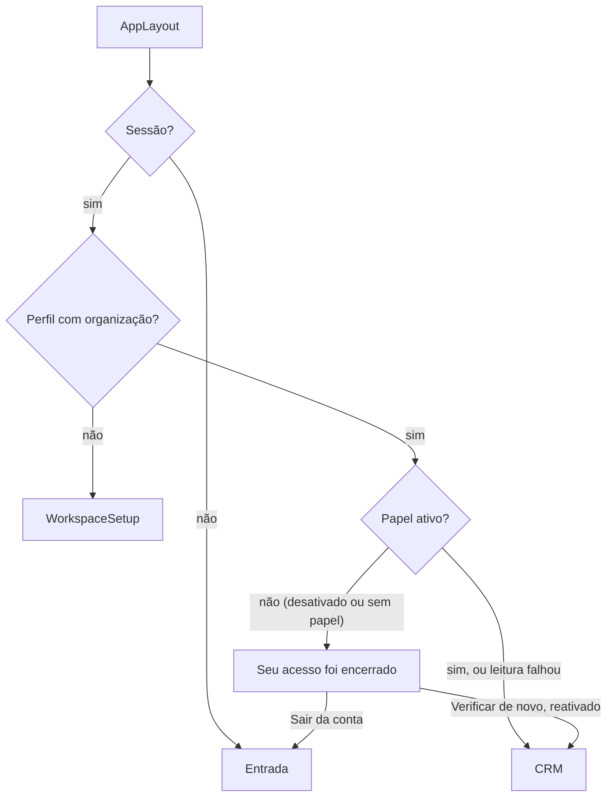

# 1.2 — Desativar membro e transferir a carteira

Desenho técnico final do item 1.2 do [roteiro](../ROADMAP-FINALIZACAO.md) (esforço M), feito por `@architect` em 13/10/2026 sobre a branch `chore/f0-base-confiavel`, depois do 1.1 e da revisão da Ajuda (commit `5801e35`). Vale junto com as premissas, a decisão D9 ("passar oportunidades abertas e tarefas pendentes é obrigatório; contatos e empresas ficam a critério do admin") e a "Saída da F1" do roteiro ("membro desativado não lê nem grava"). A implementação é do `@dev`, num único commit do item; o veredito de qualidade é do `@qa`.

Base estudada: as 13 migrações de `supabase/migrations` (a última é `20261012110000_admission_email_proof.sql`), os testes de `supabase/tests` (inclusive `upgrade/`), `scripts/test-database.mjs`, o [desenho do 1.1](1.1.md) (em especial a decisão R7, a seção 16.10 e os riscos residuais da 16.11), as RPCs `set_member_role`, `create_invitation`, `accept_invitation` e `restore_owner`, as funções `current_org`, `can_write`, `can_manage` e `is_owner`, as telas [Team.tsx](../../src/pages/Team.tsx), `AppLayout`, `WorkspaceSetup`, os seletores de responsável (`DealForm`, `DealDetail`, `ActivityDialog`, `RecordEditor`), os carregadores de membros (`useCrmSnapshot`, `pipeline/data.ts`, `operations/data.ts`), a fila de atenção (`activity-logic.ts`), `useCrmPermissions`, a fixture do E2E, a Central de ajuda e os 12 achados de baixa severidade da revisão da Ajuda. Documentação oficial do Supabase consultada: "User sessions" (o token de acesso vale até expirar; a verificação de `session_id` em `auth.sessions` é opcional e só para ações sensíveis), "Timeouts" (`authenticated` tem `statement_timeout` de 8 s, e uma função chamada pela API pode declarar o próprio, até 60 s) e a referência de `auth.admin.updateUserById` (`ban_duration` exige a chave `service_role`).

## Resumo das decisões

| # | Decisão | Onde |
| --- | --- | --- |
| M1 | **A desativação é um estado do papel**, e não a remoção do membro: `user_roles.deactivated_at`. O perfil continua na organização (`profiles.org_id`), e com ele as FKs e o histórico. | migração do item |
| M2 | **`private.current_org()` exige papel ativo.** Toda política e toda RPC passam por ela, então a desativação vale na próxima consulta, mesmo com o token do Auth ainda válido por até 1 hora. Nada muda no schema `auth`: sem ban, sem apagar sessões, sem verificação de `auth.sessions` (R7 do 1.1 continua descartada, seção 8). | `private.current_org()` |
| M3 | Quem foi desativado lê só o próprio perfil e o próprio papel (com a data da desativação), e não grava nada, nem o próprio perfil. | políticas `roles_read` e `profile_update` |
| M4 | **Transferência obrigatória, atômica e auditada.** `deactivate_member` desativa e passa, na mesma transação, as oportunidades em aberto e as atividades pendentes (não concluídas, menos notas) a um destinatário ativo que edita (dono, administrador ou colaborador). Contatos e empresas passam se `p_transfer_accounts` for verdadeiro (D9). Cada registro alterado entra na auditoria com o autor, e a passagem fica em `public.portfolio_transfers`. | RPCs `member_portfolio`, `deactivate_member`, `transfer_portfolio` |
| M5 | **Nenhum trabalho novo vai para quem está desativado.** Um gatilho recusa oportunidade em aberto, atividade pendente, contato ou empresa atribuídos (ou reabertos) a um membro desativado, com trava de linha no papel para não perder a corrida com a desativação. | `private.refuse_inactive_assignee()` |
| M6 | **Último dono ativo protegido:** ninguém desativa o próprio acesso, só um dono desativa ou reativa outro dono, e `set_member_role` passa a contar só donos ativos. A regra "quem concede qual papel" sai para uma função única, usada por todas as RPCs de equipe (antecipa o 2A.2). | `private.role_change_allowed()` |
| M7 | **Convites pendentes seguem a autoridade de quem os criou:** são revogados (excluídos, com auditoria) quando o autor é desativado ou perde o papel que permitia criá-los; a migração aplica a mesma regra aos convites antigos. A Equipe mostra quem criou cada convite. | `deactivate_member`, `set_member_role`, migração |
| M8 | **Reativação** por dono ou administrador, com o papel escolhido e as regras de `set_member_role`. A carteira passada não volta. `restore_owner` também reativa. | `reactivate_member`, `restore_owner` |
| M9 | **Equipe com ativos e desativados**; diálogo de desativação com as contagens e o destinatário obrigatório; "Passar carteira" para o que ficou com um desativado. | `Team.tsx`, `src/components/team/` |
| M10 | Quem foi desativado **sai dos seletores de responsável** e continua no histórico e nos filtros com a marca "(desativado)"; a fila de atenção trata o responsável desativado como "sem responsável". | `src/lib/team-members.ts` e telas |
| M11 | **"Seu acesso foi encerrado"**: tela inteira, no lugar do CRM, com a data e **Sair da conta**; aparece na entrada e, com o CRM aberto, ao voltar para a aba ou em até 60 s. O cache das consultas do CRM é apagado. | `AccessEnded.tsx`, `AppLayout`, `useCrmPermissions` |
| M12 | Perfis com organização e sem papel (órfãos, possíveis só por SQL) viram membros desativados na migração, porque hoje leem tudo sem papel nenhum. | backfill da migração |
| M13 | Os 12 achados de baixa severidade da revisão da Ajuda entram no item: 11 procedem e são corrigidos; 1 (instabilidade do E2E) procede como risco de infraestrutura e recebe mitigação (seção 12). | seção 12 |

## 1. Objetivo

Hoje o CRM não tira o acesso de ninguém: a Ajuda manda rebaixar a pessoa para "Somente leitura", ela continua lendo tudo, e a carteira dela fica parada até alguém editar registro por registro. O item fecha a saída de uma pessoa da equipe:

1. um dono ou administrador desativa a pessoa em **Equipe**, e ela perde o acesso a todos os dados na próxima consulta, inclusive com uma sessão aberta;
2. na mesma operação, as oportunidades em aberto e as atividades pendentes dela passam para outra pessoa da equipe, obrigatoriamente; contatos e empresas, se quem desativa quiser (D9);
3. o histórico (oportunidades ganhas e perdidas, atividades concluídas, notas, movimentações, auditoria) continua no nome dela, marcado "(desativado)";
4. a organização nunca fica sem um dono ativo, e a pessoa pode ser reativada;
5. quem foi desativado vê uma tela clara, em pt-BR, com a saída da conta;
6. os convites que a pessoa criou deixam de valer com a autoridade dela.

## 2. Estado atual

| Ponto | Hoje | Problema |
| --- | --- | --- |
| Remover alguém | Não existe. A Ajuda manda "Alterar papel" para "Somente leitura". | A pessoa continua lendo todos os dados da empresa. |
| `current_org()` | `select org_id from profiles where id = auth.uid()` | Não olha o papel: um perfil com organização e sem papel (órfão) lê tudo pela RLS. |
| Carteira | Trocar o "Responsável" de cada registro ao editá-lo. | Nada garante que oportunidades e tarefas não fiquem com quem saiu (D9). |
| Último dono | `set_member_role` conta todos os donos. | Com a desativação, contaria donos sem acesso. |
| Convites | Continuam valendo até expirar, mesmo se o autor sai ou é rebaixado; a lista não mostra o autor. | O convite é autoridade delegada que sobrevive ao autor (1.1, seção 12). |
| Atribuição | `owner_id` e `user_id` aceitam qualquer perfil da organização (FK composta). | Nada impede atribuir trabalho novo a quem saiu, nem automações de criar tarefa para ele. |
| Telas | Seletores e listas leem `profiles` sem o papel. | Não sabem quem está desativado. |
| `create_invitation` | "Esta pessoa já faz parte da equipe." para qualquer membro. | Não orienta a reativar quem saiu. |
| `restore_owner` | Devolve o papel de Dono. | Não reativaria uma conta desativada. |

## 3. Critérios de aceite

| # | Critério | Verificação |
| --- | --- | --- |
| AC-1 | `private.current_org()` devolve nulo para a conta desativada e para a conta com organização e sem papel; `can_write`, `can_manage` e `is_owner` ficam falsos. | test:db |
| AC-2 | **Membro desativado não lê nem grava, inclusive com o token antigo:** com as mesmas claims (`sub`, `session_id`, `amr`) usadas antes da desativação, a conta lê zero linhas em todas as tabelas da organização (inclusive `organizations`, `audit_logs`, `invitations`, `portfolio_transfers` e `onboarding_progress`), lê só o próprio perfil e o próprio papel, não insere, não altera (nem o próprio perfil) e não exclui, e as RPCs (`move_deal`, `delete_deal`, `create_invitation`, `set_member_role`, `member_portfolio`, `deactivate_member`, `transfer_portfolio`, `reactivate_member`, `automation_log_errors`, `accept_invitation`, `create_workspace`) recusam. | test:db e duas sessões no runner |
| AC-3 | Matriz de `deactivate_member`: dono desativa administrador, colaborador, somente leitura e outro dono; administrador desativa administrador, colaborador e somente leitura, mas não dono; colaborador e somente leitura são recusados; ninguém desativa o próprio acesso; pessoa já desativada, de outra organização ou inexistente é recusada; o último dono ativo nunca fica sem substituto. | test:db |
| AC-4 | A transferência passa todas as oportunidades em aberto (`status = 'open'`) e todas as atividades pendentes (`completed_at is null` e `type <> 'note'`) da pessoa ao destinatário, e os contatos e as empresas só com `p_transfer_accounts`; não toca oportunidades ganhas ou perdidas, atividades concluídas, notas nem registros de outras pessoas; devolve as contagens do que mudou; grava uma linha em `portfolio_transfers`; cada registro alterado ganha uma linha de auditoria com o autor, e `updated_at` muda. | test:db |
| AC-5 | Sem destinatário e com algo a passar, a RPC recusa com as contagens no texto e no `details` (JSON); o destinatário precisa ser outra pessoa, da mesma organização, ativa e com papel que edita. | test:db, unitário |
| AC-6 | **A transferência é atômica:** uma falha forçada no meio (gatilho temporário que recusa a atualização de empresas) deixa a pessoa ativa, a carteira inteira com ela, os convites dela e nenhuma linha nova em `portfolio_transfers`. | test:db |
| AC-7 | Uma atribuição concorrente à desativação nunca deixa oportunidade em aberto ou atividade pendente com a pessoa desativada: se a atribuição chega primeiro, a desativação espera e a leva junto; se chega depois, espera e é recusada. | runner, duas sessões |
| AC-8 | O gatilho de atribuição recusa: oportunidade em aberto criada, atribuída ou reaberta para um desativado; atividade pendente criada, atribuída, reaberta ou convertida de nota para um desativado; contato ou empresa criado ou atribuído a um desativado. Aceita: editar outros campos de um registro que já estava com um desativado; corrigir o responsável de uma oportunidade encerrada ou de uma atividade concluída. Uma automação que tentaria criar tarefa para um desativado registra falha, e a mudança da oportunidade é gravada. | test:db |
| AC-9 | Os convites pendentes (válidos ou expirados) criados pela pessoa são excluídos na desativação, com auditoria; os aceitos e os de outras pessoas ficam. `set_member_role` exclui os convites pendentes que o novo papel não poderia criar (de dono ou administrador para colaborador ou somente leitura: todos; de dono para administrador: os de dono). | test:db |
| AC-10 | `set_member_role` conta só donos ativos ("Mantenha pelo menos um dono ativo na organização."), recusa pessoa desativada e mostra a recusa do banco na Equipe. | test:db, unitário |
| AC-11 | `reactivate_member`: dono reativa qualquer papel e concede qualquer papel; administrador não reativa dono nem concede Dono; pessoa ativa é recusada; depois da reativação, a conta lê e grava com o papel escolhido, e a carteira passada continua com quem recebeu. | test:db, E2E |
| AC-12 | `transfer_portfolio` só aceita pessoa desativada, com as mesmas regras de destinatário e de atomicidade, e recusa quando não há carteira. | test:db |
| AC-13 | `create_invitation` diz "Esta pessoa está desativada. Para devolver o acesso, use “Reativar” em “Equipe”." para o e-mail de um desativado, e "Já existe um convite de dono válido para este e-mail. Só um dono pode copiar o link ou revogar esse convite." ao administrador que esbarra num convite de dono (achado 6). | test:db |
| AC-14 | `restore_owner` reativa a conta desativada com o papel de Dono ("A conta … foi reativada com o papel de Dono."). | test:db |
| AC-15 | `portfolio_transfers` tem RLS, FKs compostas, leitura só para donos e administradores da organização, nenhum privilégio de escrita para os papéis da API e nenhum para `anon`. | test:db |
| AC-16 | Numa instância existente: membros continuam iguais; o perfil órfão vira membro desativado (Somente leitura) e perde a leitura; os convites pendentes de quem hoje não poderia criá-los são excluídos; nenhuma oportunidade muda de responsável. | test:db com `upgrade/` |
| AC-17 | `gen:types` traz `user_roles.deactivated_at`, `portfolio_transfers` e as quatro RPCs novas; `database-types.test.ts` confere os contratos. As RPCs de transferência declaram `statement_timeout` de 60 s, e uma carteira do tamanho do volume do 0.10 passa em menos de 8 s no PostgreSQL embutido (o runner imprime o tempo e só reprova a partir de 20 s; seção 16.6, achado 8). | `gen:types:check`, typecheck, runner |
| AC-18 | Equipe: "Pessoas ativas" e "Pessoas desativadas", com a data; **Desativar** só para quem pode (nunca no próprio cartão; administrador não vê em dono); diálogo com as contagens, **Quem recebe a carteira** obrigatório quando há algo a passar, **Passar também os contatos e as empresas** marcado por padrão e a recusa por carteira alterada atualizando as contagens; **Reativar** e **Passar carteira** nos desativados; "Criado por" em cada convite; aviso de convites revogados ao alterar papel. Desktop e celular, 320 e 1440 px, claro e escuro, sem rolagem horizontal. | unitário, E2E |
| AC-19 | Seletores de responsável (oportunidade, próxima ação, atividade, contato e empresa) não oferecem desativados; o valor atual desativado aparece marcado e pode ser trocado; os valores padrão nunca caem num desativado. Filtros de responsável (Pipeline e Relatórios) listam os desativados depois dos ativos, marcados. Cartões, listas, fichas, detalhes, Relatórios e o CSV mostram "Nome (desativado)". | unitário, E2E |
| AC-20 | A conta desativada vê **Seu acesso foi encerrado** ao entrar e, com o CRM aberto, ao voltar para a aba (dados com mais de 30 s) ou em até 60 s; o cache das consultas do CRM é apagado; **Sair da conta** leva à entrada sem `?next=`; **Verificar de novo** abre o CRM se a pessoa foi reativada. | unitário, E2E desktop e celular |
| AC-21 | A fila de atenção ("Sem responsável") inclui contatos ativos, oportunidades em aberto e atividades pendentes cujo responsável foi desativado, com a explicação própria. | unitário |
| AC-22 | Frontend novo num banco sem a migração: o papel continua sendo lido (sem `deactivated_at`), ninguém fica preso em modo leitura, e as ações novas da Equipe falham com mensagem em pt-BR. | unitário |
| AC-23 | A Ajuda descreve a desativação, a reativação, "Passar carteira", "(desativado)", "Seu acesso foi encerrado", os convites revogados e o "Criado por", sem a promessa antiga ("O CRM ainda não remove nem desativa pessoas"); os 12 achados ficam resolvidos como na seção 12. | `faq-content.test.ts`, `HelpCenter.test.tsx`, `tour-state.test.ts` |

## 4. Modelo de dados e RPCs

### 4.1 Migração

Um arquivo novo, aditivo: `supabase/migrations/20261013100000_member_deactivation.sql`, posterior a `20261012110000_admission_email_proof.sql`, com o comentário inicial apontando para este desenho. Ordem do conteúdo, cada bloco com o comentário em português no estilo das migrações anteriores:

1. `user_roles.deactivated_at` e o `CHECK isfinite`;
2. `private.role_change_allowed` (nova);
3. `private.current_org` (substituída);
4. políticas `roles_read` e `profile_update` (substituídas);
5. tabela `public.portfolio_transfers`, RLS, grants e índices;
6. `private.refuse_inactive_assignee` e os gatilhos em `deals`, `activities`, `contacts` e `companies`;
7. `private.portfolio_counts` e `private.move_member_portfolio` (internas);
8. `member_portfolio`, `deactivate_member`, `transfer_portfolio` e `reactivate_member` (privadas e públicas);
9. `private.set_member_role`, `private.create_invitation` e `private.restore_owner` (substituídas; assinaturas iguais);
10. *backfill*: papel desativado para perfis órfãos e limpeza dos convites;
11. `revoke` e `grant` de execução de todas as funções novas, no fim.

Depois: `npm run gen:types`. Dados no formato anterior para o teste em `supabase/tests/upgrade/20261013100000_member_deactivation.sql` (seção 7).

### 4.2 Tabelas, colunas, constraints e índices

**`public.user_roles`**

| Mudança | Regra | Segura com dados? |
| --- | --- | --- |
| `deactivated_at timestamptz` | nulo = ativo; preenchido = desativado em | Sim: coluna anulável sem padrão, sem reescrever a tabela; todas as linhas existentes ficam ativas. |
| `user_roles_deactivated_at_finite` | `check(isfinite(deactivated_at))`, como as demais datas desde `immutable_metadata` | Sim. |

Sem `deactivated_by` nem motivo na tabela: quem desativou, para quem foi a carteira e as contagens ficam em `portfolio_transfers`, e a auditoria registra a mudança de `deactivated_at` com o autor. O `role` é mantido na desativação: é o papel sugerido na reativação. Sem índice novo: `current_org()` lê pela restrição única `(user_id, org_id)`, e a contagem de donos ativos varre uma tabela de 1 a 50 linhas.

**`public.portfolio_transfers`** (nova; uma linha por passagem de carteira, inclusive a desativação sem nada a passar)

| Coluna | Tipo | Regra |
| --- | --- | --- |
| `id` | `uuid` | `primary key default gen_random_uuid()` |
| `org_id` | `uuid not null` | `references organizations(id)` |
| `from_user_id` | `uuid not null` | FK `(from_user_id, org_id)` → `profiles(id, org_id)` |
| `to_user_id` | `uuid` | FK `(to_user_id, org_id)` → `profiles(id, org_id)`; nulo quando nada foi passado |
| `performed_by` | `uuid` | FK `(performed_by, org_id)` → `profiles(id, org_id)`; nulo só pelo editor SQL |
| `deactivation` | `boolean not null` | verdadeiro quando a passagem veio da desativação; falso em "Passar carteira" |
| `accounts_transferred` | `boolean not null` | contatos e empresas incluídos |
| `deals`, `activities`, `contacts`, `companies`, `invitations` | `integer not null default 0` | `check(... >= 0)`; o que mudou de fato |
| `created_at` | `timestamptz not null default now()` | `check(isfinite(created_at))` |

- `check(to_user_id is distinct from from_user_id)` e `check(to_user_id is not null or deals + activities + contacts + companies = 0)`.
- FKs compostas sem `ON DELETE`, como `audit_logs`: perfis com histórico não são excluídos (a anonimização de ex-membro é do 2B.8).
- Índices: `(org_id, created_at desc)` para a Equipe e um por FK (`(from_user_id, org_id)`, `(to_user_id, org_id)`, `(performed_by, org_id)`), seguindo a regra da base de indexar toda FK.
- Sem `protect_record_metadata` nem auditoria na tabela: não há `UPDATE` nem `DELETE` para nenhum papel da API, e só as RPCs inserem.

Por que uma tabela, e não só a auditoria: `audit_logs` guarda os nomes dos campos alterados, não os valores. A pergunta "para quem foi a carteira de Fulano, e quanto era?" não teria resposta. A tabela é pequena, append-only e serve de base para as notificações (2A.7) e para a anonimização de ex-membro (2B.8).

### 4.3 RLS e grants

| Objeto | `anon` | `authenticated` | Observação |
| --- | --- | --- | --- |
| `user_roles` | nada | `SELECT` (como hoje); política `roles_read` passa a `org_id = current_org() or user_id = auth.uid()` | A conta desativada lê o próprio papel e a data, para a tela "Seu acesso foi encerrado". Continua sem `INSERT`, `UPDATE` e `DELETE`. |
| `profiles` | nada | `profile_update` passa a `id = auth.uid() and org_id is not distinct from current_org()` (em `using` e `with check`) | A conta sem organização (`null` e `null`) e o membro ativo continuam editando o próprio perfil; o desativado não. `profile_read` não muda: o próprio perfil continua legível. |
| `portfolio_transfers` | nada | `SELECT`; política `portfolio_transfers_manager_read`: `org_id = current_org() and can_manage()` | `revoke all ... from public, anon, authenticated` antes do `grant select` (o Supabase hospedado concede tudo por privilégio padrão, simulado no `local-bootstrap.sql`). Uma única política permissiva de leitura. |
| `private.member_portfolio(uuid)`, `deactivate_member(uuid,boolean,uuid)`, `transfer_portfolio(uuid,boolean,uuid)`, `reactivate_member(uuid,text)` e as públicas de mesmo nome | nada | `EXECUTE` | `revoke ... from public, anon` antes, como `create_invitation`. |
| `private.role_change_allowed`, `portfolio_counts`, `move_member_portfolio`, `refuse_inactive_assignee` | nada | nada | `revoke execute ... from public, anon, authenticated, service_role`; só funções `SECURITY DEFINER` do dono do banco as chamam. |

As demais políticas não mudam de texto: todas usam `(select private.current_org())`, e é a função que passa a exigir o papel ativo. Essa é a defesa central do item, e o motivo de nenhuma tabela precisar de política restritiva nova.

### 4.4 Funções e RPCs

Todas com `set search_path = ''` e nomes qualificados. Mensagens em pt-BR, porque a interface as mostra. As travas de equipe passam de `FOR UPDATE` para `FOR NO KEY UPDATE` na linha da organização: continuam serializando convites, papéis e desativações entre si, e deixam de bloquear as verificações de FK (`FOR KEY SHARE`) dos `INSERT` dos colegas em todas as tabelas da organização enquanto uma carteira grande é passada.

**`private.role_change_allowed(p_actor_role text, p_from_role text, p_to_role text) returns boolean`** — `language sql immutable`. A regra "quem concede qual papel" num lugar só (o 2A.2 acrescenta `manager` aqui):

```sql
select p_actor_role = 'owner'
    or (p_actor_role = 'admin' and coalesce(p_from_role, '') <> 'owner' and coalesce(p_to_role, '') <> 'owner');
```

| Uso | `p_from_role` | `p_to_role` |
| --- | --- | --- |
| `set_member_role` | papel atual | papel novo |
| `create_invitation` | nulo | papel do convite |
| `deactivate_member` | papel atual | papel atual |
| `reactivate_member` | papel guardado | papel escolhido |
| limpeza de convites (`set_member_role`, migração) | nulo, com o **papel do autor** em `p_actor_role` | papel do convite |

**`private.current_org() returns uuid`** — substituída; `language sql stable security definer`, como hoje:

```sql
select p.org_id
  from public.profiles p
  join public.user_roles r on r.user_id = p.id and r.org_id = p.org_id and r.deactivated_at is null
 where p.id = (select auth.uid());
```

- Uma busca pela chave de `profiles` e outra pela restrição única de `user_roles`; nas políticas, `(select private.current_org())` continua avaliada uma vez por consulta.
- `can_write`, `can_manage` e `is_owner` não mudam: comparam `org_id = private.current_org()`, que é nula para quem está desativado.
- `accept_invitation` e `provision_organization` gravam o perfil e depois o papel; nenhum gatilho entre os dois comandos usa `current_org()` (conferido: `protect_record_metadata` e `audit_record_change` leem a linha).

**`private.portfolio_counts(p_org uuid, p_user uuid) returns table(deals integer, activities integer, contacts integer, companies integer, invitations integer)`** — `language sql stable`, interna. A definição única de "carteira", usada pela prévia, pela recusa sem destinatário e pelos testes:

| Contagem | Linhas |
| --- | --- |
| `deals` | `deals` com `owner_id = p_user` e `status = 'open'` |
| `activities` | `activities` com `user_id = p_user`, `completed_at is null` e `type <> 'note'` (a mesma definição de "pendente" da fila de atenção) |
| `contacts` | `contacts` com `owner_id = p_user` (todas as situações) |
| `companies` | `companies` com `owner_id = p_user` |
| `invitations` | `invitations` com `invited_by = p_user` e `accepted_at is null` |

Recebimentos (`payments`) não têm responsável e seguem a oportunidade, o contato ou a empresa: nada a passar. Automações não têm responsável (a tarefa vai para o dono da oportunidade, e o filtro é de funil e etapa): nada aponta para a pessoa além de `created_by`, que é histórico. O 2B.10 ("escolher responsável") precisa entrar nesta lista e no gatilho da seção 4.5.

**`private.move_member_portfolio(p_org uuid, p_user uuid, p_recipient uuid, p_accounts boolean, p_deactivation boolean) returns table(...)`** — `plpgsql`, interna, chamada só por `deactivate_member` e `transfer_portfolio`, já dentro das travas:

1. lê `portfolio_counts`; sem destinatário e com `deals + activities > 0`, ou com `p_accounts` e `contacts + companies > 0`, recusa (passo da tabela de mensagens, 4.6) com `using detail = jsonb_build_object('deals', …, 'activities', …, 'contacts', …, 'companies', …, 'invitations', …)::text`, como `delete_deal`;
2. `update public.deals set owner_id = p_recipient where org_id = p_org and owner_id = p_user and status = 'open'`; guarda `row_count`;
3. o mesmo em `activities` (`user_id`, pendentes e não notas) e, com `p_accounts`, em `contacts` e `companies` (`owner_id`);
4. `delete from public.invitations where org_id = p_org and invited_by = p_user and accepted_at is null`;
5. `insert into public.portfolio_transfers(...)` com as contagens reais (`row_count`), `performed_by = auth.uid()`;
6. devolve as contagens reais.

Os `UPDATE` passam pelos gatilhos de sempre: `audit_record_change` grava uma linha por registro, com o autor; `touch_updated_at` renova a versão (formulários abertos de colegas recebem o conflito do 0.8, em vez de devolver o registro à pessoa desativada); `record_deal_change` e `run_deal_automations` não disparam, porque etapa e situação não mudam; o gatilho da seção 4.5 confere o destinatário.

**`private.member_portfolio(p_user_id uuid)`** / **`public.member_portfolio(p_user_id uuid)`** `returns table(deals integer, activities integer, contacts integer, companies integer, invitations integer)` — a privada é `stable security definer`; a pública, `language sql stable security invoker`, devolve `select * from private.member_portfolio(p_user_id)`. Recusa sem `can_manage` ("Somente donos e administradores veem a carteira de outra pessoa.") e pessoa fora da organização ("Pessoa indisponível nesta organização."). `SECURITY DEFINER` para contar como a transferência conta, mesmo quando a visibilidade por responsável (2A.6) chegar. O tipo gerado fica `{ deals: number; … }[]`, lido com `.single()`.

**`private.deactivate_member(p_user_id uuid, p_transfer_accounts boolean, p_recipient_id uuid default null)`** / **`public.deactivate_member(...)`** `returns table(...)` — a privada é `plpgsql security definer`; a pública, `language sql security invoker set statement_timeout = '60s'` (o PostgREST aplica o tempo-limite declarado na função chamada; o padrão de `authenticated` é 8 s). Sem padrão para `p_transfer_accounts`, para o contrato do tipo dizer o que acontece com contatos e empresas; `p_recipient_id` é opcional porque só é exigido quando há carteira.

```sql
-- Esboço; a implementação segue o estilo das migrações anteriores.
v_org := private.current_org();
if auth.uid() is null or v_org is null or not private.can_manage() then
  raise exception 'Somente donos e administradores podem desativar pessoas.';
end if;
perform 1 from public.organizations where id = v_org for no key update;
select role into v_actor from public.user_roles
 where org_id = v_org and user_id = auth.uid() and deactivated_at is null;
if v_actor is null or v_actor not in ('owner', 'admin') then
  raise exception 'Sua permissão foi alterada. Atualize a página.';
end if;
if p_user_id = auth.uid() then
  raise exception 'Você não pode desativar o seu próprio acesso. Peça a outro dono ou administrador.';
end if;
select role, deactivated_at into v_target, v_since from public.user_roles where org_id = v_org and user_id = p_user_id;
if not found then raise exception 'Pessoa indisponível nesta organização.'; end if;
if v_since is not null then raise exception 'Esta pessoa já está desativada.'; end if;
if not private.role_change_allowed(v_actor, v_target, v_target) then
  raise exception 'Somente um dono pode desativar outro dono.';
end if;
if v_target = 'owner' and (select count(*) from public.user_roles
     where org_id = v_org and role = 'owner' and deactivated_at is null) <= 1 then
  raise exception 'Mantenha pelo menos um dono ativo na organização.';
end if;
-- destinatário informado: seção 4.6, linhas 6 e 7 (a falta dele, linha 5, é conferida em move_member_portfolio)
-- Ordem das travas (seção 6): primeiro as linhas da carteira, depois o papel da pessoa.
perform 1 from public.deals where org_id = v_org and owner_id = p_user_id and status = 'open' for update;
perform 1 from public.activities where org_id = v_org and user_id = p_user_id
   and completed_at is null and type <> 'note' for update;
-- (contatos e empresas, com p_transfer_accounts)
perform 1 from public.user_roles where org_id = v_org and user_id = p_user_id for update;
update public.user_roles set deactivated_at = now() where org_id = v_org and user_id = p_user_id;
return query select * from private.move_member_portfolio(v_org, p_user_id, p_recipient_id, p_transfer_accounts, true);
```

- Tudo numa transação: qualquer recusa ou falha desfaz a desativação, a transferência, a revogação dos convites e o registro.
- A verificação do último dono é redundante com "ninguém desativa o próprio acesso" e "só um dono desativa dono" (sempre sobra quem desativa), mas fica como invariante explícita, testada com dados montados por SQL.
- Devolve as contagens reais, que a tela mostra.

**`private.transfer_portfolio(p_user_id uuid, p_transfer_accounts boolean, p_recipient_id uuid)`** / **`public.transfer_portfolio(...)`** `returns table(...)` — mesma forma e o mesmo `statement_timeout`. Só para pessoa **já desativada** ("Esta pessoa está ativa. Para passar a carteira dela, use “Desativar”."); destinatário obrigatório; sem carteira, recusa ("Esta pessoa não tem mais carteira para passar."). Serve para o que ficou com um desativado (contatos e empresas mantidos na desativação, perfis órfãos da migração). Qualquer gestor pode usá-la, inclusive na carteira de um dono desativado: é reatribuição de dados, que o administrador já faz registro por registro. Passar a carteira de quem está ativo é das ações em massa (2A.8).

**`private.reactivate_member(p_user_id uuid, p_role text)`** / **`public.reactivate_member(p_user_id uuid, p_role text)`** `returns void` — gestor, trava da organização, quem reativa ativo, pessoa da organização e desativada ("Esta pessoa já está ativa."), papel válido ("Papel inválido."), `role_change_allowed(v_actor, v_previous_role, p_role)` ("Somente um dono pode reativar um dono ou dar o papel de Dono."); depois, `update user_roles set deactivated_at = null, role = p_role`. Não devolve carteira.

**`private.set_member_role(p_user_id uuid, p_role text)`** — substituída; a pública e o tipo não mudam.

| Passo | Regra | Mensagem |
| --- | --- | --- |
| 1 | gestor | "Somente donos e administradores podem alterar papéis." (antes, "Somente administradores…", que esquecia os donos) |
| 2 | papel válido | "Papel inválido." |
| 3 | trava a organização (`for no key update`) e relê quem altera, ativo | "Sua permissão foi alterada. Atualize a página." |
| 4 | pessoa da organização (`for update`) | "Pessoa indisponível nesta organização." |
| 5 | pessoa ativa | "Esta pessoa está desativada. Use “Reativar” para devolver o acesso." |
| 6 | `role_change_allowed(v_actor, v_current, p_role)` | "Somente um dono pode alterar este papel." |
| 7 | dono rebaixado com 1 dono ativo ou menos | "Mantenha pelo menos um dono ativo na organização." |
| 8 | grava o papel e exclui os convites pendentes `invited_by = p_user_id` em que `not role_change_allowed(p_role, null, role)` | — |

**`private.create_invitation(p_email text, p_role text)`** — substituída; mesma assinatura. Muda: trava `for no key update`; regra de papel por `role_change_allowed(v_actor, null, p_role)`; o passo "quem já é da equipe" separa o ativo ("Esta pessoa já faz parte da equipe.") do desativado ("Esta pessoa está desativada. Para devolver o acesso, use “Reativar” em “Equipe”."); com um convite válido de dono para o e-mail e quem convida administrador, "Já existe um convite de dono válido para este e-mail. Só um dono pode copiar o link ou revogar esse convite." (achado 6: o administrador não vê esse convite). As demais recusas não mudam.

**`private.restore_owner(p_email text, p_org_id uuid default null)`** — substituída; mesma assinatura. Na conta que pertence a uma organização: `update user_roles set role = 'owner', deactivated_at = null`; se estava desativada, responde "A conta … foi reativada com o papel de Dono."; senão, como hoje. Trava `for no key update`. As demais linhas da tabela do 1.1 (seção 4.4) não mudam.

**`accept_invitation`** e **`create_workspace`** não mudam. Para a conta desativada, o aceite recusa com "Sua conta já pertence a uma organização." (o perfil continua com a organização), e a criação da empresa chega a "Este CRM já tem uma empresa…" (e, numa instância personalizada com várias empresas, `provision_organization` recusa pelo perfil). A conta desativada nunca vê essas telas: vê a da seção 5.6.

### 4.5 Gatilho de atribuição

**`private.refuse_inactive_assignee() returns trigger`** — `plpgsql`, `SECURITY DEFINER` (a trava `FOR KEY SHARE` exige privilégio de `UPDATE` na tabela, que `authenticated` não tem em `user_roles`), `set search_path = ''`, sem execução por papel da API. Gatilho `refuse_inactive_assignee` `BEFORE INSERT OR UPDATE` em `deals`, `activities`, `contacts` e `companies`.

| Tabela | Responsável | "Trabalho novo" (o gatilho só confere nestes casos) |
| --- | --- | --- |
| `deals` | `owner_id` | `status = 'open'` e (`INSERT`, ou `owner_id` mudou, ou a oportunidade estava encerrada) |
| `activities` | `user_id` | pendente (`completed_at is null` e `type <> 'note'`) e (`INSERT`, ou `user_id` mudou, ou antes não estava pendente) |
| `contacts`, `companies` | `owner_id` | `INSERT` ou `owner_id` mudou |

```sql
-- Esboço do miolo, depois de calcular v_assignee e v_new_work.
if v_assignee is null or not v_new_work then return new; end if;
select r.deactivated_at is null into v_active
  from public.user_roles r
 where r.user_id = v_assignee and r.org_id = new.org_id
   for key share;
if coalesce(v_active, false) then return new; end if;
raise exception '%', <mensagem da seção 4.6, linhas 13 a 16>;
```

- **Trava `FOR KEY SHARE`:** conflita com o `FOR UPDATE` que `deactivate_member` toma no papel da pessoa. Se a atribuição chega antes, a desativação espera o commit dela e a leva na transferência; se chega depois, espera a desativação terminar e relê a linha já desativada (em `READ COMMITTED`, a leitura com trava devolve a versão confirmada), e recusa. Sem a trava, uma atribuição conferida antes do commit da desativação poderia ser gravada depois da transferência.
- Papel ausente (perfil órfão gravado por SQL depois da migração) conta como inativo.
- **Editar outros campos** de um registro que já estava com um desativado não é trabalho novo: a guarda de concorrência e a edição seguem como hoje, e a carteira antiga se resolve por "Passar carteira".
- **Histórico:** o responsável de uma oportunidade encerrada ou de uma atividade concluída pode ser corrigido para qualquer perfil da organização, inclusive desativado (a tela não oferece; o banco não impede a correção de histórico).
- **Automações:** a tarefa de `run_deal_automations` vai para o dono da oportunidade; se ele está desativado (oportunidade encerrada movida de etapa), o `INSERT` é recusado dentro do bloco de exceção da automação, que registra a falha ("Não foi possível criar a tarefa. Revise os vínculos e o responsável.", com o detalhe técnico para gestores), e a mudança da oportunidade é gravada. Sem reescrita de `run_deal_automations`.
- **Custo:** uma busca pela restrição única e uma trava de linha por registro com responsável criado ou reatribuído. Numa importação de 5 mil contatos, o mesmo papel é travado pela mesma transação 5 mil vezes, sem espera.
- Ordem: `BEFORE` em ordem alfabética, depois de `protect_record_metadata` e `record_activity_author`, antes de `touch_updated_at` e `validate_deal_change`; nenhum deles muda responsável, situação ou conclusão.

### 4.6 Mensagens novas ou alteradas

| # | Onde | Mensagem |
| --- | --- | --- |
| 1 | `deactivate_member` sem gestor | "Somente donos e administradores podem desativar pessoas." |
| 2 | desativar o próprio acesso | "Você não pode desativar o seu próprio acesso. Peça a outro dono ou administrador." |
| 3 | administrador e dono | "Somente um dono pode desativar outro dono." |
| 4 | já desativada | "Esta pessoa já está desativada." |
| 5 | sem destinatário, com carteira | "%s tem %s. Escolha quem recebe a carteira." (o nome da pessoa, ou o e-mail quando o nome está vazio, e a lista pluralizada, como em `delete_deal`: "3 oportunidades em aberto e 5 atividades pendentes"), com `details` em JSON |
| 6 | destinatário igual à pessoa | "Escolha outra pessoa para receber a carteira." |
| 7 | destinatário inativo, de outra organização ou sem papel que edita | "Quem recebe a carteira precisa estar ativo na equipe e poder editar (dono, administrador ou colaborador)." |
| 8 | último dono ativo | "Mantenha pelo menos um dono ativo na organização." |
| 9 | `transfer_portfolio` em pessoa ativa | "Esta pessoa está ativa. Para passar a carteira dela, use “Desativar”." |
| 10 | `transfer_portfolio` sem carteira | "Esta pessoa não tem mais carteira para passar." |
| 11 | `reactivate_member` | "Esta pessoa já está ativa." · "Somente um dono pode reativar um dono ou dar o papel de Dono." |
| 12 | `set_member_role` em desativada | "Esta pessoa está desativada. Use “Reativar” para devolver o acesso." |
| 13 | gatilho, oportunidade atribuída a desativado | "O responsável escolhido foi desativado e não recebe oportunidades em aberto. Escolha outra pessoa em “Responsável”." |
| 14 | gatilho, oportunidade reaberta com responsável desativado | "O responsável desta oportunidade foi desativado. Para reabri-la, troque antes o “Responsável” em “Editar”." |
| 15 | gatilho, atividade atribuída a desativado / reaberta | "A pessoa escolhida como responsável foi desativada. Escolha outra pessoa em “Responsável”." · "O responsável desta atividade foi desativado. Para reabri-la, troque antes o “Responsável” ao editar a atividade." (o botão muda de nome entre o painel da atividade, a ficha 360 e as listas; seção 16.6, achado 14) |
| 16 | gatilho, contato ou empresa | "A pessoa escolhida como responsável foi desativada. Escolha outra pessoa em “Responsável”." |
| 17 | `create_invitation` | as duas da seção 4.4 |
| 18 | `restore_owner` | "A conta … foi reativada com o papel de Dono." |

Todas com o código padrão `P0001`, que `rpcRefusalMessage` e `errorMessage` mostram como estão. Os nomes entre aspas curvas são os da tela e entram na verificação de rótulos da Ajuda (`src/test/ui-labels.ts`) só se forem citados nela.

### 4.7 O que não muda no banco

`can_write`, `can_manage`, `is_owner`, `accept_invitation`, `create_workspace`, `provision_organization`, o portão de cadastro, a prova do e-mail, `handle_new_user`, `run_deal_automations`, `delete_deal`, as FKs compostas existentes e as políticas das tabelas comerciais. Nada no schema `auth`.

## 5. Fluxos de tela

### 5.1 Membros com a situação: `src/lib/team-members.ts`

Novo módulo, fonte única dos membros para as telas:

| Exportação | O que faz |
| --- | --- |
| `TeamMember` | `{ id, name, email, role: CrmRole \| null, active: boolean, deactivatedAt: string \| null }` |
| `readMemberRoles(orgId)` | lê `user_roles` (`user_id, role, deactivated_at`), paginado como hoje; com `42703`/`PGRST204` (banco sem a migração), lê só `role` e trata todos como ativos (AC-22) |
| `loadTeamMembers(orgId)` | `profiles` e `readMemberRoles` em paralelo, juntados por `id` |
| `memberLabel(member, id?)` | "Nome" ou "Nome (desativado)"; "Responsável indisponível" e "Sem responsável" como hoje |
| `assignableMembers(members, currentId?)` | ativos, em ordem alfabética, mais o atual se estiver desativado (para o seletor mostrar o valor), marcado |
| `defaultAssignee(preferred, members, me)` | o preferido se ativo; senão, a própria pessoa |
| `filterMembers(members)` | ativos, depois desativados marcados (filtros de Pipeline e Relatórios) |
| `readPortfolioCounts(details)`, `portfolioSummary(counts)` | lê o JSON da recusa e escreve "3 oportunidades em aberto, 5 atividades pendentes, 12 contatos e 2 empresas", com `countLabel` de `src/lib/record-links.ts` |

Consumidores: `useCrmSnapshot` (os `members` do snapshot ganham `active` e `deactivatedAt`; `user_roles` entra no `Promise.all`, com `readCrmPages`), `loadPipelineReferences` e `loadOperationReferences` (`people`), e a Equipe. O tipo `Member` de `contact-model.ts` acompanha. Descartados: uma view `security_invoker` e o embutir do PostgREST (seção 8).

### 5.2 Equipe (`Team.tsx`, com os diálogos em `src/components/team/`)

- Texto do topo: "Pessoas e permissões da organização. Os dados comerciais são compartilhados entre os membros desta equipe." Para quem não gerencia: "Convidar pessoas, alterar papéis e desativar acessos fica com donos e administradores. Se precisar de outro acesso, fale com um deles."
- **Pessoas ativas (N):** o cartão de hoje (nome, "(você)", e-mail, papel, o que o papel faz) com **Alterar papel** e **Desativar**. **Desativar** aparece para gestores, nunca no próprio cartão, e num dono só para donos.
- **Pessoas desativadas (M)**, só quando há alguma: aviso "Quem foi desativado não entra mais no CRM. O nome continua no histórico, com a marca “(desativado)”."; o cartão mostra o nome com "(desativado)", o e-mail e "Acesso desativado em 13/10/2026". Para gestores, a última passagem de `portfolio_transfers`: "Carteira passada por Ana para Bruno: 3 oportunidades em aberto, 5 atividades pendentes, 12 contatos e 2 empresas. 1 convite revogado." (ou "Sem carteira para passar."; com a caixa de contatos e empresas desmarcada, "Os contatos e as empresas ficaram com a pessoa." e, se nada mais foi passado, "Nada foi passado. … Use “Passar carteira” para passar esses registros."), e os botões **Reativar** (num dono, só para donos) e **Passar carteira**. Para os demais papéis, só a data.
- **Convites:** cada convite ganha "Criado por Ana em 13/10/2026" (`invited_by` e `created_at`, com o nome pela lista de membros; "(desativado)" quando for o caso; sem autor: "Criado pelo painel do Supabase", o caminho de `restore_owner`).
- **Alterar papel:** quando o novo papel tira de quem é alterado a autoridade de convites pendentes que ele criou, o diálogo avisa antes de confirmar: "Os 2 convites pendentes criados por Fulano serão revogados, porque o novo papel não permite criá-los." (calculado com `role_change_allowed` espelhada em `src/lib/roles.ts` sobre a lista de convites já lida). A recusa do banco aparece no diálogo por `rpcRefusalMessage`, com a mensagem atual como reserva.
- Depois de cada ação, `invalidateQueries(['crm'])`, como hoje.

### 5.3 Diálogo de desativação (`MemberDeactivateDialog`)

Componente do DS (`Dialog`), no padrão do `DealDeleteDialog` (contagens carregadas antes, confirmação desabilitada enquanto carregam, recusa por mudança atualizando as contagens). Dois modos: **desativar** (cartão ativo) e **passar carteira** (cartão desativado).

| Parte | Modo desativar | Modo passar carteira |
| --- | --- | --- |
| Título | "Desativar Fulano" | "Passar a carteira de Fulano" |
| Explicação | "Fulano perde o acesso ao CRM na hora, mesmo que esteja com ele aberto. Oportunidades ganhas e perdidas, atividades concluídas e o histórico continuam no nome de Fulano, com a marca “(desativado)”." | "O acesso de Fulano já está desativado. O que ainda está no nome de Fulano passa para a pessoa escolhida." |
| Contagens | `member_portfolio`: "Contando a carteira…" (`role="status"`); depois, a lista "3 oportunidades em aberto", "5 atividades pendentes", "12 contatos", "2 empresas" e, se houver, "1 convite pendente criado por Fulano será revogado." Falha: "Não foi possível contar a carteira." com **Tentar novamente** | igual, sem a linha de convites |
| **Quem recebe a carteira** | seletor de ativos que editam (dono, administrador e colaborador), sem a pessoa; obrigatório quando há oportunidade, atividade ou (com a caixa marcada) contato ou empresa; ajuda: "Recebe as oportunidades em aberto e as atividades pendentes." | igual, sempre obrigatório |
| **Passar também os contatos e as empresas** | caixa marcada por padrão, com as contagens; desmarcada: "Os contatos e as empresas continuam com Fulano, marcados “(desativado)”, até alguém trocá-los ou usar “Passar carteira”." | igual |
| Sem carteira | "Fulano não tem oportunidades em aberto, atividades pendentes, contatos nem empresas.", a linha dos convites pendentes que serão revogados (se houver) e nenhum seletor | "Fulano não tem mais carteira para passar." e só **Fechar** |
| Confirmar | **Confirmar desativação** | **Confirmar passagem** |
| Sucesso | toast "O acesso de Fulano foi desativado. Bruno recebeu 3 oportunidades em aberto, 5 atividades pendentes, 12 contatos e 2 empresas. 1 convite pendente revogado." (contagens devolvidas pela RPC; frases sem gênero) | toast "Bruno recebeu …" |
| Recusa com contagens | "A carteira de Fulano mudou desde que você abriu esta confirmação. Confira as contagens e confirme de novo.", com as contagens novas (`readPortfolioCounts`) e o seletor exigido se passou a haver carteira | igual |
| Outras recusas | `rpcRefusalMessage` no `role="alert"` do diálogo, ligado ao botão por `aria-describedby`; `40P01` (impasse, seção 6): "Outra gravação aconteceu ao mesmo tempo. Tente de novo." | igual |

No celular, o diálogo ocupa a largura com rolagem interna, e o botão de confirmar continua visível ao rolar até o fim; o seletor é o `Select` do DS.

### 5.4 Reativação (`MemberReactivateDialog`)

Título "Reativar Fulano"; texto "Fulano volta a entrar no CRM com o papel escolhido. A carteira que passou para outra pessoa continua com ela: troque o “Responsável” dos registros que devem voltar."; **Novo papel** com o papel guardado como padrão ("Dono" só para donos) e o que o papel faz (`permissionCopy`); **Confirmar reativação**; toast "O acesso de Fulano foi reativado."

### 5.5 Seletores, filtros e histórico

| Lugar | Mudança |
| --- | --- |
| `DealForm` (Responsável), `DealDetail` (responsável da próxima ação), `ActivityDialog` (Responsável), `RecordEditor` (Responsável) | `assignableMembers`; o valor atual desativado aparece como "Fulano (desativado)" e pode ser trocado |
| `DealDetail` ("Combinar ação"), `ActivityEditor` (ficha 360) | padrão por `defaultAssignee`: o dono do registro se ativo, senão quem está usando |
| Pipeline (**Filtrar responsável**) e Relatórios (filtro de responsável) | `filterMembers`: ativos e, depois, desativados marcados (o histórico precisa ser filtrável) |
| `DealBoard`, `DealDetail`, `ActivityList`, `ActivityDetail`, `Relationship360` (responsável, próxima ação e linha do tempo), `DirectoryPage` (coluna e busca do responsável), Relatórios (tabela e CSV) | `memberLabel` |
| `copilot-evidence.ts` | "O responsável foi desativado." no lugar de "Há um responsável definido." |
| Filtros "Sem responsável" de Contatos, Empresas, Atividades e Agenda | continuam só com responsável vazio (registrado; a fila de atenção cobre o desativado) |

Uma recusa do gatilho (corrida, aba antiga) aparece no formulário pela mensagem do banco, com o preenchimento mantido, como as demais recusas.

### 5.6 "Seu acesso foi encerrado" (`src/components/workspace/AccessEnded.tsx`)

`useCrmPermissions` passa a ler `role, deactivated_at` do próprio papel e devolve, além do que já devolve, `active`, `deactivatedAt` e `accessEnded` (leitura concluída, sem erro, e nenhum papel ativo). `canWrite` e `canManage` consideram só papel ativo. Com `{ watchAccess: true }`, usado só pelo `AppLayout`, a consulta ganha `refetchOnWindowFocus: true` (com o `staleTime` de 30 s de hoje) e `refetchInterval: 60_000` enquanto a aba está visível. Uma falha de leitura não encerra nada: o CRM segue como hoje, e a RLS protege.



- Tela inteira, no molde de "Falta o convite da sua equipe" (`eia-auth`, `Wordmark`, `h1`): **Seu acesso foi encerrado**; "Um dono ou administrador desativou o seu acesso a este CRM em 13/10/2026. Os registros continuam com a empresa, mas você não consegue mais consultá-los nem alterá-los. Se acha que é um engano, fale com quem administra o CRM."; "Conta: fulano@empresa.com.br"; **Sair da conta** (principal, `signOut()`, que leva à entrada sem `?next=`) e **Verificar de novo** (relê o papel; "Verificando…" desabilitado só durante a leitura pedida pelo clique, e o resultado num `role="status"`: "Seu acesso continua encerrado. Se acha que é um engano, fale com quem administra o CRM." ou "Não foi possível verificar agora. Confira a conexão e tente de novo."; seção 16.6, achado 13). Sem data (perfil sem papel): "Sua conta não tem um papel ativo neste CRM…".
- Vale para qualquer rota dentro do `AppLayout`, inclusive `/invite` (que hoje diria "Você já está na equipe").
- Ao entrar no estado, o `AppLayout` remove do cache as consultas `['crm', …]`, menos a do papel: o que estava na tela some da memória do navegador.
- Sem menu, busca, Copiloto nem tours.

### 5.7 Fila de atenção

A regra `no_owner` passa a cobrir o responsável desativado: atividade pendente, contato ativo e oportunidade em aberto cujo responsável é um membro desativado entram com as explicações "Atividade pendente com responsável desativado.", "Contato ativo com responsável desativado." e "Oportunidade em aberto com responsável desativado." `attentionQueue` recebe a situação pelos `members` do snapshot. Em "Minha rotina", nada muda (a pessoa desativada não abre o CRM).

### 5.8 Arquivos do frontend

| Arquivo | Mudança |
| --- | --- |
| `src/lib/team-members.ts` | novo (seção 5.1) |
| `src/lib/roles.ts` | `roleChangeAllowed`, espelho de `private.role_change_allowed` |
| `src/hooks/useCrmPermissions.ts` | `deactivated_at`, `active`, `accessEnded`, `watchAccess`, recuo sem a coluna |
| `src/components/layout/AppLayout.tsx` | a porta da seção 5.6 e a limpeza do cache |
| `src/components/workspace/AccessEnded.tsx` | novo |
| `src/pages/Team.tsx` | seções, ações, "Criado por", aviso de convites, recusas |
| `src/components/team/MemberDeactivateDialog.tsx`, `MemberReactivateDialog.tsx` | novos |
| `src/hooks/useCrmSnapshot.ts`, `src/components/pipeline/data.ts`, `src/components/operations/data.ts`, `src/lib/contact-model.ts` | membros com a situação |
| `DealForm`, `DealDetail`, `ActivityDialog`, `ActivityEditor`, `RecordEditor`, `Pipeline`, `Reports`, `DealBoard`, `ActivityList`, `ActivityDetail`, `Relationship360`, `DirectoryPage`, `copilot-evidence.ts`, `activity-logic.ts` | seções 5.5 e 5.7 |
| `src/integrations/supabase/database.types.ts` | `npm run gen:types` |
| `src/components/help/faq-content.ts` e demais da seção 11 | Ajuda |

Componentes do DS já existentes (`Dialog`, `Select`, `Button`, `StatusChip`, a coluna `eia-auth-form`). Sem dependência nova.

## 6. Casos de borda e corrida

| Caso | Comportamento |
| --- | --- |
| Pessoa desativada com o CRM aberto | A próxima consulta volta vazia e as gravações são recusadas; ao voltar para a aba ou em até 60 s, a tela "Seu acesso foi encerrado" substitui o CRM e o cache é apagado. Uma gravação feita antes disso mostra a recusa do banco ("Seu papel não permite esta ação…" ou a mensagem da RPC). |
| Token de acesso ainda válido (até 1 hora) | Indiferente: a RLS lê o papel a cada consulta. O token continua servindo ao Auth (trocar a própria senha, sair), o que não dá acesso a dados. |
| Pessoa desativada entra de novo | Entra no Auth e cai em "Seu acesso foi encerrado". |
| Colega atribui uma oportunidade à pessoa durante a desativação | Antes da trava do papel: a desativação espera o commit e a transfere. Depois: o colega espera e recebe a recusa (AC-7). |
| Automação cria tarefa para a pessoa durante a desativação | A desativação trava primeiro as linhas da carteira e só depois o papel: a gravação do colega, que segura a oportunidade e espera o papel, termina antes, e a tarefa entra na transferência. As linhas da carteira levam `FOR NO KEY UPDATE` (a trava do próprio `UPDATE` da passagem), e não `FOR UPDATE`: a tarefa que o colega cria para a pessoa na oportunidade dela, com o papel já travado pelo gatilho, passa pela verificação de FK sem esperar, e não há impasse (seção 16.6, achado 5). Resta um impasse possível, raro (uma transação que altera outra linha da carteira, por exemplo o título de uma segunda oportunidade, depois de atribuir trabalho à pessoa): o PostgreSQL desfaz uma das duas (`40P01`), e a tela pede para tentar de novo. |
| Colega aponta para um registro da carteira durante a passagem | Uma ligação num contato da pessoa, um recebimento numa oportunidade dela ou uma oportunidade para uma empresa dela: a verificação de FK (`FOR KEY SHARE`) não conflita com `FOR NO KEY UPDATE`, e a gravação não espera a passagem terminar (com `FOR UPDATE`, esperaria e poderia cair no tempo-limite de 8 s). |
| Dois gestores desativam um ao outro | A trava da organização serializa: o segundo, ao reler o próprio papel depois da trava, recebe "Sua permissão foi alterada. Atualize a página." |
| Dois gestores desativam a mesma pessoa | O segundo recebe "Esta pessoa já está desativada." |
| O destinatário é desativado ao mesmo tempo | Serializado pela trava da organização: a segunda desativação vê o destinatário inativo e recusa (mensagem 7). |
| Carteira mudou entre o diálogo e a confirmação | A RPC passa o que existe no momento (D9 exige tudo); sem destinatário e com carteira nova, recusa com as contagens, e o diálogo as atualiza. |
| Formulário aberto de um colega sobre um registro transferido | `updated_at` mudou: a gravação recebe o conflito do 0.8 ("mudou ou não está mais disponível"), e o recarregamento mostra o novo responsável. |
| Reabrir oportunidade ganha ou perdida de quem foi desativado | Recusado (mensagem 14); trocar o responsável em "Editar" e reabrir. No kanban, o cartão volta e a mensagem aparece (caminho de falha do 0.10). |
| Reabrir atividade concluída de quem foi desativado | Recusado (mensagem 15); trocar o responsável e reabrir. |
| Contatos mantidos com a pessoa (caixa desmarcada) | Ficam com "(desativado)", entram na fila "Sem responsável" e podem ir depois por **Passar carteira** ou um a um. |
| Oportunidade parada transferida | `updated_at` muda, e a regra "Oportunidades paradas" volta a contar do dia da transferência (consequência registrada, seção 9); "Sem próxima ação" não muda. |
| Última pessoa dona tenta sair | Não desativa o próprio acesso; promove outra pessoa a Dono, e essa a desativa. |
| Intruso que ficou dono (1.1, seção 6) | Depois do break-glass, o dono recuperado usa **Desativar** no intruso: a leitura dele acaba, a carteira passa e os convites que ele criou (inclusive um convite de dono) são revogados. |
| Conta desativada abre um convite | "Seu acesso foi encerrado"; o aceite pela API recusa ("Sua conta já pertence a uma organização."). |
| Convite para o e-mail de um desativado | Recusado com a orientação de reativar (AC-13). |
| Pessoa desativada troca o próprio e-mail pelo Auth | Permitido (o perfil tem organização), sem efeito: não dá papel nem acesso, e um convite para o e-mail novo é recusado como de pessoa desativada. Registrado. |
| Reativação de quem tinha a carteira transferida | Volta sem carteira; o diálogo avisa. |
| Desativação sem carteira | Destinatário opcional; a passagem é registrada com zeros e `to_user_id` nulo. |
| Frontend novo sobre banco sem a migração | O papel é lido sem `deactivated_at` (todos ativos); "Desativar" e "Reativar" falham com a mensagem de reserva ("Não foi possível… Tente novamente."). Nada fica em modo leitura por engano. |
| Banco novo sobre frontend antigo | Os dados ficam protegidos, mas a pessoa desativada vê o CRM vazio em vez da tela, e a Equipe antiga não desativa. Por isso a migração e o frontend sobem juntos (seção 7). |
| Carteira muito grande | `statement_timeout` de 60 s nas RPCs de transferência; o runner mede o volume do 0.10 e compara com os 8 s do padrão de `authenticated` (reprova só a partir de 20 s, porque o tempo acompanha a carga da máquina). Acima do limite, a RPC falha inteira (nada muda) e a mensagem pede para tentar de novo; registrado como risco. |
| Pessoa só com histórico em outra organização (instância personalizada) | A RLS por organização continua: tudo acima vale por organização, porque `user_roles` é por `(user_id, org_id)`. |

## 7. Caminho de atualização para instâncias existentes

1. A migração é aditiva: uma coluna anulável, uma tabela nova, quatro funções internas novas, quatro RPCs novas (privada e pública), quatro funções substituídas com as mesmas assinaturas (`current_org`, `set_member_role`, `create_invitation` e `restore_owner`), duas políticas trocadas e quatro gatilhos. Sem reescrever tabela.
2. **Backfill 1, perfis órfãos** (organização sem papel; só nascem por SQL): `insert into user_roles(user_id, org_id, role, deactivated_at) select id, org_id, 'viewer', now() from profiles p where org_id is not null and not exists (...)`. Hoje eles leem tudo; depois, ficam na lista de desativados, sem leitura, com o papel Somente leitura sugerido na reativação. A carteira deles não muda: aparece na fila "Sem responsável" e vai por **Passar carteira**.
3. **Backfill 2, convites:** `delete from invitations i where accepted_at is null and invited_by is not null and not exists (select 1 from user_roles r where r.user_id = i.invited_by and r.org_id = i.org_id and r.deactivated_at is null and private.role_change_allowed(r.role, null, i.role))`. Sai o convite pendente de quem hoje não poderia criá-lo (rebaixado antes do item, órfão, administrador com convite de dono). Os gatilhos ficam ligados: a auditoria registra as duas mudanças sem autor, o rastro de que vieram da migração.
4. Membros ativos não mudam, e nenhuma oportunidade, atividade, contato ou empresa muda de responsável.
5. Ordem de publicação: a migração e o frontend do mesmo commit, juntos, como no 1.1. Entre os dois passos, a seção 6 descreve as duas combinações.
6. Registro do ambiente do dono: a migração entra na lista das não aplicadas, depois das duas do 1.1, com a mesma regra (aplicar com o frontend do mesmo commit). Ela substitui `current_org`, de que toda a RLS depende: aplicar no mesmo script das anteriores e conferir com a conta do dono que Hoje carrega.
7. O receptor da Fecha IA passa a precisar de timestamp posterior a `20261013100000` no rebase (`docs/INTEGRACOES-PENDENTES.md`).
8. Dados no formato anterior para o teste, `supabase/tests/upgrade/20261013100000_member_deactivation.sql`, com `session_replication_role = replica` como os demais, na organização legada: um perfil órfão (`orfao-membro@example.test`, com organização e sem papel) com uma oportunidade em aberto e um contato; um colaborador (`ex-admin@example.test`) com um convite pendente criado quando era administrador; um administrador (`admin-legado@example.test`) com um convite de colaborador (fica) e um de dono (sai); um convite aceito do órfão (fica).
9. Volta atrás, se preciso: uma migração nova recria `current_org` sem o `join`, as políticas e as três funções anteriores, e remove os gatilhos e as RPCs novas. **Atenção:** sem a coluna na função, quem está desativado volta a ler tudo; antes de voltar, quem administra decide o que fazer com essas contas. `portfolio_transfers` e a coluna podem ficar.

## 8. Alternativas consideradas

| Alternativa | Por que foi descartada |
| --- | --- |
| Remover o membro (apagar `user_roles` ou anular `profiles.org_id`) | Quebra as FKs compostas do histórico (`owner_id`, `changed_by`, `audit_logs`), não permite reativar e, sem papel e com organização, o perfil ainda leria tudo pela `current_org` de hoje. |
| Papel `inactive` no `CHECK` de `role` | Perde o papel anterior para a reativação e espalha a exceção por todas as regras de papel. |
| Ban no Auth (`banned_until` ou `ban_duration`) | Exige a chave `service_role` numa Edge Function (a instância mínima não tem), ou SQL em coluna do schema `auth`; não alcança o token já emitido, que vale até 1 hora, porque a RLS não conhece o ban; e a tela de entrada mostraria só "acesso bloqueado", sem a explicação. Pode voltar como reforço opcional. |
| Apagar as sessões da pessoa (`auth.sessions`) | Mesma limitação do token emitido, depende de privilégio do `postgres` no schema `auth` e acrescenta acoplamento que o 1.1 evitou. Com `current_org` exigindo o papel ativo, não acrescenta segurança. |
| Verificar sessão viva em `current_org()` (R7 do 1.1) | Desnecessária para a desativação, que a coluna já corta na hora. Custaria uma leitura em `auth.sessions` em toda consulta e dependeria do privilégio no hospedado. O ganho real seria outro (cortar o token depois de "Encerrar todas as sessões" ou da troca de senha): fica registrado como reforço futuro (seção 13, 2B.8). |
| Política restritiva nova em cada tabela | 19 políticas a mais, com a mesma regra; `current_org` já é o ponto único por onde todas passam. |
| Transferência pela tela, registro a registro | Não é atômica, falha no meio, deixa a carteira dividida e não cumpre D9. |
| Contatos e empresas sempre transferidos | Contraria D9 ("a critério do admin"). A caixa vem marcada, e o que fica tem caminho ("Passar carteira") e aviso (fila de atenção). |
| Um destinatário por tipo de registro | Mais complexidade sem pedido; a divisão fina é de "Atribuir" nas ações em massa (2A.8). |
| Destinatário com papel Somente leitura | Não conseguiria concluir as tarefas nem mover as oportunidades que recebe. |
| Desativar o próprio acesso | Sem outra pessoa para conferir, é o caminho mais curto para uma empresa sem dono ativo; quem sai pede a um colega. |
| Manter os convites do autor e só mostrar "Criado por" | O convite é autoridade delegada; sobreviver ao autor obriga revisão manual, que a Ajuda pedia e ninguém faz. A revogação automática segue a mesma regra de quem pode criar o convite. |
| Coluna de situação no convite (revogado) | Decisão do 1.1: a auditoria já guarda a exclusão. |
| Só esconder o desativado nos seletores, sem gatilho | API, automações e corridas atribuiriam trabalho novo a quem saiu, e a invariante de D9 não seria verificável. |
| Gatilho sem trava de linha | Corrida com a desativação: a atribuição conferida antes do commit seria gravada depois da transferência. |
| Preservar `updated_at` na transferência, para não zerar "Oportunidades paradas" | Exigiria mudar `touch_updated_at`, comum a todas as tabelas, e tiraria dos formulários abertos o conflito que mostra a transferência. A consequência fica registrada. |
| View `security_invoker` com perfil, papel e situação | Padrão novo na base (privilégios padrão concedem a view a `anon`), mais um objeto no manifesto do 1.13 e na fixture; duas leituras em paralelo resolvem. |
| Embutir `user_roles` na leitura de `profiles` pelo PostgREST | A fixture do E2E não emula embutidos, e o nome da FK vira parte do contrato. |
| Contagens da prévia pelo cliente (`count: exact` por tabela) | Cinco pedidos e a definição de "pendente" duplicada; a RPC usa a mesma função que a transferência. |
| Mostrar a tela de acesso encerrado só depois de uma gravação recusada | Os dados já carregados ficariam na tela. A leitura do papel no foco e a cada 60 s é uma linha. |
| Excluir a conta no Auth depois da transferência | As FKs do histórico impedem, e a anonimização de ex-membro é do 2B.8. |

## 9. Riscos

| Risco | Efeito | Mitigação |
| --- | --- | --- |
| Carteira grande demais para o tempo-limite | A desativação falha inteira, sem mudar nada | `statement_timeout` de 60 s nas RPCs públicas (o PostgREST aplica o da função chamada); o runner mede o volume do 0.10 (5 mil contatos, 2 mil oportunidades, 15 mil atividades de uma pessoa) abaixo de 8 s, o padrão de `authenticated`, sem contar com o aumento. A aplicação real do tempo-limite fica para a validação no hospedado (seção 14). |
| "Oportunidades paradas" zerada nas transferidas | A pessoa que recebe não vê de imediato as paradas herdadas | "Sem próxima ação" continua; o resumo da passagem fica na Equipe; a Ajuda explica. Rever com o alerta por etapa do 2B.5. |
| Impasse (`40P01`) numa corrida rara | A desativação ou a gravação do colega falha | Ordem das travas da seção 6, `FOR NO KEY UPDATE` nas linhas da carteira (sem impasse na tarefa criada na oportunidade da pessoa) e mensagem para tentar de novo. |
| Função personalizada que filtre por `profiles.org_id` em vez de `current_org()` | Contorna a desativação | Invariante no 1.8 ("toda RLS e toda RPC usam `current_org()`") e o manifesto do 1.13. |
| Realtime (3.9) | O Realtime guarda as permissões por conexão até o token ser renovado | Registrado no 3.9: reavaliar a assinatura ao desativar, ou JWT curto. |
| Storage (2B.15, 3.5) e Edge Functions com `service_role` (F3) | Ignoram `current_org` se escritos sem ela | Registrado nos itens: políticas de Storage usam `current_org()`, e funções com `service_role` conferem o papel ativo. |
| Volta atrás da migração | Desativados voltam a ler | Aviso na seção 7. |
| Frontend e banco em versões diferentes | Tela vazia para o desativado (banco novo, tela antiga) | Subir juntos; o frontend novo tolera o banco antigo (AC-22). |
| Perfil órfão legítimo (criado por SQL de propósito) perde a leitura | Uma integração própria que dependesse disso para | Ele aparece em "Pessoas desativadas" e volta com **Reativar**; a migração explica. |

## 10. Plano de testes

### 10.1 Unitários (Vitest)

- `src/lib/team-members.test.ts` (novo): junção de perfis e papéis; recuo sem a coluna (`42703` e `PGRST204`); `memberLabel` (ativo, desativado, ausente, sem responsável); `assignableMembers` (sem desativados, com o atual desativado marcado, ordem); `defaultAssignee`; `filterMembers` (ativos antes); `readPortfolioCounts` (JSON válido, inválido, ausente); `portfolioSummary` (singular, plural, "e" final, zeros omitidos).
- `src/lib/roles.test.ts`: `roleChangeAllowed` com a mesma matriz da função do banco.
- `src/hooks/useCrmPermissions.test.tsx` (ampliado ou novo): papel ativo, desativado (`canWrite` falso, `accessEnded` verdadeiro, data), sem linha, erro (não encerra), recuo sem a coluna, `watchAccess` com foco e intervalo (relógio falso).
- `src/components/layout/AppLayout.test.tsx` (ampliado): a tela no lugar do CRM, inclusive em `/invite`; cache `['crm']` removido menos o papel; **Verificar de novo** abrindo o CRM depois da reativação; **Sair da conta** com `signOut`.
- `src/components/workspace/AccessEnded.test.tsx` (novo): título `h1`, data, conta, sem data, botões.
- `src/pages/Team.test.tsx` (ampliado): seções e contagens; **Desativar** por papel (dono, administrador, colaborador, somente leitura; nunca no próprio cartão; administrador sem a ação em dono); **Reativar** e **Passar carteira** só para gestores (Reativar em dono, só para donos); detalhes da passagem só para gestores; "Criado por" (nome, desativado, painel); aviso de convites revogados ao alterar papel (para colaborador, de dono para administrador, sem aviso quando nada sai); recusa do banco no diálogo de papel.
- `src/components/team/MemberDeactivateDialog.test.tsx` (novo): carregando, falha e nova tentativa; contagens; destinatário obrigatório e sem a pessoa e sem leitores; caixa marcada por padrão e o texto desmarcada; sem carteira; chamada com `p_transfer_accounts` e `p_recipient_id`; recusa com `details` atualizando as contagens; outras recusas no alerta ligado ao botão; `40P01`; toast com as contagens devolvidas; modo "passar carteira".
- `src/components/team/MemberReactivateDialog.test.tsx` (novo): papel padrão, opção Dono só para donos, chamada, recusa.
- Seletores e exibição: `DealForm.test.tsx`, `ActivityDialog`/`ActivityEditor`, `RecordEditor.test.tsx`, `DealDetail` (sem desativados, atual marcado, padrão nunca desativado); `DealBoard.test.tsx`, `ActivityList`, `Relationship360.test.tsx`, Relatórios (tabela e CSV com "(desativado)"); filtros do Pipeline e de Relatórios (ordem e marca).
- `src/lib/activity-logic.test.ts`: `no_owner` com responsável desativado, nas três entidades, e as explicações; `volume-parity.test.ts` acompanha o tipo `Member`.
- `src/integrations/supabase/database-types.test.ts`: `user_roles.deactivated_at`; `portfolio_transfers` (colunas e FKs compostas); `member_portfolio`, `deactivate_member` (`p_recipient_id` opcional, `p_transfer_accounts` obrigatório), `transfer_portfolio` e `reactivate_member` com `Args` e `Returns`; `set_member_role` e `create_invitation` sem mudança.
- Ajuda: `faq-content.test.ts`, `HelpCenter.test.tsx`, `tour-state.test.ts` e `src/test/ui-labels.test.ts` (seções 11 e 12).

### 10.2 test:db

Arquivo novo `supabase/tests/member-deactivation.sql`, incluído por `\ir` em `commercial-security.sql` antes de `instance-admission.sql` (cuja seção 9 esvazia a instância; correção da implementação, seção 16.2), dentro de um `savepoint` desfeito no fim, com contas próprias criadas com o portão desligado na transação (como o arquivo principal) e a organização A:

1. **Schema:** coluna, `CHECK`, `current_org` com o `join` (`security definer`, `search_path=''`), políticas `roles_read`, `profile_update` e `portfolio_transfers_manager_read` (uma única permissiva de leitura em cada), RLS ligada, FKs compostas e índices de `portfolio_transfers`, gatilhos `BEFORE INSERT OR UPDATE` habilitados nas quatro tabelas, funções `SECURITY DEFINER` ou `INVOKER` como na seção 4.4, `proconfig` com `statement_timeout=60s` nas duas públicas de transferência, grants da seção 4.3 (inclusive `anon` sem nada, `authenticated` sem escrita em `portfolio_transfers` e as internas sem `EXECUTE`), e `anon` continuando a executar em `private` só `instance_status`.
2. **`role_change_allowed`:** a matriz completa (4 papéis de quem age × papel de origem com e sem dono × papel de destino com e sem dono).
3. **Antes:** colaborador M lê contatos, oportunidades e atividades da organização com as claims de `sign_in` (guardadas).
4. **Matriz de `deactivate_member`** (AC-3), com `denied_with` conferindo cada texto da seção 4.6.
5. **Transferência** (AC-4): M com oportunidades em aberto, ganha e perdida, atividades pendentes, concluída e nota, contatos e empresas, convites pendente válido, expirado e aceito, e registros de outra pessoa; desativação com destinatário R e `p_transfer_accounts` falso, depois "Passar carteira" com verdadeiro; as contagens devolvidas, as linhas de `portfolio_transfers`, a auditoria (uma linha por registro, `changed_fields = {owner_id}` ou `{user_id}`, com o autor, e a de `user_roles` com `deactivated_at`), `updated_at` maior que antes, os registros intocados e os convites (pendentes excluídos, aceito mantido).
6. **Destinatário** (AC-5): nulo com carteira (texto e `details` com as contagens), a própria pessoa, desativado, somente leitura, de outra organização e inexistente; nulo sem carteira aceito, com a passagem registrada em zeros.
7. **Atomicidade** (AC-6): como superusuário, um gatilho temporário em `companies` que recusa; a desativação com `p_transfer_accounts` verdadeiro é recusada (`denied_with`, desfeita pelo `savepoint` do bloco de exceção); a pessoa continua ativa, a carteira e os convites continuam com ela e não há passagem nova; o gatilho temporário sai.
8. **Depois, com as mesmas claims** (AC-2): `current_org`, `can_write`, `can_manage` e `is_owner`; zero linhas em todas as tabelas da organização; só o próprio perfil e o próprio papel, com a data; `INSERT` recusado; `UPDATE` do próprio nome sem efeito (zero linhas); `DELETE` sem efeito; cada RPC da AC-2 recusada.
9. **Gatilho de atribuição** (AC-8): cada caso recusado e aceito da tabela da seção 4.5, inclusive a conversão de nota em tarefa e a automação (ativa em `deal_moved`) sobre uma oportunidade encerrada do desativado, que grava a mudança de etapa e um log `failed` com o detalhe do gatilho.
10. **Último dono** (AC-3 e AC-10): com dois donos e um deles desativado por SQL, `set_member_role` não rebaixa o único ativo; a invariante de `deactivate_member` com dados montados por SQL.
11. **`set_member_role`** (AC-9 e AC-10): pessoa desativada recusada; rebaixamentos e os convites excluídos ou mantidos em cada caso; texto novo da recusa de não gestor.
12. **`reactivate_member`** (AC-11): matriz, papel inválido, pessoa ativa; depois, a conta lê e grava com o papel novo, e a carteira continua com R.
13. **`transfer_portfolio`** (AC-12): pessoa ativa recusada; sem carteira recusada; contatos mantidos passam.
14. **`create_invitation`** (AC-13) e **`restore_owner`** (AC-14), inclusive a auditoria sem autor da reativação pelo editor SQL.
15. **`member_portfolio`:** contagens iguais às de `portfolio_counts`; colaborador e outra organização recusados.
16. **Dados de atualização** (AC-16), de `upgrade/`: o órfão tem papel `viewer` desativado, não lê nada e mantém a oportunidade e o contato; os convites do ex-administrador e o de dono do administrador saíram; o de colaborador do administrador e o aceito ficaram; o dono legado continua dono ativo.

### 10.3 Verificações com duas sessões no runner

Em `scripts/test-database.mjs`, depois das atuais, contadas nas verificações `PASS`, com as contas e a organização criadas pela sessão de administração (o cluster é descartável):

1. **Token antigo:** a sessão M (papel `authenticated`, claims de M, sem transação aberta) lê N contatos; a sessão do dono chama `deactivate_member` e faz commit; a mesma conexão de M, com as mesmas claims, lê zero e tem o `INSERT` recusado.
2. **Atribuição depois da trava:** o dono abre a transação e chama `deactivate_member(M, …)` sem commit; a sessão C tenta criar uma oportunidade em aberto para M; o runner confere em `pg_stat_activity` que C espera uma trava (`wait_event_type = 'Lock'`); o dono faz commit; C termina com a mensagem 13; nenhuma oportunidade em aberto fica com M.
3. **Atribuição antes da trava:** C abre a transação e cria uma oportunidade em aberto para M sem commit; o dono chama `deactivate_member` e espera; C faz commit; a desativação termina e a oportunidade de C está com o destinatário.
4. **Volume:** uma pessoa com o volume do 0.10 gerado por `generate_series` (5 mil contatos, 2 mil oportunidades em aberto e 15 mil atividades pendentes) é desativada com `p_transfer_accounts`; a verificação confere as contagens e um tempo abaixo de 8 s, e imprime o tempo (desde a revisão, com o `statement_timeout` de 60 s da RPC, um aviso acima de 8 s e a reprovação a partir de 20 s; seção 16.6, achado 8).
5. **Colega que segura uma oportunidade da pessoa** (revisão, achado 6): o colega altera uma oportunidade em aberto da pessoa sem commit; a desativação espera a trava prévia; o colega cria uma tarefa para a pessoa nessa oportunidade e faz commit; a desativação leva a oportunidade e a tarefa. Sem as travas prévias, as duas transações fechariam um impasse.
6. **Tarefa na oportunidade da pessoa** (achado 5): o colega cria uma tarefa para a pessoa (o gatilho trava o papel); a desativação espera o papel; o colega cria outra tarefa para ela na oportunidade dela, sem impasse; a desativação leva as duas.
7. **Gravação que só aponta para a carteira** (achado 5): com a desativação aberta, uma ligação do colega na oportunidade e no contato da pessoa é gravada sem esperar (tempo-limite de 3 s).
8. **Dois administradores ao mesmo tempo** (achado 6): A desativa B sem commit; B, com o mesmo token, chama `deactivate_member` (em A), `transfer_portfolio` e `reactivate_member`, cada uma na sua conexão; as três esperam a trava da organização e, depois do commit, recusam com "Sua permissão foi alterada. Atualize a página."; só a primeira desativação fica.

Falhas saem como "Falha na desativação vista de outra sessão: …", no padrão das atuais.

### 10.4 E2E (Playwright)

Arquivo novo `tests/browser/team.spec.ts`; o projeto `mobile-chrome` passa a `testMatch: ['smoke.spec.ts', 'entry.spec.ts', 'team.spec.ts']`.

Fixture (`tests/browser/fixture.ts`): `deactivated_at` nos papéis; um colaborador e um administrador a mais; `portfolio_transfers` (leitura só para gestores); emulação de `member_portfolio`, `deactivate_member`, `transfer_portfolio`, `reactivate_member` e das regras novas de `set_member_role` e `create_invitation`, com as mesmas mensagens; a transferência aplicada às tabelas da fixture; opção `accessEnded` (a conta da sessão desativada: tabelas da organização vazias, só o próprio perfil e o próprio papel, gravações recusadas); opção para a próxima desativação recusar com contagens novas.

Cenários, em desktop e no celular:

1. dono desativa um colaborador: contagens, **Confirmar desativação** desabilitado até escolher **Quem recebe a carteira**, caixa de contatos e empresas, toast com as contagens, a pessoa em "Pessoas desativadas" e o corpo do pedido com `p_transfer_accounts` e `p_recipient_id`;
2. depois disso: no Pipeline, o cartão com o novo responsável e a oportunidade ganha com "Fulano (desativado)"; **Nova oportunidade**, **Nova atividade** e o contato sem a pessoa nos seletores; o filtro do Pipeline com a pessoa marcada depois dos ativos;
3. corrida: a desativação recusada com contagens novas atualiza o diálogo e confirma de novo;
4. administrador sem **Desativar** e **Reativar** em donos; ninguém com **Desativar** no próprio cartão; colaborador vê as duas listas sem ações e sem os detalhes da passagem;
5. reativação com o papel escolhido, a pessoa de volta em "Pessoas ativas";
6. **Passar carteira** de um desativado com contatos mantidos;
7. convites com "Criado por" e o aviso de revogação ao alterar papel;
8. a conta desativada: ao entrar, "Seu acesso foi encerrado" com a data, e **Sair da conta** leva à entrada sem `?next=`; com o CRM aberto no Pipeline, a fixture passa a conta para desativada e, ao voltar para a aba depois de 30 s (relógio do Playwright), a tela aparece e os dados somem; **Verificar de novo** depois da reativação abre o CRM;
9. layout a 320 e 1440 px, claro e escuro, sem rolagem horizontal (a mesma medida do `smoke.spec.ts`): Equipe com as duas listas, o diálogo de desativação aberto com as contagens e o seletor (o botão de confirmar alcançável), e "Seu acesso foi encerrado".

`routes.spec.ts`, `flows.spec.ts` e `csv.spec.ts` acompanham os seletores e o rótulo de Relatórios (achado 9) onde citam os textos alterados.

### 10.5 Mutações a conferir

Cada uma deve reprovar algum teste: `current_org` sem o filtro de desativação; `roles_read` sem a linha própria (a tela nunca aparece); `profile_update` sem a conferência da organização; gatilho sem a trava `FOR KEY SHARE` (reprovado pela corrida do runner); gatilho ausente em `activities`; gatilho que só confere `INSERT` (reabertura passa); transferência sem as atividades; transferência que ignora `p_transfer_accounts`; recusa sem destinatário trocada por destino nulo; exceção engolida no meio (transferência parcial); último dono contando desativados; administrador desativando dono; desativar o próprio acesso; convites não revogados na desativação; `set_member_role` sem a limpeza de convites; `reactivate_member` sem a regra do dono; `restore_owner` sem reativar; `create_invitation` sem a mensagem de desativado; `portfolio_transfers` legível por colaborador; `anon` com privilégio na tabela nova; destinatário somente leitura aceito; backfill dos órfãos ausente; `statement_timeout` ausente; seletor listando desativados; padrão de "Combinar ação" caindo num desativado; a porta do `AppLayout` removida; sem `refetchOnWindowFocus` no papel; cache não apagado; `useCrmPermissions` tratando desativado como ativo; recuo sem a coluna ausente (banco antigo vira modo leitura); fila sem o responsável desativado.

### 10.6 Suíte completa

`format:check`, `docs:links`, `lint:ci` (no máximo 9 avisos), `typecheck`, `npm test`, `test:db`, `gen:types:check`, `emails:check` (o item não muda os e-mails do Auth; conferido: nenhum cita a Equipe, a desativação ou o texto de convites alterado), `build` e `test:e2e`.

## 11. Ajuda do app e documentação

### 11.1 Central de ajuda (`faq-content.ts`)

Categoria "Entrada, convites e senha" (o título passa a "Entrada, equipe, convites e senha", para a busca por "equipe"):

- **Substitui** "Como tiro o acesso de quem saiu da equipe?" por **"Como desativo quem saiu da equipe e passo a carteira?"**: "Em “Equipe”, donos e administradores usam “Desativar” no cartão da pessoa; o de um dono, só outro dono desativa, e ninguém desativa o próprio acesso. A confirmação mostra quantas oportunidades em aberto, atividades pendentes, contatos e empresas estão com a pessoa e pede “Quem recebe a carteira”, que precisa ser dono, administrador ou colaborador ativo. As oportunidades em aberto e as atividades pendentes passam sempre; os contatos e as empresas, se “Passar também os contatos e as empresas” ficar marcado. Em “Confirmar desativação”, a pessoa perde o acesso na hora, mesmo com o CRM aberto, e os convites pendentes que ela criou são revogados. Oportunidades ganhas e perdidas, atividades concluídas e o histórico continuam no nome dela, com a marca “(desativado)”." Termos: remover desativar bloquear demitir demissao saiu sair tirar acesso excluir apagar pessoa membro usuario funcionario vendedor carteira transferir passar reatribuir trocar responsavel ex.
- **Nova** "Como reativo uma pessoa desativada?": "Em “Equipe”, em “Pessoas desativadas”, donos e administradores usam “Reativar”, escolhem o papel e confirmam em “Confirmar reativação”. Reativar um dono, ou dar o papel de Dono, só um dono faz. A pessoa volta a entrar com a mesma conta. A carteira que passou para outra pessoa continua com ela: troque o “Responsável” dos registros que devem voltar." Termos: reativar voltar devolver acesso readmitir.
- **Nova** "Ficaram contatos com uma pessoa desativada. Como passo para outra?": "Em “Equipe”, na pessoa desativada, donos e administradores usam “Passar carteira”: a confirmação mostra o que ainda está com ela e pede “Quem recebe a carteira”. Também dá para trocar o “Responsável” de cada registro ao editá-lo. Enquanto isso, a fila de atenção mostra esses contatos na regra de sem responsável."
- **Nova** "Por que um nome aparece com “(desativado)”?": "É alguém que saiu da equipe. O nome continua nas oportunidades, atividades e históricos que ficaram com a pessoa, mas ela não entra mais no CRM e não aparece para ser escolhida como “Responsável”. Um registro que já estava com ela pode ser editado; para reabrir uma oportunidade ou uma atividade dela, troque antes o responsável."
- **Nova** "Apareceu “Seu acesso foi encerrado”. E agora?": "Um dono ou administrador desativou o seu acesso a este CRM. Os registros continuam com a empresa, mas você não consegue mais consultá-los nem alterá-los. Se acha que é um engano, fale com quem administra o CRM; depois da reativação, use “Verificar de novo”. Para deixar a tela, use “Sair da conta”."
- **Atualiza** "O que cada papel pode fazer?": o administrador também "desativa e reativa pessoas (menos donos)"; o dono, também os donos.
- **Atualiza** "Como copio, renovo ou cancelo um convite?": cada convite mostra quem o criou; os convites pendentes de quem foi desativado, ou perdeu o papel que permitia criá-los, são revogados sozinhos; e o achado 6 (seção 12).
- **Atualiza** "Quem administra o CRM perdeu o acesso de dono. Como recuperar?": conta desativada por engano, outro dono usa "Reativar"; o guia de recuperação também reativa; se outra pessoa ficou com o papel de Dono, depois de recuperar o acesso use “Desativar” na conta dela.
- **Atualiza** "Como saio da conta ou encerro o acesso em outros aparelhos?": nada muda para quem está ativo; não cita a desativação (que não é da própria pessoa).
- Categoria "Hoje, agenda e tarefas", **atualiza** "O que significa a fila de atenção?": "sem responsável" inclui o responsável desativado.
- Categoria "Conexão, erros e colegas", **atualiza** "Por que não consigo criar ou editar um registro?": se o CRM disser que o responsável foi desativado, escolha outra pessoa em “Responsável”.

`faq-content.test.ts`: troca o teste "sem prometer a desativação" por testes das respostas novas (quem pode, o destinatário obrigatório, a caixa de contatos, a revogação de convites, a marca, a reativação sem carteira, a tela de acesso encerrado) e o mapa de buscas (`desativar`, `reativar`, `carteira`, `transferir`, `trocar responsável`, `demitir`, `acesso encerrado`). `SCREENS` ganha `Team.tsx`, os dois diálogos, `AccessEnded.tsx` e `src/lib/team-members.ts` (onde nasce a marca “(desativado)”) para os rótulos citados. As respostas novas não usam ênclise ("copiá-lo"), pela regra do achado 1.

### 11.2 Tours, guia e textos das telas

- **Tours:** nenhum tour novo. A Equipe não tem tour; desativar é raro e destrutivo, um tour não pode demonstrá-lo sem executá-lo, e o diálogo se explica. O tour `pipeline` muda só o texto do passo do kanban (achado 8), sem versão nova; o README dos tours não muda de tabela.
- **Guia "Configurar CRM" e checklist:** sem mudança (o item não mexe na configuração inicial; conferido em `setup-state.ts`).
- **Textos das telas:** os da Equipe (seção 5.2), os diálogos, "Seu acesso foi encerrado" e as recusas do gatilho; `src/test/ui-labels.test.ts` continua exigindo "donos e administradores".

### 11.3 Documentação (no commit da implementação)

- `README.md`: na lista do que está implementado, a desativação e a transferência (e a correção dos achados 3 e 10); em "Rotas, papéis e conexão" (ou seção nova "Saída da equipe"), `current_org` com papel ativo, o gatilho de atribuição, as RPCs, `portfolio_transfers`, a tela de acesso encerrado, os convites revogados e o `team-members.ts` para quem personaliza; em "Validação", o arquivo novo do `test:db` e as verificações do runner.
- `docs/RECUPERAR-ACESSO-DONO.md`: `restore_owner` também reativa; "O que fazer depois" passa a **Desativar** quem não deveria estar na empresa (no lugar de rebaixar); sai o "Limite atual".
- `docs/PUBLICACAO-CRM.md`: em "Primeiro dono e convites", como alguém sai da equipe e a regra de subir migração e frontend juntos.
- `docs/INTEGRACOES-PENDENTES.md`: a última migração da base passa a `20261013100000_member_deactivation.sql`.
- Registro do ambiente do dono: a migração na lista das não aplicadas (seção 7, passo 6).
- `DESIGN.md`: o padrão "(desativado)" (texto em `text-muted-foreground` depois do nome, sem cor de alerta) e o diálogo de passagem com contagens, no molde do de exclusão.
- `src/components/help/README.md`: sem regra nova; `src/components/tours/README.md`: sem mudança de tabela.
- `docs/arquitetura/README.md`: estado do 1.2 ("Implementado em …").
- Roteiro: item 1.2 `[x]` com "Feito em 13/10/2026" e as pendências da seção 14; notas nos itens da seção 13.

## 12. Achados de baixa severidade da revisão da Ajuda

Lidos no arquivo da revisão e conferidos contra o código atual (a busca foi exercitada com `searchFaq` sobre `faq-content.ts`):

| # | Achado | Procede? | Correção | Teste |
| --- | --- | --- | --- | --- |
| 1 | "mudá-lo" vira "mudalo" na busca, e os termos da resposta sobre o nome da empresa não trazem mudar, trocar nem alterar | Sim: "mudar nome da empresa" acha só a resposta de funis, e "trocar nome da empresa" e "alterar nome empresa" não acham nada | Reescrever sem ênclise ("onde donos e administradores podem mudar o nome") e acrescentar mudar trocar alterar editar aos termos; na mesma passada, procurar outras ênclises nas respostas | `faq-content.test.ts`: as três buscas acham a resposta; nenhuma resposta tem palavra com hífen de ênclise (`-lo`, `-la`, `-los`, `-las`) |
| 2 | Telas citadas sem aspas curvas ficam fora da trava de rótulos | Sim: "Em Contatos e Empresas", "abre Contatos", "O filtro de Contatos", "Hoje, Agenda, Atividades, Tarefas…" | Citar as telas entre aspas curvas; o teste de rótulos passa a aceitar os nomes do menu (`AppRail` e `MobileBottomNav`) como prova para nomes de tela | teste novo: um nome de tela do menu, com maiúscula e fora do início da frase, fora de aspas, reprova |
| 3 | README com o papel antigo na lista de funcionalidades | Sim: "para administradores" (linha das automações) e "para dono e administradores" (exportação) | "para donos e administradores" nas duas | revisão, `docs:links` |
| 4 | E2E com uma falha intermitente do servidor de desenvolvimento, pela segunda rodada | Procede como risco de infraestrutura, não de produto: as duas execuções gravadas da revisão passaram (210), e a falha não deixou rastro | `retries: process.env.CI ? 1 : 0` (decisão já registrada no 0.6 para o CI) e `server.warmup.clientFiles` no `vite.config.ts` com `src/main.tsx` e `src/pages/*.tsx`, que pré-compila as telas no início do servidor; local continua sem nova tentativa, para a instabilidade aparecer | `test:e2e` completo duas vezes seguidas sem falha; pendência registrada se voltar |
| 5 | "Que e-mails o CRM envia?" não cita “Confirme a troca de e-mail” nem “Seu e-mail de acesso mudou”, e o comentário do teste diz que eles não saem | Sim: saem na troca de e-mail pela API numa conta da empresa, inclusive por um intruso com sessão, e o `supabase/templates/README.md` documenta | Acrescentar: "“Confirme a troca de e-mail” e “Seu e-mail de acesso mudou” só chegam se o e-mail de acesso de uma conta for trocado (o CRM não tem tela para isso): se não foi você, avise quem administra na hora."; corrigir o comentário do teste | `faq-content.test.ts` com os dois assuntos de `subjects.json` |
| 6 | O convite de dono escondido do administrador vira beco sem saída na Ajuda | Sim | Ajuda: "Se o aviso disser que já existe um convite de dono, só os donos veem esse convite: peça a um dono que copie o link ou revogue o convite."; `create_invitation` com a mensagem própria (AC-13) | `faq-content.test.ts`; test:db |
| 7 | Faltam termos e respostas | Em parte: criar funil e adicionar etapa já são achados (a resposta foi acrescentada na revisão); continuam sem resposta "trocar responsável", as preferências de tour, trocar a senha com a conta aberta e trocar o e-mail da conta | "trocar responsável" entra na resposta de desativação e numa linha nova de "Como acompanho uma negociação?" (o “Responsável” muda em “Editar”); nova "Como mudo as preferências dos tours?" (“Mostrar convites discretos nas telas novas” e a orientação automática, com o texto exato da tela); nova "Como troco minha senha ou meu e-mail?" ("Não há tela para isso com a conta aberta: use “Sair da conta” e “Esqueceu a senha?” na entrada; o e-mail de acesso não muda pelo CRM: peça um convite para o novo endereço a quem administra.") | mapa de buscas do `faq-content.test.ts` com cada consulta |
| 8 | "até o banco confirmar" pode ser lido como banco do dinheiro | Sim, na Ajuda e no tour `pipeline` | "até a gravação terminar" nas duas (texto, sem versão nova do tour) | `faq-content.test.ts` e `tour-state.test.ts`: nenhuma ocorrência de "banco" nas respostas e nos passos |
| 9 | "pipeline" e "funil" misturados | Sim: Relatórios ("Todos pipelines", "Filtrar pipeline", coluna e CSV "Pipeline", "Pipeline indisponível", "Valor aberto por pipeline") e a validação da oportunidade ("Selecione um pipeline.", "Escolha uma etapa deste pipeline.", "A etapa não pertence ao pipeline desta oportunidade.") | "Todos os funis", "Filtrar funil", "Funil", "Funil indisponível", "Valor aberto por funil" (e a descrição), "Selecione um funil.", "Escolha uma etapa deste funil.", "A etapa não pertence ao funil desta oportunidade."; "Pipeline" continua só como nome da tela | testes de Relatórios, `deal-logic` e E2E que citam os textos; teste novo de que Relatórios e `deal-logic` não usam "pipeline" em texto de interface |
| 10 | README contradiz a regra "donos e administradores" | Sim (as mesmas linhas do achado 3) | idem 3 | revisão |
| 11 | Quem já tem conta e usa a aba “Cadastrar” do convite recebe “Seu link de acesso”, que a Ajuda atribui só a “Link por e-mail” | Sim | "“Seu link de acesso” chega depois de “Link por e-mail”, de “Enviar link para o meu e-mail” ou de “Cadastrar” com um e-mail que já tem conta" | `faq-content.test.ts` |
| 12 | Respostas ensinam edição sem dizer quem pode | Sim: "Como movo uma oportunidade pelo teclado?", "Como registro a próxima ação?", "De onde vem a probabilidade…", "Ao editar uma automação ativa, ela é pausada?" e "Como digito valores em reais?" | Uma frase por resposta com os papéis ("Donos, administradores e colaboradores…; quem tem “Somente leitura” vê o menu desabilitado e só consulta"; automações: só donos e administradores) | teste novo: toda resposta que ensina um botão de edição cita ao menos um papel da Equipe (lista de verbos e botões de edição no teste) |

## 13. Impacto em itens futuros

| Item | O que herda deste desenho |
| --- | --- |
| 1.4 Guia e `verify-instance` | `instance-check.sql` confere os quatro gatilhos `refuse_inactive_assignee` habilitados e `current_org` com o filtro de papel ativo; o ensaio pode incluir desativar e reativar uma pessoa. |
| 1.8 Regras para IA | Invariantes: toda política e RPC nova usa `current_org()` (nunca `profiles.org_id` direto); responsável novo em tabela nova entra em `portfolio_counts`, `move_member_portfolio` e no gatilho de atribuição; a regra de papel mora em `role_change_allowed`. |
| 1.11 Importação | A coluna `responsavel` só casa com membros ativos; desativado vira erro da linha; "Distribuir igualmente entre" lista só ativos. |
| 1.13 Manifesto | Listar `current_org` (nova definição), `role_change_allowed`, `refuse_inactive_assignee` e os quatro gatilhos, `portfolio_counts`, `move_member_portfolio`, as quatro RPCs e `portfolio_transfers`. |
| 1.14 Gestão mínima | Filtro por vendedor e "Ganhos por responsável" usam `filterMembers` (desativados marcados, depois dos ativos). |
| 2A.2 Times e `manager` | `manager` entra em `role_change_allowed` (e nos `CHECK`); desativar tira a pessoa dos times ou os times ignoram desativados. |
| 2A.4 Distribuição | Rodízio só entre membros ativos (`deactivated_at is null`). |
| 2A.6 Visibilidade por responsável | Com `own` ou `team`, um contato mantido com um desativado fica invisível para a equipe: a caixa de contatos e empresas deve vir obrigatória nesses modos, ou "Passar carteira" ganha destaque; gestores continuam vendo tudo (D11), e as RPCs `SECURITY DEFINER` já contam tudo. |
| 2A.7 Notificações | "Você recebeu a carteira de Fulano" a partir de `portfolio_transfers`. |
| 2A.8 Ações em massa | "Atribuir" em massa respeita o gatilho; passar a carteira de quem está ativo reaproveita `move_member_portfolio`. |
| 2B.5 Funis | O alerta de parada por etapa pode usar `stage_entered_at`, que a transferência não muda. |
| 2B.8 LGPD | "Anonimizar ex-membro" parte da pessoa desativada; reforço possível: verificação de sessão viva para cortar o token depois de "Encerrar todas as sessões". |
| 2B.10 Automações | "Escolher responsável" entra na carteira, na transferência e no gatilho; a automação com responsável desativado precisa de regra (pausar ou usar o dono da oportunidade). |
| 2B.14 Financeiro | A comissão das ganhas fica com quem ganhou (o `owner_id` não muda nas encerradas); a das transferidas em aberto vai para quem recebeu. |
| 2B.15 e 3.5 Storage | Políticas do Storage usam `current_org()`. |
| 3.x Edge Functions com `service_role` | Conferem o papel ativo antes de agir em nome de uma pessoa. |
| 3.9 Realtime | Reavaliar a assinatura de quem foi desativado (o Realtime guarda as permissões até a renovação do token). |

## 14. Fora do escopo e pendências de pessoas

Fora do escopo:
- excluir ou anonimizar a conta de quem saiu (2B.8);
- passar a carteira de quem está ativo, ou dividi-la entre várias pessoas (2A.8);
- avisar quem recebeu a carteira (2A.7);
- cortar o token depois de "Encerrar todas as sessões" (reforço futuro, seção 8);
- tour da Equipe.

Pendências que dependem de pessoas (para a linha "Pendente" do roteiro):
- `@devops` ou o dono: validar num projeto Supabase real que o PostgREST aplica o `statement_timeout` declarado em `deactivate_member` e `transfer_portfolio`, que uma conta desativada com o token ainda válido vê "Seu acesso foi encerrado" e nenhum dado, e que os gatilhos novos são aceitos (tabelas de `public`, sem dependência do schema `auth`);
- dono: aplicar `20261013100000_member_deactivation.sql` no projeto de desenvolvimento depois das duas do 1.1, com o frontend do mesmo commit (seção 7);
- piloto (F1): observar se a caixa de contatos e empresas marcada por padrão é o que as empresas esperam.

## 15. Sequência de implementação sugerida

1. Migração, `upgrade/`, `member-deactivation.sql` e as verificações do runner; `gen:types`.
2. `team-members.ts`, `roles.ts`, `useCrmPermissions` e testes unitários.
3. `AppLayout` e `AccessEnded`; carregadores de membros; seletores, filtros e exibição; fila de atenção.
4. Equipe e os dois diálogos.
5. Ajuda (seção 11) e os 12 achados (seção 12).
6. Fixture e `team.spec.ts`, desktop e celular.
7. Documentação da seção 11.3, mutações da 10.5 e suíte completa, num único commit do item: `feat: desativar membro e transferir a carteira [Roteiro 1.2]`.

## 16. Ajustes da implementação (13/10/2026)

Implementado por `@dev` em 13/10/2026, sem commit (o commit do item fica com quem coordena a F1). O desenho valeu como estava, com os ajustes abaixo. Nenhum muda uma decisão M1 a M13.

### 16.1 Banco

- **Uma função interna a mais, `private.check_portfolio_recipient`** (sem execução por nenhum papel da API): a conferência do destinatário informado (mensagens 6 e 7) fica num lugar só, e `deactivate_member` e `transfer_portfolio` a chamam antes de travar as linhas da carteira, para uma recusa por destinatário não travar milhares de linhas antes. A falta do destinatário continua em `move_member_portfolio`, com as contagens.
- **`p_transfer_accounts` nulo** é recusado ("Informe se os contatos e as empresas também passam."): o tipo já o exige, e a tela sempre manda o valor.
- **Perfil da organização sem papel** (gravado por SQL depois da migração), que conta como desativado: `member_portfolio` e `transfer_portfolio` o aceitam (a busca é pelo perfil, com o papel por `left join`), e `reactivate_member` cria o papel dele. Sem isso, a Equipe o mostraria entre as pessoas desativadas, com "Reativar" e "Passar carteira" que falhariam.
- **Gatilho de atribuição:** a conversão de uma nota em tarefa usa a mensagem de atribuição (15, primeira), e a de reabertura (15, segunda) vale só para a atividade que estava concluída. Na mensagem 5, sem nome nem e-mail no perfil, a pessoa vira "Esta pessoa".
- **`portfolio_transfers`:** os dois `CHECK` da seção 4.2 se chamam `portfolio_transfers_other_recipient` e `portfolio_transfers_recipient_when_moved`; o índice `(org_id, created_at desc)` cobre também a FK de `org_id`.

### 16.2 Testes de banco

- **`member-deactivation.sql` roda antes de `instance-admission.sql`, e não por último** (correção da seção 10.2): a seção 9 de `instance-admission.sql` esvazia a instância (`truncate auth.users, public.organizations`), e os dados de `upgrade/` que a seção 16 do arquivo novo confere sumiriam. O arquivo roda inteiro num `savepoint` desfeito no fim, para as contas, os registros e as desativações dele não mudarem as verificações de `instance-admission.sql`; a última verificação confere esse desfazer.
- **`deal-lifecycle.sql`:** a verificação "backfill writes no history or audit entries" da organização legada passou a olhar só a auditoria de `deals`. A migração do item audita, sem autor, o papel que dá ao perfil órfão e os convites que exclui nessa organização (seção 7, passo 3), que `member-deactivation.sql` confere.
- **A invariante do último dono em `deactivate_member`** é exercitada trocando, num `savepoint`, `role_change_allowed` por uma versão quebrada (administrador mexendo em dono): com a regra certa, ela é inalcançável, como a seção 4.4 já dizia.
- **Volume no runner:** além das oportunidades, atividades e contatos da seção 10.3, entra 1 mil empresas (o volume completo do 0.10). Medido em 13/10/2026, no desktop de desenvolvimento: 4,6 s. Na primeira versão, a transação tinha `statement_timeout` de 8 s; desde a revisão (seção 16.6, achado 8), tem os 60 s que a RPC declara, e a verificação só reprova a partir de 20 s.

### 16.3 Telas

- **Seletores nativos** (`<select>`) em "Quem recebe a carteira" e em "Novo papel" da reativação, como os de papel e de convite que a Equipe já usava, em vez do `Select` do DS (seção 5.3): no celular, abre o seletor do sistema, e o rótulo fica ligado ao campo sem componente extra.
- **Tempo-limite (`57014`)** no diálogo: "A passagem da carteira demorou demais e nada foi alterado. Tente de novo." (o caso da seção 6, "Carteira muito grande").
- **`accessEnded` não volta atrás por uma falha:** depois de encerrado, uma releitura do papel que falha não reabre o CRM (os dados da última leitura ficam); só uma leitura com papel ativo, como em "Verificar de novo", reabre. A conta sem organização continua no `WorkspaceSetup`, antes da porta.
- **`DealDetail`** lê a conta da sessão (`useAuth`) para o padrão de "Combinar ação"; a Equipe mostra "Sem papel ativo" no lugar da data para o perfil sem papel.
- O botão "Voltar ao pipeline", da oportunidade indisponível, virou "Voltar ao Pipeline", o nome da tela (achado 9).

### 16.4 Ajuda

- **"Que e-mails o CRM envia?" passaria de 130 palavras** com os achados 5 e 11: os avisos de segurança ganharam resposta própria, "Recebi um aviso de senha ou de e-mail alterado. O que faço?", com “Sua senha foi criada ou alterada”, “Confirme a troca de e-mail” e “Seu e-mail de acesso mudou”. O teste confere os sete assuntos de `subjects.json` que saem (só o código de verificação, que o CRM não pede, fica de fora).
- **Telas entre aspas também nas perguntas** (achado 2): "A empresa criada no primeiro acesso aparece em “Empresas”?", "Por que “Integrações” diz que a tela não é para o meu papel?", "Em que período uma venda ganha aparece nos “Relatórios”?" e "Para que servem os “Modelos”?". "O valor do pipeline é dinheiro recebido?" virou "O valor das oportunidades é dinheiro recebido?" (achado 9). O teste do achado 2 aceita o nome de produto ("Google Agenda").
- **Ênclises** também em "Como reutilizo filtros da minha rotina?" ("apagá-la") e "Como registro um recebimento?" ("apagá-lo"), e "usá-lo" saiu da recuperação do dono (achado 1).
- **Achado 12:** o teste conta como botão de edição também “Prévia”, “Probabilidade (%)”, “Fechada em” e “Responsável”; por isso "Em que período uma venda ganha aparece nos “Relatórios”?" e "Por que um nome aparece com “(desativado)”?" ganharam a frase dos papéis, além das cinco respostas da seção 12.
- **"Como troco minha senha ou meu e-mail?"** diz também que a conta nova começa sem a carteira da antiga, que donos e administradores passam com “Desativar” na conta antiga.

### 16.5 Achado 4 (E2E)

`retries: process.env.CI ? 1 : 0` e `server.warmup.clientFiles` com `src/main.tsx` e `src/pages/*.tsx`. Na primeira execução do E2E depois da troca do `vite.config.ts`, dois cenários de `team.spec.ts` falharam com a página recarregando no meio do teste (o Vite reotimizou as dependências, porque a configuração mudou); as execuções seguintes passaram, inclusive duas completas seguidas (238 cenários cada, 157 no desktop e 81 no celular). A instabilidade continua possível localmente, sem nova tentativa, como o achado pedia.

### 16.6 Revisão de 13/10/2026 (rodada 1)

Vinte achados de três lentes (critérios e suíte, segurança do banco, produto e documentação), todos reproduzidos ou conferidos no código antes da correção; dois são repetidos (12 = 3 e 18 = 4). Nenhum muda uma decisão M1 a M13. A migração do item ainda não estava em nenhum commit nem em nenhum banco remoto, e foi corrigida no próprio arquivo.

| # | Achado | Correção | Teste |
| --- | --- | --- | --- |
| 1 | `transfer_portfolio` sem teste das regras de destinatário e de atomicidade (AC-12): sem `check_portfolio_recipient`, um destinatário com Somente leitura passaria | Seção 13 de `member-deactivation.sql`: destinatário nulo (texto com o nome e as contagens, e o `detail` em JSON), a própria pessoa, Somente leitura, desativado, de outra organização e inexistente; a falha forçada no `UPDATE` de `companies` (contatos e empresas continuam com a pessoa, sem passagem registrada); e o administrador passando a carteira de um dono desativado | mutação "sem `check_portfolio_recipient`" reprovada |
| 2 | Sem teste do filtro de responsável dos Relatórios nem da marca em `ActivityList`, `ActivityDetail`, na coluna de `DirectoryPage` e no autor do histórico de `DealDetail` | E2E novo em `team.spec.ts` (desktop e celular): a ordem do filtro dos Relatórios, a célula "Responsável" de Contatos, a ligação concluída na lista e no detalhe de Atividades e o autor da movimentação no Pipeline | seis mutações de tela reprovadas |
| 3 e 12 | Frases com o nome sempre no masculino ("Ana foi desativado.") | "O acesso de Ana foi desativado.", "O acesso de Ana foi reativado.", "O acesso de Ana já está desativado. O que ainda está no nome de Ana passa para a pessoa escolhida." e "Acesso desativado em 13/10/2026"; a marca "(desativado)" continua como rótulo | `MemberDeactivateDialog`, `MemberReactivateDialog`, `Team`, `team.spec.ts` |
| 4 e 18 | `INTEGRACOES-PENDENTES.md` contraditório (14ª e 15ª migração) e com "9 RPCs" | A do receptor passa a ser a 15ª; o teste dos tipos confere "só as RPCs da base", sem número. O README dizia "as 9 RPCs" no mesmo teste: agora lista as 13, `user_roles.deactivated_at` e `portfolio_transfers` | `docs:links` |
| 5 | `FOR UPDATE` nas linhas da carteira bloqueava a verificação de FK de quem só aponta para elas (uma ligação num contato da pessoa caía no tempo-limite) e fechava impasse com a tarefa criada para a pessoa na oportunidade dela | As quatro travas prévias de `deactivate_member` e `transfer_portfolio` passaram a `FOR NO KEY UPDATE`, a trava do próprio `UPDATE` da passagem; o papel continua em `FOR UPDATE`, que conflita com o `FOR KEY SHARE` do gatilho. Seção 6 atualizada | runner (6) e (7); a mutação "de volta a `FOR UPDATE`" reprova com o impasse |
| 6 | Os casos de corrida da seção 6 não eram verificados (sem as travas prévias, sem a trava da organização e a releitura do papel sem `deactivated_at is null` sobreviviam) | Runner (5): o colega que segura uma oportunidade em aberto da pessoa e atribui a ela uma tarefa; (8): dois administradores, A desativa B e B, com o mesmo token, chama `deactivate_member`, `transfer_portfolio` e `reactivate_member`, cada uma na sua conexão: as três esperam a trava da organização e recusam com "Sua permissão foi alterada. Atualize a página." | mutações B, W, C, T e R reprovadas |
| 7 | Nenhum convite pendente sem autor nos dados de atualização: o filtro `invited_by is not null` do backfill não era verificado | Convite de dono pendente e sem autor (como o de `restore_owner`) em `upgrade/20261013100000_member_deactivation.sql`, conferido na seção 16 | mutação "backfill sem o filtro" reprovada |
| 8 | A verificação de volume reprovava acima de 8 s com folga de menos de 2 vezes, e falhou com a máquina carregada | A passagem roda com os 60 s que a RPC declara; o tempo é impresso, comparado com os 8 s de `authenticated` (aviso acima deles) e só reprova a partir de 20 s. A medição local não garante os 8 s no hospedado, cuja validação continua pendente (seção 14) | medido em 4,6 s depois da troca |
| 9 | O recuo de `readMemberRoles` valia para qualquer erro sem reprovar teste | O teste usa uma segunda leitura que daria todos ativos e confere que ela não acontece (`PGRST000` e `08006`) | mutação reprovada |
| 10 | O aviso dos convites que serão revogados sumia quando a pessoa não tinha carteira; o aviso de sucesso não os citava | A linha dos convites aparece também sem carteira, e o aviso de sucesso termina com "2 convites pendentes revogados." | `MemberDeactivateDialog.test.tsx`; mutação reprovada |
| 11 | O cartão do desativado dizia "Sem carteira para passar." quando os contatos e as empresas ficaram de propósito com a pessoa | Com `accounts_transferred` falso: "Os contatos e as empresas ficaram com a pessoa." e, sem nada passado, "Nada foi passado. … Use “Passar carteira” para passar esses registros." | `Team.test.tsx`; mutação reprovada |
| 13 | "Verificar de novo" não dava retorno e piscava "Verificando…" a cada releitura automática | `useCrmPermissions.recheck` diz o resultado (ativo, encerrado ou falha); `AccessEnded` guarda o estado do clique e mostra, num `role="status"`, "Seu acesso continua encerrado. Se acha que é um engano, fale com quem administra o CRM." ou "Não foi possível verificar agora. Confira a conexão e tente de novo." | `AccessEnded`, `useCrmPermissions`, `AppLayout`, `team.spec.ts` |
| 14 | A recusa ao reabrir a atividade de um desativado citava “Editar / reagendar”, que só existe no painel da atividade | "…troque antes o “Responsável” ao editar a atividade." (mensagem 15 da seção 4.6) | `test:db` |
| 15 | "Todos os funis" ao lado de "Todos responsáveis", e "pipeline" minúsculo na ficha 360 e no Pipeline | "Todos os responsáveis" (Relatórios e Pipeline); "Pipeline" com maiúscula como nome da tela: "no Pipeline", "Abrir o Pipeline", "Não foi possível carregar o Pipeline", "Atualizar o Pipeline" e "consultar o Pipeline" | `deal-logic.test.ts`: nenhum texto de interface com "pipeline" minúsculo |
| 16 | README com "restrita a dono e administradores" | "donos e administradores" | revisão |
| 17 | README com dois itens colados no passo 4 do `test:db` | vírgula antes de "a corrida entre dois primeiros cadastros" | revisão |
| 19 | O roteiro citava `crm-cache` entre os testes ampliados, mas o teste ampliado foi `volume-parity` | troca no roteiro | revisão |
| 20 | "Recebi um aviso de senha ou de e-mail alterado" mandava redefinir a senha também depois de “Seu e-mail de acesso mudou”, quando o e-mail antigo já não entra | Os dois casos separados: com “Confirme a troca de e-mail”, não abrir o link e redefinir a senha; com “Seu e-mail de acesso mudou”, a troca já aconteceu, e quem administra usa “Desativar” na conta, em “Equipe”, e convida o e-mail de novo | `faq-content.test.ts` |

Mutações novas, todas reprovadas: no banco, `transfer_portfolio` sem `check_portfolio_recipient`, `deactivate_member` sem as travas prévias da carteira, as travas prévias de volta a `FOR UPDATE`, a releitura do papel de quem age sem `deactivated_at is null` em `deactivate_member`, `transfer_portfolio` e `reactivate_member`, `deactivate_member` sem a trava da organização e o backfill apagando convites sem autor; nas telas, o filtro de responsável dos Relatórios sem `filterMembers` e sem a marca, a lista e o detalhe das atividades sem a marca, a coluna de Contatos sem a marca, o autor das movimentações sem a marca, o aviso de convites só com carteira, o resumo da Equipe sem os contatos mantidos, "Verificar de novo" sem o resultado e o recuo de `readMemberRoles` para qualquer erro.

Suíte depois da revisão: 1.189 unitários (eram 1.183), 657 verificações de banco (eram 636) e 240 E2E (158 no desktop e 82 no celular; eram 238), mais `format:check`, `docs:links`, `lint:ci` (0 erros e 9 avisos), `typecheck`, `gen:types:check` (o tipo gerado não mudou), `emails:check` e `build`.

### 16.7 Revisão de 13/10/2026 (rodada 2)

Três achados de duas lentes (segurança do banco; produto e documentação), todos reproduzidos antes da correção. Nenhum muda uma decisão M1 a M13, e a migração não mudou.

| # | Achado | Correção | Teste |
| --- | --- | --- | --- |
| 1 | Com a releitura do papel a cada 60 s (`watchAccess`), uma única releitura que falhasse punha `canWrite` e `canManage` em falso no CRM inteiro, porque `!query.isError` valia mesmo com um papel ativo lido antes (no TanStack Query v5, a releitura com falha deixa a consulta em `error` e guarda os dados). As telas que montam o editor só com `canWrite` desmontavam o formulário aberto (o texto digitado se perdia), Atividades e Agenda mostravam a um colaborador que o papel dele só permite consulta, e `RequireRole` trocava a tela pelo "Não foi possível verificar seu acesso", até a próxima releitura certa | `useCrmPermissions` só nega gravações, e só devolve `error`, quando a leitura falhou sem nenhum dado lido antes (`query.isError && query.data === undefined`). Uma releitura com falha mantém os papéis da última leitura; a RLS continua protegendo, e `accessEnded` já não voltava atrás por uma falha (seção 16.3) | `useCrmPermissions.test.tsx` (renomeado de `.ts`): "leitura certa e depois uma releitura com falha" e uma tela com a guarda de papel e o formulário aberto, que continua montado com o texto; mutações "`!query.isError` de volta" e "`error` de qualquer releitura" reprovadas |
| 2 | A migração reescreveu `profile_update`, e nenhum teste conferia o caminho positivo: uma política que bloqueasse todos (o "Salvar" do nome em Configurações) passava no `test:db`, e `=` no lugar de `is not distinct from` (que tira a edição da conta sem organização) também | Seção 9 de `member-deactivation.sql`: a colaboradora ativa R edita o próprio perfil (1 linha), não edita o de outra pessoa, ativa ou desativada (0 linha), e a conta sem organização edita o próprio perfil (1 linha) | mutações P1 e P2 do revisor reprovadas |
| 3 | A fila de atenção listava um a um os contatos que ficam com quem foi desativado (caixa "Passar também os contatos e as empresas" desmarcada): em "Toda a organização", centenas de itens de prioridade 2 soterravam as oportunidades sem próxima ação e as paradas, o que o 0.10 evitou para os sem próxima ação | Na regra `no_owner`, acima de `NO_NEXT_ACTION_GROUP_ABOVE` (10) contatos ativos da mesma pessoa desativada, um item por pessoa: "Ana (desativado): 120 contatos sem responsável ativo", com `group.reason` `deactivated-owner`, link para `/team` e o rótulo "Ver na Equipe" em Hoje, onde donos e administradores usam "Passar carteira". Até 10, um item por contato, como antes; `groupContactsAbove` controla os dois agrupamentos. O Copiloto inclui o item em "O que falta nos contatos?" (sem sugestão de tarefa, como o outro grupo). A Ajuda corrige "Ficaram contatos com uma pessoa desativada…" e troca "Por que a fila mostra muitos contatos sem próxima ação num item só?" por "Por que a fila mostra muitos contatos num item só?", com os dois casos; o passo `today-attention` do tour cita os contatos de uma pessoa desativada (texto, sem versão nova) | `activity-logic.test.ts` (agrupamento por pessoa, limite, encerrados e `groupContactsAbove`), `faq-content.test.ts` (as respostas e os rótulos "Ver na Equipe" e "Toda a organização" em `Dashboard.tsx`), `tour-state.test.ts` e o E2E "Hoje reúne num item os muitos contatos que ficaram com quem saiu", no desktop e no celular |

Suíte depois da rodada 2: 1.195 unitários (eram 1.189), 661 verificações de banco (eram 657) e 242 E2E (159 no desktop e 83 no celular; eram 240), mais `format:check`, `docs:links`, `lint:ci` (0 erros e 9 avisos), `typecheck`, `gen:types:check` (o tipo gerado não mudou), `emails:check` (os e-mails do Auth não mudaram) e `build`.
